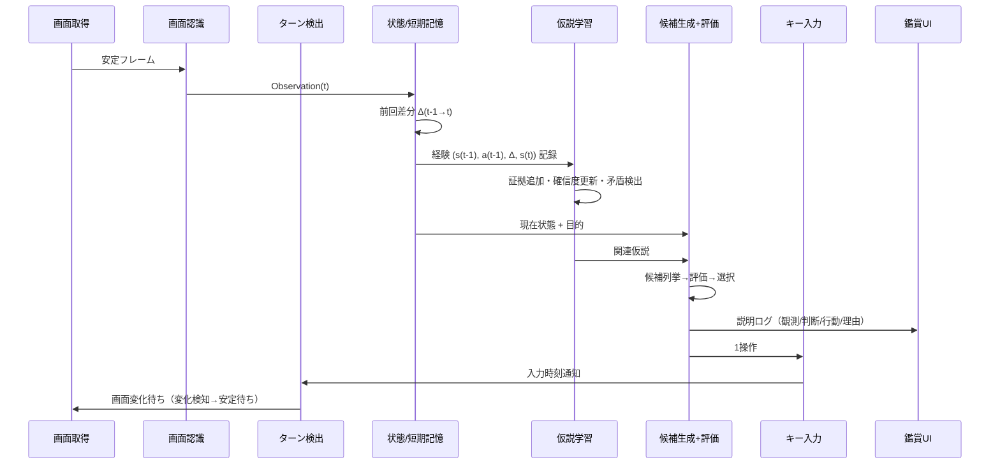
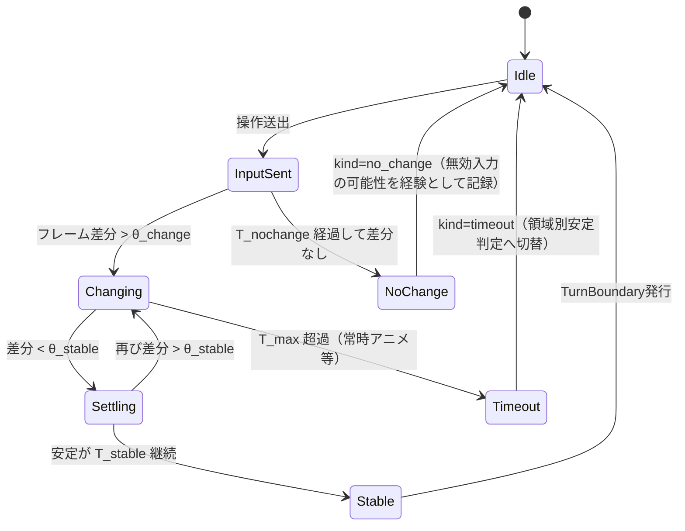
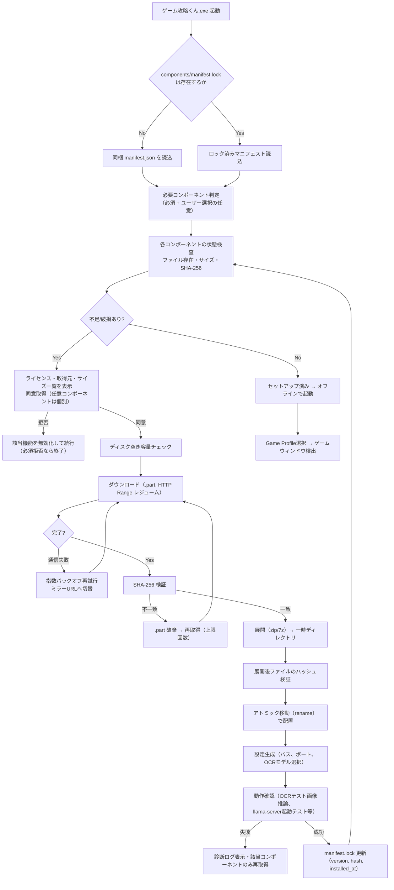
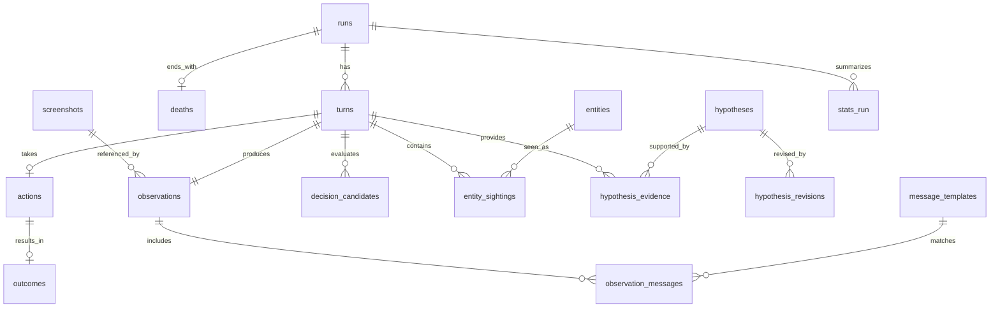

# ゲーム攻略くん ソフトウェアアーキテクチャ設計書

| 項目 | 内容 |
|---|---|
| プロジェクト名 | ゲーム攻略くん（実行ファイル名: `ゲーム攻略くん.exe`） |
| 対象OS | Windows 11（x64） |
| 初期対象ゲーム | Steam版『トルネコの大冒険 不思議のダンジョン ちょっと不思議なリマスター』 |
| 文書種別 | アーキテクチャ設計書（設計のみ。実装コードは含まない） |
| 版 | 0.1（初版ドラフト） |
| 作成日 | 2026-10-17 |

---

## 0. はじめに

### 0.1 目的

「ゲーム攻略くん」は、AIが **人間と同じく画面だけを見て** ゲームを自律プレイし、**何も知らない状態から** 死亡と再挑戦を繰り返しながら、ルール・敵・アイテム・危険・戦術を少しずつ学んでいく過程を、人間が横で **鑑賞する** ためのツールである。

最速攻略・高スコアは目的ではない。重要なのは次の2点である。

1. 学習が「本物」であること（チートや事前知識ではなく、観測した経験から獲得されたものであること）
2. 学習過程が「見える」こと（観測→判断→行動→結果→学習の流れが人間に追えること）

### 0.2 絶対条件（設計制約）

| ID | 制約 | 設計上の担保 |
|---|---|---|
| C1 | 取得情報は人間が画面から得られるもののみ | 入力源は画面キャプチャのみ。プロセスメモリ・ゲームファイル・ネットワークへのアクセスAPIを本体に一切実装しない（コードレビュー項目化、§10.6） |
| C2 | 入力は通常キーボード/ゲームパッド相当のみ | `SendInput`（スキャンコード）または仮想XInputパッドのみ。DLL注入・ウィンドウメッセージ偽装・フックはしない |
| C3 | セーブステート・巻き戻し・乱数取得禁止 | エミュレータ機能やセーブファイル操作を持たない。ゲーム内の通常の進行のみ |
| C4 | トルネコ固有攻略知識を事前に与えない | Game Profile に書ける内容をスキーマで制限（§9）。敵名・アイテム効果・ダメージ式等の項目そのものを持たせない |

### 0.3 用語

| 用語 | 意味 |
|---|---|
| ターン | AIが1操作を入力し、その結果画面が安定するまでの1サイクル |
| 冒険（Run） | ゲーム開始（ダンジョン突入）から死亡・クリア・中断までの1回分 |
| 観測（Observation） | 1ターンの画面から認識された構造化データ |
| 視覚エンティティ（VE） | 画面上の見た目クラスタ（例: `VE#0017`）。AIが内部で付けるID。OCRで名前が判明すれば別名として紐づく |
| 仮説（Hypothesis） | 「条件Cのとき行動Aをすると結果Oが起きる」等の汎用テンプレートに基づく、確信度付きの信念 |
| Game Profile | ゲーム固有の“インフラ情報”（画面領域、キー割当、冒険開始手順など）。攻略知識は含まない |
| 内在動機 | 本体にハードコードされる最小の価値基準（死亡=負、生存・深度・新規性=正） |

---

## 1. 全体アーキテクチャと技術スタック

### 1.1 全体アーキテクチャ図

```mermaid
flowchart LR
    subgraph GAME["ゲームプロセス（不可侵）"]
        GW[ゲームウィンドウ]
    end

    subgraph APP["ゲーム攻略くん.exe（単一プロセス + 任意の子プロセス）"]
        direction TB
        subgraph PERCEPTION["知覚層"]
            CAP["(1) 画面取得<br/>Windows Graphics Capture"]
            REC["(2) 画面認識<br/>領域分割・タイル分類・OCR"]
            TURN["(3) ターン検出<br/>安定判定・差分"]
        end
        subgraph COGNITION["認知層"]
            STATE["(4) 状態表現<br/>抽象状態・特徴量"]
            STM["(5) 短期記憶<br/>直近N ターン・現在フロア地図"]
            LTM[("(6) 長期経験DB<br/>SQLite")]
            HYP["(7) 仮説・ルール学習<br/>Beta確信度・矛盾修正"]
        end
        subgraph DECISION["意思決定層"]
            GEN["(8) 行動候補生成"]
            EVAL["(9) 行動評価<br/>価値+探索+危険"]
        end
        subgraph ACTUATION["操作層"]
            INP["(10) キー入力<br/>SendInput / 仮想パッド"]
        end
        UI["(11) 鑑賞UI（WPF）"]
        LLM["(12) ローカルLLM任意連携<br/>（抽象化インタフェース）"]
        PROF[/"Game Profile<br/>（トルネコ用）"/]
        SETUP["セットアップ/コンポーネント管理"]
    end

    subgraph OPT["任意コンポーネント"]
        LS["内蔵 llama-server 子プロセス<br/>(127.0.0.1:ランダムポート)"]
        EXT["外部 OpenAI互換API<br/>(例: localhost:1234)"]
    end

    GW -- 画面フレーム --> CAP --> REC --> TURN --> STATE
    STATE --> STM --> HYP
    STATE --> LTM
    LTM <--> HYP
    STM --> GEN --> EVAL
    HYP --> EVAL
    LTM --> EVAL
    EVAL -- 1操作 --> INP -- キー/パッド入力 --> GW
    INP -. 入力済み通知 .-> TURN
    PROF -. 領域定義・キー割当 .-> REC
    PROF -. .-> INP
    PROF -. .-> TURN
    CAP --> UI
    STATE & EVAL & HYP & LTM --> UI
    HYP <-. 非同期・任意 .-> LLM
    LLM --> LS
    LLM --> EXT
    SETUP -.-> REC & LLM
```

### 1.2 プロセス/スレッド構成

| スレッド/プロセス | 役割 | 備考 |
|---|---|---|
| UIスレッド | WPF描画、ユーザー操作（開始/一時停止/速度） | 重い処理禁止 |
| Captureスレッド | WGCのFrameArrivedを受け、最新フレームをリングバッファへ | GPU→CPUコピーは必要時のみ |
| Agentループ（専用スレッド） | 1ターンサイクルの直列実行 | 決定論的に再生できるよう全入出力をログ化 |
| Learningワーカー | 仮説の集計・修正・統計更新（ターン境界で差分処理） | DB書込はここに集約（単一ライター） |
| LLMワーカー（任意） | 非同期キュー。結果は「提案」として仮説エンジンに戻す | 毎ターン処理に介在しない |
| llama-server 子プロセス（任意） | ローカル推論 | アプリが起動・監視・終了。Job Objectで親と寿命を同期 |

### 1.3 1ターンサイクル（シーケンス）



### 1.4 技術スタック選定

| 領域 | 採用 | 理由 | 却下案と理由 |
|---|---|---|---|
| 実装言語 | **C# / .NET 8 (LTS)**（以降のLTSへ追随） | Windows API（WGC, SendInput, D3D11）との親和性が最も高い。型安全で長期保守に向く。ONNX Runtime・SQLite・OpenCVのバインディングが成熟 | Python: 配布時に埋め込みランタイム・依存解決が重く「個別インストール不要」と相性が悪い。C++: UI/保守コストが高い。Rust: WinRT/UI周りのエコシステムが相対的に薄い |
| exe化 | `dotnet publish` **self-contained + single-file**（win-x64）、ReadyToRun有効。ネイティブDLL（onnxruntime, OpenCV等）はアプリ配下 `runtime/` に展開 | .NETランタイムの別途インストール不要。単一exe+データディレクトリの単純な構成 | NativeAOT: WPFが非対応。MSIX: サンドボックス/書込先制約が鑑賞ツールには過剰 |
| exe名 | 内部アセンブリ名は `GameKouryakuKun`、配布物のファイル名を `ゲーム攻略くん.exe` とする | 非ASCIIアセンブリ名によるツール側の不具合を避けつつ、要求どおりの表示名を実現 | — |
| UIフレームワーク | **WPF**（+ D3DImage/WriteableBitmapでゲーム映像表示） | 成熟・安定、ログやグラフ等の情報量の多い画面を作りやすい。self-contained配布可 | WinUI 3: 配布（Windows App SDK）とself-contained化の難度が高め。Avalonia: 候補だがWin限定なら利点が小さい |
| 画面キャプチャ | **Windows Graphics Capture (WGC)** によるウィンドウ単位キャプチャ。フォールバックに **DXGI Desktop Duplication**（モニタ単位+矩形切出し） | WGCは他ウィンドウに隠れたゲームも取得可能、GPUテクスチャで低負荷。Win11では `IsBorderRequired=false` で黄色枠を消せ、`IsCursorCaptureEnabled=false` でカーソル除外可能 | GDI BitBlt: DirectX/フリップモデルのウィンドウで黒画面になりやすい。PrintWindow: 同様に不安定 |
| 画像処理 | **OpenCvSharp4**（OpenCV, Apache-2.0）+ 自前の軽量処理 | テンプレートマッチ、差分、連結成分、ハッシュ等が揃う | — |
| OCR | 主: **PaddleOCR系モデル（日本語認識, PP-OCR系）を ONNX Runtime で推論**。補助: **Windows.Media.Ocr**（日本語言語パックがある場合のみ） | ゲーム内の日本語メッセージ・数値を高精度に読む必要がある。ONNX RuntimeはMIT、モデルはApache-2.0（取得時に再確認しマニフェストに記録）。Windows OCRはOS内蔵で軽いが日本語OCRの言語パックが無い環境があるため補助扱い | Tesseract: 日本語のゲームフォントで精度が劣りがち。クラウドOCR: オフライン要件に反する |
| 数値・定型文字 | OCR結果を **フォントグリフ自己学習辞書** でキャッシュ（同一グリフ画像→同一文字） | ステータス数値は毎ターン読むため、OCR呼出しを減らし高速化・安定化 | — |
| 入力方式 | 既定: **SendInput（KEYEVENTF_SCANCODE）**。任意: **仮想XInputパッド（ViGEmBus）** | SendInputはOS標準・追加ドライバ不要。スキャンコード送出でDirectInput/RawInput系ゲームにも届きやすい | PostMessage/SendMessage: 多くのゲームが無視、かつ“通常入力”の趣旨から外れる |
| 仮想パッドの注意 | ViGEmBusはカーネルドライバで **管理者権限インストールが必要**、ライセンスはBSD-3-Clause、**プロジェクトは開発終了（アーカイブ）済み** と公表されている。よって既定では使わず、ユーザーが明示的に有効化した場合のみマニフェスト経由で導入案内（自動サイレント導入はしない） | ドライバ導入は「アプリ配下で完結」という配布方針と衝突するため任意扱い | — |
| DB | **SQLite**（Microsoft.Data.Sqlite, WALモード） | 単一ファイル、オフライン、トランザクション、外部ツールで閲覧可能 | — |
| 学習 | 自前実装の統計学習（Beta-Bernoulli、正規-ガンマ、オンラインロジスティック回帰、カウントベース新規性） | 透明性（説明可能性）を最優先。ブラックボックスなDNN強化学習は「何を学んだか」を見せにくい | 深層強化学習: 学習が遅く、説明不能、GPU要求大 |
| 画像特徴量 | pHash/dHash + 色ヒストグラム + 小型CNN埋め込み（任意、ONNX） | タイル画像のクラスタリング用 | — |
| ローカルLLM（任意） | **llama.cpp の `llama-server`（MIT）をアプリが子プロセスとして同梱起動**。アプリ側は **OpenAI互換クライアント1本** で、内蔵サーバー・外部（`http://localhost:1234/v1` 等）を同一抽象で扱う | 別アプリ常駐不要、かつ将来の外部API接続と実装を共通化できる。ランタイム交換が容易 | LLamaSharp（in-process）: 候補。ネイティブクラッシュがUIを巻き込むため初期は子プロセス方式とし、抽象化の下で差替え可能にする |
| ログ | Serilog（ファイル）+ 構造化イベント（DB） | — | — |

---

## 2. モジュール別設計

各モジュールは以下の形式で記述する: **責務 / 入力 / 出力 / アルゴリズム案 / Game Profile依存点 / 失敗時の扱い**。
疑似インタフェースは言語非依存の記法で示す。

### 2.1 (1) 画面取得（Capture）

- **責務**: 対象ゲームウィンドウを特定し、フレームを低遅延で取得する。プレビュー用と解析用のフレームを供給する。
- **入力**: Profileの `window.match`（実行ファイル名・ウィンドウタイトルの正規表現）、取得解像度設定。
- **出力**: `Frame { id, timestamp_qpc, width, height, pixels(BGRA), client_rect }`
- **アルゴリズム案**:
  1. `EnumWindows` でProfileの条件に一致するウィンドウを探索 → `GraphicsCaptureItem` 生成（WGCのHWND interop）。
  2. `Direct3D11CaptureFramePool`（FreeThreaded）で受信。最新3フレームをリングバッファ保持。
  3. 解析はクライアント領域のみ（タイトルバー除去）。DPI・ウィンドウサイズ変化時は**論理座標系（Profileの基準解像度）へ正規化**するスケール係数を更新。
  4. 解析用フレームはダウンロード時にCPUへコピー（必要時のみ）。プレビューはGPUテクスチャをUIへ共有。
  5. フォールバック: WGC失敗時はDXGI Desktop Duplicationでモニタ取得→ウィンドウ矩形で切出し（この場合ゲームは前面必須）。
- **Profile依存点**: ウィンドウ特定条件、基準解像度、アスペクト比、レターボックス除去設定。
- **失敗時**: ウィンドウ消失→Agent一時停止、UIに「ゲームが見つかりません」。最小化→WGCはフレームが来ないためタイムアウト検知して一時停止。

```
interface IFrameSource {
  Start(target: WindowTarget)
  Stop()
  LatestFrame(): Frame?
  WaitForNewFrame(after: FrameId, timeout): Frame?
  event FrameArrived(Frame)
}
```

### 2.2 (2) 画面認識（Recognition）

- **責務**: フレームを「人間が見て分かる程度の構造」に変換する。意味付け（これは敵だ、等）は**しない**。見た目の同一性と、文字・数値の読み取りまでを行う。
- **入力**: Frame、Profileの領域定義（`regions`）、グリッド定義、既知のVEクラスタ辞書（長期DB由来）。
- **出力**: `Observation`

```
Observation {
  frame_id, timestamp
  screen_mode_id        // 画面モードクラスタID（AIが自己発見。例: mode#3）
  regions: {
    map:      Grid<TileObs>?      // タイル単位の見た目ID
    status:   [TextToken]         // OCRされた文字列と数値の並び
    message:  [TextLine]          // メッセージ欄のOCR行
    menu:     MenuObs?            // 項目テキスト列・カーソル位置
    minimap:  Grid<CellObs>?      // 任意
  }
  waiting_indicator: bool?        // 「送り待ち記号」らしきものの有無（汎用検出）
  confidence: {region: float}
}
TileObs { cell(x,y), ve_id, ve_conf, layers[] }   // 背景層と前景層を分離できる場合はlayers
```

- **アルゴリズム案**:
  1. **領域切出し**: Profileの矩形（基準解像度座標）でmap/status/message/menu候補を切り出す。
  2. **画面モード分類**: 縮小画像（例: 64×36）の特徴量でオンラインクラスタリング（leader clustering + 距離閾値）。モードIDに意味はなく、「マップが見えるモード」「文字が多いモード」などはAIが統計的に区別する（Profileは“map領域が有効になるモード判定の手掛かり”としてグリッド整列度などの汎用基準のみ提供）。
  3. **タイル分割と視覚エンティティ化**: マップ領域をProfileのセルサイズで格子分割 → 各セルのpHash+色ヒストグラム（+任意で小型CNN埋め込み）→ 既知VEとの最近傍照合（閾値以内なら既存ID、以上なら新規VE発行）。アニメーションによる見た目揺らぎは「同一位置・連続フレームで共起する見た目」を同一VEへ併合するリンク学習で吸収。
  4. **前景/背景分離**: 同一セルで時間的に変化しない成分を背景（床・壁候補）、変化・移動する成分を前景（キャラクター候補）として推定。
  5. **自キャラ特定（学習で発見）**: 移動入力の方向とマップ上の変位が一致するVE、あるいは「画面中央に固定され周囲がスクロールする」パターンを統計的に検出し、`self` 候補とする。**Profileで自キャラ画像は与えない**。
  6. **OCR**: message/status/menu領域を文字行検出→認識。ステータス領域は「ラベル文字列＋数値（`a/b`形式含む）」の汎用パーサで `TextToken{label_text, value, max?}` に分解。ラベルの意味は付与しない（例: `"HP" → 15/15` という“表示上のラベル”として保持）。
  7. **送り待ち検出**: メッセージ領域内で点滅する小領域（周期的に出現・消失）を汎用的に検出。
  8. **メニュー検出**: 縦方向に整列したテキスト行と、行に追従して移動する小図形（カーソル）を汎用検出。
- **Profile依存点**: 領域矩形、セルサイズ・グリッド原点、OCR対象領域と言語、フォント想定（OCR前処理: 二値化閾値・拡大率）、ステータス表記の区切り文字。
- **失敗時**: 認識信頼度が閾値未満の領域は `unknown` として扱い、Agentは「待機/再観測」を優先。連続失敗はUIに警告し、該当フレームを診断用に保存。

```
interface IRecognizer {
  Recognize(frame: Frame, profile: GameProfile, ctx: RecognitionContext): Observation
}
interface IOcrEngine {      // PaddleOCR-ONNX / Windows.Media.Ocr を差替え可能に
  Recognize(image, lang, hints): [TextLine]
}
```

### 2.3 (3) ターン検出（Turn Detector）

- **責務**: 「入力受付可能な安定状態」を判定し、1操作ごとのサイクル境界を作る。メッセージ送り・アニメーション中の誤入力を防ぐ。
- **入力**: フレーム列、入力済み通知（時刻・操作）、Observation。
- **出力**: `TurnBoundary { turn_index, stable_frame_id, change_detected: bool, latency_ms, kind }`
  - `kind ∈ { normal, no_change, message_wait, mode_change, timeout }`
- **アルゴリズム案**（状態機械）:



  - 差分は**領域別**に算出（map/status/message）。常時アニメする要素（水面・点滅カーソル等）は「周期的変化マスク」として学習し、安定判定から除外。
  - 送り待ち記号が検出された安定状態は `message_wait`。この状態でAIが取れる行動は候補生成側で制限される（§2.8）。
  - パラメータ（θ, T）はProfile初期値＋実測レイテンシ分布から自動調整（p95を採用）。
- **Profile依存点**: 初期閾値、T_stable/T_max初期値、常時アニメ領域のヒント（任意）。
- **注**: 「ゲーム内ターン」と「入力1回」は必ずしも一致しない（メニュー操作はゲーム内ターンを消費しない等）。AIはこの区別も **ステータスや敵の動きが変化したか** から学習する（`turn_consumed` を推定量として持つ）。

### 2.4 (4) 状態表現（State Representation）

- **責務**: Observationを、学習・評価に使える**抽象状態**へ変換する。表現は汎用で、ゲーム固有の意味ラベルを持たない。
- **入力**: Observation、短期記憶（地図・追跡情報）。
- **出力**: `State`

```
State {
  raw_ref: observation_id
  mode: screen_mode_id
  self: { cell, ve_id }?                        // 推定された自キャラ
  local_view: Grid<ve_id> (自キャラ中心 7x7 など)
  entities: [ { track_id, ve_id, cell, rel_pos, dist, moved_last_turn } ]
  stats: { "<label_text>": { value, max?, delta, trend } }   // 例 "HP": 12/15, delta -3
  floor_marker: { label_text, value }?          // ステータス中の値の一つ。意味は未付与
  messages_new: [TextLine]                      // 前ターンから新規に出た行
  message_templates: [ { template_id, slots } ] // 「<X>は<Y>のダメージを受けた」型の自動抽出
  menu: { items_text[], cursor_index }?
  novelty: { ve_new: [...], template_new: [...], mode_new: bool }
  features: Vector                               // 学習用の汎用特徴量（下記）
  abstract_key: string                           // 状態抽象化キー（§6.1）
}
```

- **汎用特徴量の例**: 各statの値/最大値比、直近Δ、隣接8近傍のVE分布、最近傍の移動エンティティ距離、未探索セル比、新規メッセージテンプレートの有無、モードID、在フロアターン数。
- **メッセージテンプレート抽出**: 新規メッセージ行を、既出行との最長共通部分で「固定部＋スロット」に分解（例: `「{A}は {B}に {N}の ダメージを あたえた」`）。数値スロットと名詞スロットを自動判別。**意味は付けない**が、スロットの数値と stat Δ との相関は仮説学習が発見する。
- **Profile依存点**: local_viewサイズ、使用する特徴量のON/OFF（ゲームによりミニマップが無い等）。

### 2.5 (5) 短期記憶（Short-Term Memory）

- **責務**: 現在の冒険・現在フロア内の文脈を保持する。
- **保持内容**:
  - 直近N（既定200）ターンの (State, Action, Outcome) リングバッファ
  - **フロア地図**: 自キャラ移動量から推定したフロア座標系の占有格子（各セル: 観測VE分布、通行成否回数、最終観測ターン）。スクロール型画面ではマップ領域の位置合わせ（位相相関）で座標を統合
  - **エンティティ追跡**: 前景VEのトラッキング（ハンガリアン法による対応付け）、track毎のHP変化の推定、行動パターン
  - **現在の目的スタック**（§2.8参照: 例「未探索領域へ」「危険から距離を取る」「未知VEを調べる」）
  - 所持品リスト（メニューOCRで最後に見た内容）
  - 「フロア切替」の検出: マップ全体の見た目が大きく変わり、`floor_marker` の値が変化した等の汎用イベント（意味付けは学習）
- **リセット規則**: フロア切替候補イベントで地図をアーカイブ、冒険終了で全消去（長期DBへは逐次記録済み）。
- **Profile依存点**: なし（パラメータのみ）。

### 2.6 (6) 長期経験DB（Long-Term Experience Store）

- **責務**: すべての経験・エンティティ・仮説・統計を永続化し、冒険間・アプリ再起動間・LLMランタイム交換後も学習を継続させる。スキーマは §5。
- **書込方針**: 単一ライタースレッド、ターン単位トランザクション、WAL。クラッシュ時でも最後の完了ターンまで保証。
- **読出し**: 行動評価用に「抽象状態キー × 行動」の集計テーブル（`sa_stats`）をメモリキャッシュ。
- **Profile依存点**: DBは **Profile ID 単位で分離**（`data/profiles/<profile_id>/memory.sqlite`）。共通の“汎用メタ知識”（例: 「数値が0になるとモードが変わりがち」等）は将来 `meta.sqlite` に分離可能とする。

### 2.7 (7) 仮説・ルール学習（Hypothesis Engine）

- **責務**: 経験から仮説を生成・更新・修正・統合・棄却する。行動評価に使える「世界モデル」を提供する。詳細は §6。
- **入力**: 経験 `(s, a, Δ, s')`、死亡イベント、LLM提案（任意）。
- **出力**: 仮説集合と確信度、`new_discoveries[]`、`revisions[]`、UI向け要約。
- **アルゴリズム案（概要）**:
  1. **候補生成**: 汎用テンプレート（§6.3）に経験を当てはめ、未登録なら仮説を「試行中（tentative）」で作成。爆発を防ぐため、(a) 新規性のある結果（大きなΔ・新テンプレート・モード変化・死亡）を伴う経験、(b) 繰り返し観測された共起、からのみ生成。
  2. **証拠更新**: 該当仮説の条件が満たされた各ターンで、結果の一致/不一致をBeta分布に加算。
  3. **矛盾検出**: 確信度が高い仮説に反例が集中した場合（§6.4）、条件分割（精緻化）・効果量修正・棄却を行い、改訂履歴に残す。
  4. **昇格/降格**: `tentative → supported → established`、逆方向も可。
  5. **ドメイン別仮説群**: 敵（移動VEとstat変化）・地形（通行可否、踏むとイベント）・アイテム（取得/使用とstat変化・メッセージ）・戦闘（攻撃行動とメッセージ/消滅）・回復（時間経過とstat増加）・満腹度（単調減少statと0到達時の影響）・階層（floor_marker変化を起こすVEと行動）。**これらは「ドメイン」というUI上の分類名に過ぎず、テンプレートは共通**。
- **Profile依存点**: なし（テンプレートは本体共通）。

### 2.8 (8) 行動候補生成（Action Candidate Generator）

- **責務**: 現在状態で取りうる「1操作」の候補と、その操作が属する「意図（目的）」を列挙する。
- **原子行動**: Profileのキー割当で定義される操作（上下左右・斜め・決定・キャンセル・メニュー・その他ボタン）。**原子行動は1ターン1回**。
- **意図付き候補**（評価の単位）: 原子行動を「何のために押すか」で注釈したもの。例:
  - `move(dir)`、`wait`、`interact(confirm)`、`open_menu`、`menu_navigate(up/down)`、`menu_select(item_text)`、`advance_message`
  - 意図: `explore_unknown_cell`、`approach_ve(VE#)`、`flee_from(track#)`、`test_hypothesis(H#)`、`try_unknown_menu_item("…")`、`go_to(VE#=floor_marker変化を起こした候補)`
- **多段操作の扱い**: メニュー操作など複数入力が必要な行動は「計画（plan）」として短期記憶に保持し、1ターンに1入力ずつ実行。各入力後に画面を再観測し、想定と違えば計画を破棄して再評価（＝常に1操作ずつ観測に基づく）。
- **制約（インフラとして許容する最小限）**:
  - `message_wait` 状態では「送り（Profileで定義された決定キー）」を最有力候補にする**汎用UIリテラシー**（§3グレーゾーン議論参照）。ただし他キーの試行も低確率で残す。
  - 経路計画: 短期記憶の地図上でA*（通行コスト = 経験上の通行失敗率・危険度から算出）。
- **Profile依存点**: キー一覧と表示名、斜め移動の有無、メニュー開閉キー、送りキー。

### 2.9 (9) 行動評価（Action Evaluator）

- **責務**: 各候補のスコアを算出し、1つを選択し、理由を構造化して出力する。
- **評価式（概念）**:

```
Score(a | s) =  E[R_intrinsic(s, a)]                       // 世界モデル(仮説+sa_stats)による期待内在報酬
              + β · Bonus_explore(s, a)                    // UCB or Thompson のばらつき由来
              + η · InfoGain(a)                            // 確信度の低い仮説を検証できる行動
              − λ · P_death(s, a) · |R_death|              // 学習された危険度モデル（§6.6）
              + γ · Goal_progress(s, a)                    // 現在の目的への進捗（目的もスコアで選ばれる）
```

  - `β, η` は「冒険回数が少ないほど大」「危険度が高い局面ほど小」に自動調整（安全側の探索）。
  - 未知の対象（観測回数0〜少）には**楽観的初期値**を与え探索を許可。既知の危険（危険度事後分布の下限が閾値超過）は回避（ただし完全禁止ではなく、仮説の再検証が必要な場合のみ低確率で許可）。
  - 1〜2手先の浅い先読み: 仮説から遷移を生成するモデルベース評価（展開数を限定）。
- **出力**: `Decision { chosen, candidates[ {action, intent, score, components{…}} ], reason_tokens[], related_hypotheses[] }`
  - `reason_tokens` は説明ログ生成（§8.3）用の構造化理由（例: `{type:"avoid", target:"VE#0031", basis:"H#122", p:0.78}`）。
- **Profile依存点**: なし（重み初期値のみProfileで上書き可能だが、攻略的チューニングは禁止）。

### 2.10 (10) キー入力（Input Injector）

- **責務**: 選ばれた1操作を、人間の操作と同等の入力としてゲームに送る。
- **方式**:
  - 既定: `SendInput` + `KEYEVENTF_SCANCODE`。押下保持時間（例: 50〜80ms、Profileで調整）後に解放。人間並みの最小入力間隔を設ける。
  - 任意: 仮想XInputパッド（ViGEmBus導入済み環境のみ）。ボタン押下→保持→解放。
- **フォーカス管理**: SendInputは前面ウィンドウに届くため、Agent実行中は**ゲームウィンドウを前面に保つ**。鑑賞UIは `WS_EX_NOACTIVATE` 相当で表示しフォーカスを奪わない。入力直前に前面ウィンドウを検査し、ゲームでなければ入力を送らず一時停止（誤入力防止の安全装置）。
- **安全装置**: 緊急停止ホットキー（例: `Ctrl+Alt+Pause`、グローバル登録）、ゲームウィンドウ外へのマウス操作は一切しない、入力レート上限。
- **Profile依存点**: 論理キー→物理キー（スキャンコード）/パッドボタン割当、押下時間、斜め入力方法（同時押し/専用キー）。

```
interface IInputInjector {
  Press(logicalKey: string, holdMs: int): InputReceipt
  IsTargetForeground(): bool
}
```

### 2.11 (11) 鑑賞UI（Viewer）

- **責務**: 1ウィンドウ内で、ゲーム映像（左）と、AIの「観測→判断→行動→結果→学習」（右）をリアルタイム表示。詳細は §8。
- **入力**: Captureプレビュー、Decision、Outcome、仮説更新イベント、統計。
- **出力**: 表示、および操作（開始/一時停止/1ターン実行/速度/緊急停止/ログ出力）。
- **Profile依存点**: 映像のアスペクト比、stat表示ラベル（OCR由来をそのまま表示）。

### 2.12 (12) ローカルLLM任意連携（LLM Adapter）

- **責務**: 毎ターンの操作には一切関与せず、**非同期の補助**として (a) 未知現象の整理、(b) 複数経験からの仮説候補生成、(c) 矛盾の整理、(d) 人間向け要約、を行う。詳細は §7。
- **抽象化**:

```
interface ILlmProvider {
  Id, DisplayName, Capabilities { maxContext, jsonMode }
  Health(): Status
  Complete(request: ChatRequest{ messages[], json_schema?, max_tokens, temperature }): ChatResponse
}
実装:
  - EmbeddedLlamaServerProvider  // アプリが llama-server を 127.0.0.1:<空きポート> で起動、OpenAI互換で通信
  - OpenAICompatibleProvider     // 任意のベースURL（既定候補: http://localhost:1234/v1）
  - NullProvider                 // LLM無効（既定）
```

- **出力の取り込み**: LLMの出力は必ず **JSONスキーマで構造化された「仮説提案」** として受け取り、仮説エンジンが `source=llm, status=tentative, prior=弱` で登録する。**確信度はLLMの言明では上がらず、観測証拠でのみ更新**。
- **入力の制約**: LLMへ渡すのは長期DBから抽出した観測要約（VE ID・OCRテキスト・統計）のみ。LLMの事前知識（トルネコの知識）混入リスクについては §7.3 で扱う。
- **Profile依存点**: なし（プロンプトは汎用）。

---

## 3. 「直接プログラムする部分」と「経験から発見すべき部分」

### 3.1 基本方針

> **本体とProfileに書いてよいのは「画面を見て、ボタンを押せる身体」と「生き延びたい・知りたいという最小の動機」だけ。ゲームの“意味”はすべて経験から獲得させる。**

人間の初見プレイヤーにたとえると、「画面の見方（どこが地図でどこが文字か）」「コントローラの持ち方」「文字が読めること」は持っているが、「このゲームで何が強いか」「何を食べるべきか」は知らない状態を再現する。

### 3.2 区別表

| 分類 | 項目 | 直接プログラム（事前知識/インフラ） | 経験から発見 | 根拠・備考 |
|---|---|:---:|:---:|---|
| 知覚 | 画面の領域定義（地図・ステータス・メッセージ・メニュー欄の位置） | ✔（Profile） | | 人間も一目で分かるレイアウト情報。意味ではなく“どこを見るか” |
| 知覚 | グリッドのセルサイズ・原点 | ✔（Profile） | | 画素→格子の変換。視覚の前処理 |
| 知覚 | 文字を読む能力（OCR） | ✔（本体） | | 人間の識字能力に相当 |
| 知覚 | 見た目の同一性判定（クラスタリング） | ✔（本体） | | 汎用視覚能力 |
| 知覚 | どの見た目が自分か | | ✔ | 入力と移動の相関から発見 |
| 知覚 | どの見た目が壁/床/通路か | | ✔ | 通行成否の統計から発見 |
| 操作 | 操作キーの割当（論理キー→物理キー） | ✔（Profile） | | コントローラの持ち方 |
| 操作 | 各キーが何をするか（移動、決定、メニュー） | △（論理名のみ） | ✔（効果） | キー名は「上」「決定」等の汎用名まで。具体的効果は観測で確認 |
| 操作 | メッセージ送り | △（送り待ち記号の汎用検出と、送り候補キーの優先） | ✔ | グレーゾーン（§3.3 G3） |
| 操作 | タイトル画面から冒険を開始する手順・死亡後の再開手順 | ✔（Profileの「ライフサイクル手順」） | | 学習対象外のメタ操作。冒険の外側の手続きとして許容。手順中に得た情報は学習に使わない |
| 動機 | 死亡は悪い | ✔（本体: 内在報酬） | | 最小の生存動機 |
| 動機 | 長く生きる・深く進むのは良い | ✔（本体: 内在報酬） | | 「深さ」の検出は汎用（floor_markerの値の増加をどう扱うかはG2） |
| 動機 | 新しいものを知るのは良い（好奇心） | ✔（本体: 内在報酬） | | カウントベース新規性・情報利得 |
| 動機 | 現在の目的の切替（探索/退避/検証） | ✔（汎用の目的フレーム） | ✔（いつどれを選ぶか） | 目的の“型”は汎用、選択は評価値で決まる |
| ルール | HPという数値の意味（0で死ぬ） | | ✔ | 死亡直前特徴の学習で発見（G1） |
| ルール | 敵の強さ・行動パターン | | ✔ | VEとstat Δの相関 |
| ルール | アイテムの効果 | | ✔ | 使用→stat Δ/メッセージ/モード変化 |
| ルール | 満腹度（空腹）の意味 | | ✔ | 単調減少statとその0到達後の影響 |
| ルール | 階段の価値 | | ✔ | floor_marker変化・新規性・報酬との相関 |
| ルール | 罠の存在と効果 | | ✔ | 特定セル進入時の予期しないイベント |
| ルール | 回復の仕組み（時間経過、アイテム） | | ✔ | statの増加と条件の相関 |
| ルール | レベル・経験値 | | ✔ | statの増加と戦闘結果の相関 |
| 戦術 | 逃げる/戦う/通路で戦う等 | | ✔ | 行動評価の結果として創発 |
| 禁止 | 敵名・アイテム名と効果の対応表、ダメージ式、出現階層 | ✘ | | Profileスキーマに項目自体を設けない |
| 禁止 | メモリ値・ゲームファイル・乱数状態 | ✘ | | 本体にAPIを実装しない |

凡例: ✔=該当、△=限定的に該当、✘=禁止

### 3.3 グレーゾーンの議論

| ID | 論点 | 選択肢 | 採用方針 | 理由 |
|---|---|---|---|---|
| G1 | 「HPが減ると死ぬ」を教えるか | (a) 教える（HP=生命として報酬に組込む） (b) 教えない | **(b) 教えない**。代わりに**危険度モデル**（死亡までの残りターンを予測するオンラインロジスティック回帰）を全statの特徴量で学習させる。数回の死亡で「HPと表示された数値が小さいと死にやすい」がデータから浮かび上がる | 鑑賞上もっとも面白い“発見”の一つ。初期数冒険の早死には「学習コスト」として受け入れる。学習の遅さ対策は§10.7 |
| G2 | 到達階層を報酬にするか（＝何が階層かを教えるか） | (a) Profileで「階数表示の領域」を指定 (b) 完全に発見させる | **折衷**: Profileは「ステータス領域」を指定するのみ。本体の内在動機は「**画面全体が大きく変わり、以後二度と戻れない不可逆な場面遷移**（＝新しい場所）」を新規性として報酬化する。stat中のどれが階層を表すかは「不可逆遷移と同時に単調増加する数値」として自動推定し、確信度が高まれば深度報酬に採用 | 「深く進むと良い」は汎用的な“前進”動機に還元できる。階段という概念は教えない |
| G3 | メッセージ送り・メニューのUIリテラシー | (a) 全部学習 (b) 送りとメニューの基本操作を組込む | **最小限組込み**: 「点滅する送り記号がある間は決定キーで進む可能性が高い」という**汎用的UI事前分布**のみ与える（確率0.8程度の事前、学習で更新）。メニュー内の項目の意味は教えない | 送りを学習するのに何百ターンも浪費すると鑑賞価値が損なわれる。現代のゲーム全般に共通するUI常識の範囲 |
| G4 | 報酬設計の粒度 | 多数の手作り報酬 vs 最小報酬 | **最小報酬**: 死亡 −1.0、生存1ターン +ε、不可逆前進 +δ、新規性 +κ/√n（n=観測回数）。経験値や所持金の増加などは報酬にしない（AIが「それが生存・前進に効く」と学習すれば間接的に追う） | 手作り報酬は事実上の攻略知識になる |
| G5 | ゲームオーバー画面の判定 | 学習 vs Profile | **Profileで「冒険終了画面の検出手掛かり」を与えてよい**（画面モードのテンプレート画像1枚、または決まった文言の位置）。ただし「なぜ死んだか」は教えない | 冒険の区切り（run境界）はインフラ。死亡がわからないと報酬を与えられない |
| G6 | 斜め移動・方向転換などの特殊操作 | 教える vs 発見 | キーの存在（論理キー）だけ教え、効果は発見させる | 「ボタンがある」ことは人間も見れば分かる |
| G7 | LLMの事前知識 | 使う/使わない | 使う場合も**ゲーム名・固有名詞を伏せて匿名化**した観測要約のみ渡し、出力は仮説候補として観測で検証（§7.3） | LLMは世界知識を持つため、無制限だと実質的な攻略知識注入になる |
| G8 | 一般常識（「薬草」という名前なら回復しそう、等の言語的連想） | 禁止 vs 許容 | 本体の統計学習は文字列の意味を解さないため発生しない。LLM有効時のみ起こり得るため、UIで「LLM由来の仮説」と明示し、設定で匿名化強度を選べるようにする | 透明性で担保 |

### 3.4 内在動機（最小セット）

```
R_intrinsic(t) =  -1.0                    if 冒険終了（死亡）を検出
               +  ε    (例 0.001)          生存1ターン（ゲーム内ターンを消費したと推定された場合のみ）
               +  δ    (例 0.2)            不可逆な場面遷移（新しい場所）への到達
               +  κ / sqrt(n_visit(x))    新規性: x ∈ {新VE, 新メッセージテンプレート, 新モード, 新セル}
```

- 「好奇心」は新規性報酬と情報利得（§6.5）の2本立て。
- 「生存」は死亡ペナルティと危険度モデルの組合せ。HPという概念はどこにも書かれない。

---

## 4. 初回セットアップ

### 4.1 フロー



- **オフライン導入**: 管理者・回線制約環境向けに「コンポーネントパック（zip）をローカルから取り込む」機能を用意。ハッシュ検証は同じ。
- **正常ファイルの再取得禁止**: 検査はハッシュベース。ハッシュ一致ファイルはスキップ。大容量ファイルは「サイズ+mtime」で一次判定し、変化があった場合のみフルハッシュ。
- **配置先**: すべて `<アプリ配下>/components/<id>/<version>/`。Program Files配下に置かれた場合は書込不可のため、`%LOCALAPPDATA%\GameKouryakuKun\` をデータルートにするフォールバックを持つ（ポータブルモードはexe隣の `portable.flag` で判定）。
- **管理者権限**: 既定では不要。ViGEmBus（任意）のみ管理者権限のドライバインストーラが必要で、自動では実行せず、ユーザーの明示操作で公式インストーラを起動する。

### 4.2 ディレクトリ構成（配布物・実行時）

```
GameKouryakuKun/                      ← アプリ配下（ポータブル既定）
├─ ゲーム攻略くん.exe                 ← self-contained single-file
├─ manifest.json                       ← 同梱マニフェスト（署名付き）
├─ THIRD_PARTY_NOTICES.md
├─ components/
│  ├─ manifest.lock                    ← 導入済み状態
│  ├─ onnxruntime/1.x.y/...
│  ├─ opencv-runtime/4.x.y/...
│  ├─ ocr-paddle-ja/vN/{det.onnx, rec.onnx, dict.txt}
│  ├─ llama-server/bNNNN-cpu|cuda|vulkan/... (任意)
│  └─ llm-models/<model-id>/<file>.gguf    (任意)
├─ profiles/
│  └─ torneko-remaster/                ← §9
├─ data/
│  ├─ settings.json
│  └─ profiles/torneko-remaster/
│     ├─ memory.sqlite                 ← 長期経験DB
│     ├─ screenshots/YYYY/MM/<sha1-2>/<sha1>.webp
│     └─ exports/
├─ logs/
└─ cache/downloads/*.part
```

### 4.3 コンポーネントマニフェスト形式例

```json
{
  "manifest_version": 1,
  "app_min_version": "0.1.0",
  "signature": { "alg": "ed25519", "key_id": "gkk-2026-01", "value": "<base64>" },
  "components": [
    {
      "id": "onnxruntime",
      "kind": "native-runtime",
      "required": true,
      "version": "1.x.y",
      "license": { "spdx": "MIT", "url": "https://github.com/microsoft/onnxruntime/blob/main/LICENSE" },
      "source": {
        "homepage": "https://github.com/microsoft/onnxruntime",
        "urls": [
          "https://github.com/microsoft/onnxruntime/releases/download/v1.x.y/onnxruntime-win-x64-1.x.y.zip",
          "https://mirror.example.invalid/onnxruntime-win-x64-1.x.y.zip"
        ]
      },
      "archive": { "format": "zip", "size_bytes": 0, "sha256": "<64hex>" },
      "files": [
        { "path": "lib/onnxruntime.dll", "size_bytes": 0, "sha256": "<64hex>" }
      ],
      "install_dir": "components/onnxruntime/1.x.y",
      "post_install_check": { "type": "load-library", "target": "lib/onnxruntime.dll" }
    },
    {
      "id": "ocr-paddle-ja",
      "kind": "model",
      "required": true,
      "version": "vN",
      "license": { "spdx": "Apache-2.0", "url": "https://github.com/PaddlePaddle/PaddleOCR/blob/main/LICENSE" },
      "source": { "homepage": "https://github.com/PaddlePaddle/PaddleOCR", "urls": ["<onnx変換済み配布URL>"] },
      "archive": { "format": "zip", "size_bytes": 0, "sha256": "<64hex>" },
      "files": [
        { "path": "det.onnx", "size_bytes": 0, "sha256": "<64hex>" },
        { "path": "rec_japan.onnx", "size_bytes": 0, "sha256": "<64hex>" },
        { "path": "japan_dict.txt", "size_bytes": 0, "sha256": "<64hex>" }
      ],
      "post_install_check": { "type": "ocr-selftest", "image": "builtin:selftest_ja.png", "expect": "テスト" }
    },
    {
      "id": "llama-server",
      "kind": "executable",
      "required": false,
      "feature": "local-llm",
      "variants": [
        { "when": "gpu.vendor == 'nvidia'", "version": "bNNNN-cuda", "archive": { "sha256": "<64hex>", "size_bytes": 0 } },
        { "when": "default", "version": "bNNNN-vulkan", "archive": { "sha256": "<64hex>", "size_bytes": 0 } },
        { "when": "fallback", "version": "bNNNN-cpu", "archive": { "sha256": "<64hex>", "size_bytes": 0 } }
      ],
      "license": { "spdx": "MIT", "url": "https://github.com/ggml-org/llama.cpp/blob/master/LICENSE" },
      "source": { "homepage": "https://github.com/ggml-org/llama.cpp" },
      "post_install_check": { "type": "process-health", "args": ["--version"] }
    },
    {
      "id": "llm-model-small",
      "kind": "model",
      "required": false,
      "feature": "local-llm",
      "version": "<model-rev>",
      "license": { "spdx": "<モデル毎に確認・記録>", "url": "<モデルカードURL>", "requires_user_acceptance": true },
      "source": { "urls": ["<GGUF配布URL>"] },
      "archive": { "format": "none", "size_bytes": 0, "sha256": "<64hex>" },
      "hardware_hint": { "min_ram_gb": 8, "recommended_vram_gb": 4 }
    },
    {
      "id": "vigembus",
      "kind": "driver",
      "required": false,
      "feature": "virtual-gamepad",
      "license": { "spdx": "BSD-3-Clause", "notes": "上流プロジェクトは開発終了（アーカイブ）。管理者権限インストールが必要。自動インストールしない" },
      "install_mode": "user-initiated-external-installer"
    }
  ]
}
```

- `size_bytes:0`/`<64hex>` はリリースビルド時にCIで実値を埋める。マニフェストは署名検証し、改ざん時は導入を拒否。
- `manifest.lock` には `{id, version, variant, installed_at, files[{path, sha256}], license_accepted_at}` を記録。

---

## 5. データ保存形式

### 5.1 方針

- 1 Profile = 1 SQLite（`memory.sqlite`）。WAL、`foreign_keys=ON`、ターン単位のトランザクション。
- 生画像はDBに入れず、ファイルとしてコンテンツアドレス（SHA-1）保存し、DBは参照のみ。
- 全テーブルに `created_at`（UTC、ISO8601）。UI表示時にユーザーのタイムゾーンへ変換。
- JSON列はSQLiteのJSON1関数で検索可能な形で格納。

### 5.2 ER概要



### 5.3 SQLiteスキーマ（DDL相当の定義）

```sql
-- メタ/バージョニング
schema_meta(key TEXT PRIMARY KEY, value TEXT)
  -- 'schema_version', 'profile_id', 'profile_version', 'created_by_app'
migrations(version INTEGER PRIMARY KEY, applied_at TEXT, app_version TEXT, description TEXT)

-- 冒険
runs(
  run_id INTEGER PRIMARY KEY,
  started_at TEXT, ended_at TEXT,
  end_reason TEXT CHECK(end_reason IN ('death','clear','abort','crash','unknown')),
  profile_version TEXT, recognizer_version TEXT, policy_version TEXT,
  turns_total INTEGER, game_turns_est INTEGER,
  max_depth_value INTEGER,             -- floor_marker候補の最大値（推定）
  irreversible_transitions INTEGER,
  novelty_count INTEGER,
  notes_json TEXT
)

-- ターン（入力1回単位）
turns(
  turn_id INTEGER PRIMARY KEY,
  run_id INTEGER REFERENCES runs,
  turn_index INTEGER,                  -- run内連番
  boundary_kind TEXT,                  -- normal/no_change/message_wait/mode_change/timeout
  latency_ms INTEGER,
  game_turn_consumed_p REAL,           -- ゲーム内ターンを消費した推定確率
  abstract_state_key TEXT,             -- §6.1
  created_at TEXT,
  UNIQUE(run_id, turn_index)
)
CREATE INDEX ix_turns_state ON turns(abstract_state_key);

-- 観測
observations(
  obs_id INTEGER PRIMARY KEY,
  turn_id INTEGER UNIQUE REFERENCES turns,
  screen_mode_id INTEGER,
  self_cell_x INTEGER, self_cell_y INTEGER, self_ve_id INTEGER,
  floor_seq INTEGER,                   -- run内の不可逆遷移区間番号
  stats_json TEXT,                     -- {"HP":{"v":12,"max":15,"d":-3}, ...}（ラベルはOCR文字列）
  local_view_json TEXT,                -- 7x7 VE ID
  features_blob BLOB,                  -- float32ベクトル
  menu_json TEXT,
  recog_conf_json TEXT,
  screenshot_id INTEGER REFERENCES screenshots
)

-- メッセージ
message_templates(
  template_id INTEGER PRIMARY KEY,
  pattern TEXT UNIQUE,                 -- 例 '{N0}は {N1}に {D0}の ダメージを あたえた'
  slot_types_json TEXT,                -- {"N0":"noun","D0":"number"}
  first_seen_turn INTEGER, seen_count INTEGER
)
observation_messages(
  obs_id INTEGER REFERENCES observations,
  line_index INTEGER, raw_text TEXT,
  template_id INTEGER REFERENCES message_templates,
  slots_json TEXT,
  PRIMARY KEY(obs_id, line_index)
)

-- 行動・結果
actions(
  action_id INTEGER PRIMARY KEY,
  turn_id INTEGER UNIQUE REFERENCES turns,
  logical_key TEXT,                    -- 'up','confirm',...
  intent TEXT,                         -- 'explore','flee','test_hypothesis',...
  intent_target TEXT,                  -- 'VE#31','H#122','cell(4,5)'
  plan_id INTEGER,                     -- 多段操作の計画ID
  score REAL, score_components_json TEXT,
  reason_json TEXT,                    -- 構造化理由（説明ログ生成元）
  policy_mode TEXT                     -- 'thompson','ucb','greedy','scripted_lifecycle'
)
decision_candidates(
  turn_id INTEGER REFERENCES turns, rank INTEGER,
  logical_key TEXT, intent TEXT, intent_target TEXT,
  score REAL, components_json TEXT,
  PRIMARY KEY(turn_id, rank)
)
outcomes(
  action_id INTEGER PRIMARY KEY REFERENCES actions,
  next_turn_id INTEGER REFERENCES turns,
  screen_changed INTEGER, self_moved INTEGER,
  stat_delta_json TEXT,                -- {"HP":-3,"満腹度":-1}
  new_message_templates_json TEXT,
  entity_events_json TEXT,             -- appear/disappear/moved/adjacent
  mode_changed INTEGER, irreversible_transition INTEGER,
  reward_intrinsic REAL,
  surprise REAL                        -- 予測との乖離（-log p）
)

-- エンティティ（視覚エンティティ）
entities(
  ve_id INTEGER PRIMARY KEY,
  kind_guess TEXT,                     -- 'static'/'mobile'/'self'/'ui'/'unknown'（学習推定）
  display_name TEXT,                   -- OCRで紐づいた名前（任意、複数候補はaliasesへ）
  aliases_json TEXT,
  prototype_hash TEXT, embedding BLOB,
  icon_screenshot_id INTEGER REFERENCES screenshots,
  first_seen_turn INTEGER, seen_count INTEGER,
  merged_into INTEGER REFERENCES entities   -- クラスタ併合時
)
entity_sightings(
  turn_id INTEGER REFERENCES turns, ve_id INTEGER REFERENCES entities,
  track_id INTEGER, cell_x INTEGER, cell_y INTEGER, conf REAL,
  PRIMARY KEY(turn_id, ve_id, track_id)
)

-- 仮説
hypotheses(
  hyp_id INTEGER PRIMARY KEY,
  template TEXT,                       -- §6.3 のテンプレートID
  domain TEXT,                         -- UI分類: 'enemy','terrain','item','combat','recovery','satiety','floor','ui','other'
  condition_json TEXT,                 -- 条件（述語の連言）
  action_json TEXT,                    -- 行動条件（任意）
  effect_json TEXT,                    -- 期待効果（離散 or 連続分布パラメータ）
  parent_hyp_id INTEGER REFERENCES hypotheses,  -- 精緻化元
  status TEXT CHECK(status IN ('tentative','supported','established','weakened','refuted','merged')),
  source TEXT CHECK(source IN ('stat','llm','user_note')),
  alpha REAL, beta REAL,               -- Beta事後
  n_obs INTEGER, n_success INTEGER, n_failure INTEGER,
  confidence REAL,                     -- 表示用（§6.2）
  effect_mean REAL, effect_var REAL,   -- 連続効果（正規-ガンマ等）
  importance REAL,                     -- UI表示優先度
  summary_text TEXT,                   -- 定型文生成 or LLM要約
  created_at TEXT, updated_at TEXT
)
CREATE INDEX ix_hyp_status ON hypotheses(status, domain);
hypothesis_evidence(
  evidence_id INTEGER PRIMARY KEY,
  hyp_id INTEGER REFERENCES hypotheses,
  turn_id INTEGER REFERENCES turns,
  result TEXT CHECK(result IN ('support','contradict','neutral')),
  weight REAL,                         -- 観測信頼度（認識confidence）で重み付け
  observed_value REAL,
  note TEXT
)
hypothesis_revisions(
  revision_id INTEGER PRIMARY KEY,
  hyp_id INTEGER REFERENCES hypotheses,
  revised_at_turn INTEGER REFERENCES turns,
  kind TEXT CHECK(kind IN ('create','promote','demote','refine_split','effect_update','merge','refute','revive')),
  before_json TEXT, after_json TEXT,
  trigger TEXT,                        -- 'contradiction','threshold','llm_suggestion','manual'
  explanation TEXT                     -- 説明ログ用短文
)

-- 死亡
deaths(
  run_id INTEGER PRIMARY KEY REFERENCES runs,
  turn_id INTEGER REFERENCES turns,
  last_messages_json TEXT,
  last_stats_json TEXT,
  nearby_entities_json TEXT,
  cause_estimate_json TEXT,            -- [{cause:'VE#31 adjacent & HP低下', p:0.62, basis:[H#..]}]
  screenshot_ids_json TEXT,            -- 死亡直前K枚
  llm_summary TEXT
)

-- 統計
stats_run(run_id INTEGER REFERENCES runs, key TEXT, value REAL, PRIMARY KEY(run_id,key))
stats_global(key TEXT PRIMARY KEY, value REAL, updated_at TEXT)
sa_stats(                              -- 抽象状態×行動 の集計（評価キャッシュ）
  abstract_state_key TEXT, logical_key TEXT, intent TEXT,
  n INTEGER, reward_sum REAL, reward_sq_sum REAL, death_within_k INTEGER,
  PRIMARY KEY(abstract_state_key, logical_key, intent)
)
hazard_model(                          -- 危険度モデルの係数（版管理）
  model_version INTEGER PRIMARY KEY, trained_at TEXT, feature_names_json TEXT, weights_blob BLOB, metrics_json TEXT
)

-- スクリーンショット
screenshots(
  screenshot_id INTEGER PRIMARY KEY,
  sha1 TEXT UNIQUE, path TEXT, width INTEGER, height INTEGER,
  format TEXT, quality TEXT,           -- 'thumb','full','region'
  reason TEXT,                         -- 'periodic','discovery','death','contradiction','recog_fail'
  retained INTEGER DEFAULT 0,          -- 1=保持固定
  created_at TEXT
)

-- LLM利用記録
llm_calls(
  call_id INTEGER PRIMARY KEY, provider_id TEXT, model_id TEXT,
  purpose TEXT, request_digest TEXT, response_json TEXT,
  tokens_in INTEGER, tokens_out INTEGER, latency_ms INTEGER, created_at TEXT
)
```

### 5.4 スクリーンショット保存方針

| 種別 | 解像度/形式 | 保存条件 | 保持 |
|---|---|---|---|
| 定期サムネイル | 基準解像度の1/4、WebP品質60 | 毎ターン（設定でN ターン毎） | リングバッファ（直近K=300ターン）。run終了時に間引き |
| 発見時フル | 原寸、WebP lossless or PNG | 新VE初観測、新テンプレート、新モード、仮説の昇格/棄却 | 永続（`retained=1`） |
| 死亡前後 | 原寸 | 死亡直前K=20ターン＋死亡画面 | 永続 |
| 認識失敗診断 | 原寸＋領域切出し | 認識信頼度が閾値未満 | 最大500件、古い順に削除 |
| エンティティアイコン | セル切出しPNG | VE新規作成時 | 永続（UI表示用） |

- 総量上限（既定10GB）を設定し、超過時は `retained=0` の古いものから削除。DBの参照は `NULL` 化。
- 個人情報が映り込む可能性（通知トースト等）を考慮し、キャプチャはゲームウィンドウ単位に限定。

### 5.5 スキーマバージョニング

- `PRAGMA user_version` と `schema_meta.schema_version` を一致させる。起動時に差分マイグレーションを順次適用（前方のみ、各マイグレーションは単一トランザクション）。
- マイグレーション前に自動バックアップ（`memory.sqlite.bak-v{N}-{timestamp}`、SQLite Online Backup API）。
- **認識器のバージョン変更**（例: VEクラスタリングの改良）で `ve_id` が変わる問題に対し、`entities.merged_into` と `recognizer_version` を使い、旧IDを新IDへマップする「再同定ジョブ」を提供（保存済みアイコン画像で再照合）。これにより学習済み仮説を失わない。
- エクスポート形式: JSON Lines（仮説・エンティティ・統計）。他DBやLLMランタイムに依存しない。

---

## 6. AI学習方式

### 6.1 状態抽象化

生画面は膨大で同一状態はほぼ再来しないため、**階層的な抽象状態キー**を用いる。

| レベル | キー構成（例） | 用途 |
|---|---|---|
| L0（最粗） | `mode` × `danger_bin`（危険度モデル出力の3段階） | データが少ない初期の汎化 |
| L1 | L0 × 各statの比率ビン（0-25-50-75-100%）× 隣接mobile VEの有無 | 一般的な行動価値 |
| L2 | L1 × 隣接/距離2以内のVE ID集合 × 足元VE | エンティティ固有の評価 |
| L3 | L2 × 所持品テキスト集合のハッシュ | アイテム使用判断 |

- 評価時は **L3→L0 の順にバックオフ**（観測数nが閾値未満なら粗いレベルを使用、または n による重み付き混合）。
- statのビン化は「表示ラベル」単位で行い、どのstatが重要かは危険度モデル・報酬回帰の係数で自動的に重み付けされる（重要でないstatはキーから除外＝特徴選択）。

### 6.2 ベイズ的確信度

- **二値結果の仮説**（例: 「VE#31に隣接すると次ターンにHP表示値が減る」）: Beta-Bernoulli。
  - 事前: `Beta(1,1)`（統計由来）/ `Beta(0.5,0.5)` 相当の弱事前（LLM由来は更に弱く、かつ“提案”扱い）。
  - 更新: `α += w·support`, `β += w·contradict`（w=観測信頼度）。
  - 表示確信度: 事後平均 `α/(α+β)` と、95%信用区間の下限 `LB`。UIは「確信度 = LB」を主表示（少数観測の過信を避ける）。
  - 状態遷移: `tentative`（n<5）→ `supported`（LB>0.6）→ `established`（LB>0.85 かつ n≥20）。
- **連続効果の仮説**（例: 「VE#31の攻撃で減るHPは平均3.2」）: 正規-ガンマ共役（平均・分散の事後）。
- **計数型**（例: 「満腹度は約Kターン毎に1減る」）: ガンマ-ポアソン。
- **非定常性への対処**: 冒険間でルールが変わることは少ないが、階層や状況依存はあり得るため、忘却係数（`α,β ← ρ·α, ρ·β`、ρ=0.999/ターン、下限あり）をオプションで導入し、条件分割（§6.4）を優先。

### 6.3 仮説テンプレート（汎用の因果/相関形式）

すべての仮説は次の汎用形式で表現する。

```
Hypothesis := IF Condition [AND Action] THEN Effect [WITHIN k turns]
Condition  := 述語の連言  { pred_1 ∧ pred_2 ∧ ... }
pred       := adjacent(self, VE#x) | at(self, VE#x) | dist(self, VE#x) <= d
            | stat(L) in bin | stat(L) == 0 | trend(stat(L)) == dec
            | mode == m | message_template == T | holding(text) | floor_seq_turns >= n
Action     := key(k) | intent(i) | menu_select(text)
Effect     := stat_delta(L) {<0, >0, =0, ~N(μ,σ)} | entity_event(VE#x, appear|vanish|move)
            | mode_change(m) | message(T) | irreversible_transition | death | blocked(no_change)
```

| テンプレートID | 形式 | 例（AIが生成し得る具体例、ラベルはOCR文字列） | ドメイン |
|---|---|---|---|
| T1 Action→Effect | `IF ctx AND key THEN effect` | 「VE#5が前方にあるとき 右 を押すと移動しない（blocked）」 | terrain |
| T2 Proximity→Effect | `IF adjacent(VE#x) THEN stat_delta(HP)<0 WITHIN 1` | 「VE#31に隣接すると HP が減る」 | enemy |
| T3 Attack→Vanish | `IF adjacent(VE#x) AND key(confirm) THEN vanish(VE#x) WITHIN n` | 「VE#31に決定キーを数回でVE#31が消える」 | combat |
| T4 Use→StatChange | `IF menu_select("<text>") THEN stat_delta(L)>0` | 「『○○』を選ぶと HP が増える」 | item |
| T5 Drift | `IF turns_pass THEN stat_delta(L)<0 rate r` | 「満腹度 は約10ターンで1減る」 | satiety |
| T6 Threshold→Effect | `IF stat(L)==0 THEN stat_delta(M)<0 per turn` | 「満腹度 が0のとき HP が毎ターン減る」 | satiety |
| T7 Step→Transition | `IF at(self, VE#x) AND key(k) THEN irreversible_transition` | 「VE#12の上で決定→新しい場所へ（floor値+1）」 | floor |
| T8 Hidden-cell | `IF at(self, cell c) THEN unexpected_event` かつ見た目に差がない | 「見た目は床だが踏むと何かが起きる場所がある」 | trap |
| T9 Regen | `IF no_adjacent_mobile AND turns_pass THEN stat_delta(HP)>0` | 「敵がいないと HP がゆっくり回復する」 | recovery |
| T10 Hazard | `IF features THEN death WITHIN k`（ロジスティック） | 「HP比が低いほど死亡が近い」 | survival |
| T11 Message-Slot Coupling | `IF message(T) THEN stat_delta(L) == slot(D0)` | 「『…ダメージ』テンプレートの数値＝HP減少量」 | ui/combat |
| T12 Name-Binding | `IF message(T, N0=name) ∧ appear(VE#x) THEN alias(VE#x)=name` | 「VE#31の名前は『△△』らしい」 | entity |

- **生成制御**: 驚き（surprise = −log 予測確率）が高い経験から優先して候補を作る。条件の述語は最大3個（MDL的にシンプルな仮説を優先）。仮説数の上限（既定5,000）を超えたら重要度の低い `tentative` を剪定。
- **重要度**: `importance = |効果量| × 関与頻度 × (死亡関与度+1) × 不確かさボーナス`。UIの「重要仮説」はこの上位。

### 6.4 矛盾検出と修正

1. **検出**: 仮説Hが `supported` 以上で、直近ウィンドウW（例: 20件）の反例率が事後予測から有意に高い（ベータ二項の予測区間外、または逐次確率比検定SPRTで棄却）。
2. **原因探索（精緻化）**: 支持例と反例の文脈特徴を比較し、最も情報利得の大きい述語を見つける（決定木の1分割に相当）。
   - 例: 「VE#31に隣接するとHPが減る」の反例が「VE#31が直前に移動したターン」に集中 → `H_a: 隣接 ∧ 相手が移動しなかった`, `H_b: 隣接 ∧ 相手が移動した` に分割。
3. **効果量修正**: 方向は正しいが量が違う場合は、連続効果の事後を更新し「平均3→5へ修正（深いfloor_seqで増加）」等の条件付き効果に分割。
4. **棄却/降格**: 精緻化しても説明できない場合、`weakened`→`refuted`。棄却仮説は削除せず保持（後に再浮上したら `revive`）。
5. **記録**: すべて `hypothesis_revisions` に `before/after/trigger/explanation` を保存し、UIの「仮説修正履歴」に表示。
6. **認識誤りとの切り分け**: 反例のうち認識信頼度の低い観測は重みを下げる。特定VEで矛盾が多発する場合、まず「VEクラスタが2種類の見た目を混同している」可能性（クラスタ分割）を検査する。

### 6.5 探索と活用

- **行動選択**: 既定は **Thompson Sampling**。各候補について、関係する仮説・`sa_stats` の事後からサンプルを引き、§2.9の式でスコア化 → 最大を選ぶ。自然に「確信度の低い行動を時々試す」動きが出る。
- **UCB併用**: 鑑賞向けに挙動の説明が明快なUCB1-Tunedモードも選択可（`Bonus = c·sqrt(ln N / n)`）。UIで表示される「探索ボーナス」はこの値。
- **情報利得**: `InfoGain(a) = E[KL(posterior‖prior)]` を近似（Betaの分散減少量）。重要度の高い不確かな仮説を検証できる行動を加点（例: 未知アイテムを安全そうな局面で試す）。
- **危険度による探索抑制**: `β_eff = β · (1 − P_death_soon)`。危険局面では活用寄りになる（人間も危ないときは無茶をしない）。
- **目的（ゴール）選択**: 目的候補 {探索, 退避/回復待ち, 仮説検証, 前進（不可逆遷移を起こすと推定されるVEへ）} も同じバンディットで選択し、目的は数ターン持続（ヒステリシス）させて挙動のブレを防ぐ。

### 6.6 危険度モデル（生存の学習）

- 目的変数: 「k ターン以内（k=1,3,10）に冒険が終了するか」。
- 特徴: 全statの比率・Δ・trend、隣接mobile VE数とVE別ワンホット（上位N）、モード、在フロアターン数、直前メッセージテンプレート。
- 学習: オンラインL2正則化ロジスティック回帰（死亡は稀なので重み付けとrun終了時の一括再学習を併用）。
- **説明性**: 係数の大きい特徴を「死に近い兆候」としてUIに提示。最初は何も分からないが、数回の死で「`HP` の比率」の係数が突出する様子が見える＝G1の発見過程の可視化。

### 6.7 死亡原因のAI推定

死亡時に、死亡直前K ターンについて以下を計算し、上位3原因を確率付きで提示。

1. stat減少の寄与分解: どのstatが0（または急減）に向かったか、そのΔの内訳を直前の出来事（隣接VE・メッセージテンプレート・自分の行動）に帰属（仮説の効果量で按分）。
2. 反実仮想: 危険度モデルで「k ターン前に別行動（退避・アイテム使用）を取った場合」の死亡確率を比較し、「回避可能だった判断ミス」を抽出。
3. 結果は `deaths.cause_estimate_json` に保存し、次runの「教訓」として関連仮説の重要度を上げる。

### 6.8 run間転移

- 長期DB（エンティティ・仮説・`sa_stats`・危険度モデル）は run 間で完全に共有。短期記憶のみリセット。
- VEのIDは見た目に基づくため、run が変わっても同じ敵は同じVEとして同定される → 知識が自然に転移。
- 「階層ごとに変わる性質」は `floor_seq` や floor_marker 値を条件述語として精緻化で獲得。
- **カリキュラム的効果**: 序盤の run は探索重み大、累積 run 数と仮説の確立数に応じて探索重みを減衰（ただし新規性が出れば再上昇）。
- **ベースライン比較**: 「学習なし（毎回DB空）」のポリシーと比較した到達階層・生存ターンを統計に表示し、学習効果を可視化。

---

## 7. LLMを使う箇所/使わない箇所

### 7.1 対応表

| 処理 | LLM使用 | 理由・方式 |
|---|:---:|---|
| 毎ターンの行動決定 | ✘ | レイテンシ・再現性・説明性。統計学習の評価式のみで決定 |
| 画面認識・OCR | ✘ | 専用モデル（ONNX）で十分。マルチモーダルLLMで画面を見せることは行わない（事前知識混入・速度） |
| ターン検出・入力 | ✘ | リアルタイム処理 |
| 仮説の確信度更新 | ✘ | 観測証拠のみで更新（LLMの言明で確信度を変えない） |
| 学習結果の保存 | ✘ | SQLiteへ構造化保存。LLMの重み・コンテキストには保存しない |
| 未知現象の整理 | ✔（任意） | 説明できない驚き経験が一定数溜まった時、匿名化した要約を渡し「考えられる説明候補」を構造化JSONで受け取る |
| 複数経験からの仮説生成 | ✔（任意） | テンプレートT1〜T12に当てはめた形で仮説候補を提案させる → `tentative` で登録 |
| 矛盾の整理 | ✔（任意） | 支持例/反例の集合を渡し、分割すべき条件の候補を提案させる（最終判断は情報利得計算） |
| 人間向け要約 | ✔（任意） | 冒険終了時の「今回の冒険のまとめ」、重要仮説の自然文化。LLM無効時は定型文テンプレート |
| 死亡原因の文章化 | ✔（任意） | §6.7の数値結果を自然文にするのみ（原因推定自体は統計） |
| メッセージテンプレートの意味推測 | ✘（既定）/✔（任意・明示設定） | 言語的連想は事前知識に近いため既定OFF。ONにした場合はUIで明示 |

### 7.2 呼出し制御

- 非同期キューで実行し、Agentループは結果を待たない。結果到着時に仮説エンジンへ“提案”として渡す。
- 頻度上限（例: 1分に1回、run終了時に1回）。GPU/CPU負荷が高い場合は一時停止中・run間のみ実行するモードを用意。
- タイムアウト・失敗は無視して続行（LLMは常にオプション）。
- 入出力は `llm_calls` に記録し、UIから参照可能（透明性）。

### 7.3 事前知識混入の抑制

- ゲーム名・タイトル・Profile名をプロンプトに含めない。
- OCRで得た固有名詞（敵名・アイテム名）は **匿名トークン化**（`NAME_07` 等）して渡す設定を既定とする（匿名化レベル: 強=全固有名詞 / 中=数値以外 / 弱=なし）。
- システムプロンプトで「与えた観測以外の知識を使わない」「推測は必ず検証可能な仮説形式で」と指示し、出力はJSONスキーマで制約（llama-serverの文法/JSONスキーマ制約機能を利用）。
- それでも混入はゼロにできないため、LLM由来仮説は `source=llm` としてUIで色分けし、確信度は観測でしか上がらない設計で影響を限定する。

### 7.4 ランタイム交換

- `ILlmProvider` 抽象化により、内蔵llama-server ⇄ 外部OpenAI互換API（`http://localhost:1234/v1` 等）を設定のみで切替。
- 学習結果はDB側にあるため、モデル/ランタイムを交換しても学習は継続。プロンプトテンプレートはアプリ側で版管理。

---

## 8. 鑑賞UI

### 8.1 ワイヤーフレーム

```
┌───────────────────────────────────────────────────────────────────────────────────────────────┐
│ ゲーム攻略くん   Profile: torneko-remaster   [▶開始][⏸一時停止][⏭1ターン][速度: ━━●━ ][■緊急停止] │
│ 冒険 #27  ターン 412   LLM: OFF   状態: 実行中（入力待ち検出 120ms）                              │
├──────────────────────────────────────────┬────────────────────────────────────────────────────┤
│                                          │ ■ 現在の認識状態                                    │
│                                          │  モード: map(#1)  自分: VE#2 @ (14,9)               │
│                                          │  HP 9/22 (−4)  満腹度 63 (−1)  [OCRラベルのまま]    │
│                                          │  周囲: VE#31(隣接・右) VE#12(距離5) 未探索 42%      │
│         ゲーム画面（キャプチャ映像）       │ ■ 現在の目的: 退避（危険度 0.41 > 閾値0.30）         │
│         ※認識オーバーレイ ON/OFF          │ ■ 行動候補と評価値                                   │
│         （セル枠・VE ID・自キャラ枠）      │  ▶ 左へ移動 [退避]     +0.31  (期待+0.05 危険−0.08) │
│                                          │    決定(攻撃) [VE#31]  +0.12  (期待+0.20 危険−0.30) │
│                                          │    メニュー→「NAME」   +0.09  (情報利得+0.15)       │
│                                          │    待機                −0.20                         │
│                                          │ ■ 選択行動: 左  ■ 理由: VE#31に隣接時のHP減少        │
│                                          │   (H#122 確信度0.82) と危険度上昇のため距離を取る      │
│                                          │ ■ 直前行動の結果: 決定→「…ダメージ」HP −4（予測−3±1）│
├──────────────────────────────────────────┼────────────────────────────────────────────────────┤
│ ■ 判断説明ログ（新しい順・簡潔）           │ ■ 重要仮説と確信度                                   │
│ 412 観測:VE#31隣接 HP9/22               │  H#122 VE#31に隣接→HP減少     ███████░ 0.82 (n=34) │
│     判断:危険度0.41 目的=退避            │  H#140 満腹度は約10ターンで−1  ██████░░ 0.74 (n=19) │
│     行動:左  結果:移動成功 HP変化なし     │  H#151 VE#12上で決定→新しい場所 █████░░ 0.66 (n=6) │
│     学習:H#122 反例なし(+1)              │ ■ 新発見（今回）                                     │
│ 411 観測:… 行動:決定 結果:HP−4           │  ★ VE#44 初観測（ターン398）                         │
│     学習:H#122 支持(+1) 効果量3.1→3.3    │  ★ メッセージ型「{N}を ひろった」初出                │
│ …                                        │ ■ 仮説修正履歴                                       │
│                                          │  ✎ H#97 分割: 隣接∧相手が静止 / 隣接∧相手が移動      │
│                                          │  ✘ H#88 棄却: 「VE#7の上でHP回復」反例12/15          │
├──────────────────────────────────────────┴────────────────────────────────────────────────────┤
│ ■ 今回の冒険: 412T / 到達値3 / 新発見5 / 戦闘11  ■ 累積: 27冒険 / 平均生存288T / 最高到達値5      │
│ ■ 前回の死亡原因（AI推定）: ①HP減少 62%（VE#31連続隣接） ②満腹度0後のHP減少 21% ③不明 17%     │
└───────────────────────────────────────────────────────────────────────────────────────────────┘
```

- 右ペインはタブ/折りたたみ可能なカード群。狭い画面では「判断説明ログ」と「仮説」をタブ化。
- ゲーム映像は左に縮小ミラー表示（実ゲームウィンドウは別に存在し前面に保持。§10.3参照）。認識オーバーレイを重ね、「AIが何を見ているか」を可視化。
- 統計タブ: 冒険ごとの生存ターン・到達値の推移グラフ、学習なしベースラインとの比較、確立仮説数の推移。
- 仮説詳細ダイアログ: 支持例/反例のターン一覧、代表スクリーンショット、改訂履歴。
- エンティティ図鑑: VEアイコン、名前（OCRで判明した場合）、関連仮説、遭遇回数、「この敵に殺された回数」。

### 8.2 表示項目と供給元

| UI項目 | 供給元 | 更新タイミング |
|---|---|---|
| 現在認識状態 | State | 毎ターン |
| 現在目的 | Evaluator（目的バンディット） | 目的変更時 |
| 行動候補と評価値 | Decision.candidates（上位5） | 毎ターン |
| 選択行動・理由 | Decision.chosen / reason_tokens | 毎ターン |
| 直前行動の結果 | Outcome（予測との比較つき） | 毎ターン |
| 重要仮説と確信度 | hypotheses（importance上位） | 変化時 |
| 新発見 | novelty イベント | 発生時 |
| 仮説修正履歴 | hypothesis_revisions | 発生時 |
| 今回/累積統計 | stats_run / stats_global | 毎ターン/冒険終了時 |
| 死亡原因推定 | deaths.cause_estimate_json | 冒険終了時 |

### 8.3 説明ログ生成方式

- **原則**: 内部思考の全文ではなく、**5要素（観測→判断→行動→結果→学習）を各1行以内**で出す。
- **生成**: `reason_tokens` と Outcome・仮説更新イベントから**定型文テンプレート**で生成（LLM不要、決定論的）。

```
reason_token 例:
 {type:"avoid",   target:"VE#31", basis:"H#122", conf:0.82}
 → 「VE#31に隣接時のHP減少（H#122 確信度0.82）を避ける」
 {type:"explore", target:"cell", unknown_ratio:0.42, bonus:0.12}
 → 「未探索領域が多い（42%）ため探索（探索ボーナス+0.12）」
 {type:"test",    target:"H#160", info_gain:0.15}
 → 「確信度の低い仮説H#160を検証するため試す」
```

- **要約度の階層**:
  - Level 1（既定）: 1ターン2〜3行
  - Level 2: 候補の評価内訳つき
  - Level 3（デバッグ）: 全候補・全成分
- **重要イベントの強調**: 新発見（★）、仮説昇格（▲）、修正（✎）、棄却（✘）、危険回避（⚠）、死亡（☠）をアイコンで区別。
- **冗長抑制**: 同一理由が連続する場合は「（同上×5）」に圧縮。メッセージ送りのみのターンはまとめて1行。
- **ラベル表記**: stat名はOCRで読んだ文字列をそのまま表示（例「HP」「満腹度」）。AIが意味を知っていると誤解されないよう、意味の推定はあくまで仮説として別表示。
- **エクスポート**: ログはMarkdown/JSONLでエクスポート可能（配信・記事化用）。

---

## 9. Game Profile と共通部分の境界

### 9.1 境界

| 共通本体（ゲーム非依存） | Game Profile（ゲーム固有のインフラのみ） |
|---|---|
| キャプチャ、OCRエンジン、画像特徴・クラスタリング | 対象ウィンドウの特定条件、基準解像度 |
| ターン検出の状態機械 | 領域矩形（地図・ステータス・メッセージ・メニュー・ミニマップ） |
| 状態表現・短期記憶・長期DB | グリッド（セルサイズ・原点・視野サイズ）、スクロール方式 |
| 仮説テンプレート・学習・評価 | 論理キー一覧と物理キー/パッド割当、押下時間 |
| 内在動機（報酬） | 冒険のライフサイクル手順（開始・死亡後の再開）、終了画面の検出手掛かり |
| UI、LLM連携、セットアップ | OCR前処理パラメータ、言語、ステータス表記の区切り |

**Profileに書けない項目（スキーマ上存在しない）**: エンティティ名と意味の対応、アイテム効果、敵の強さ、ダメージ・満腹度の数式、階段の意味、罠の種類、推奨戦術、報酬の追加項目、statの意味付け（「HPは生命」等）。

Profileはスキーマ検証（JSON Schema）され、未知キーはエラー。これにより攻略知識の混入を構造的に防ぐ。

### 9.2 Profileのファイル構成例（トルネコ用）

```
profiles/torneko-remaster/
├─ profile.json            ← メタ情報・ウィンドウ特定・基準解像度
├─ layout.json             ← 領域矩形・グリッド定義
├─ input.json              ← 論理キー割当
├─ lifecycle.json          ← 冒険開始・再開・終了検出の手順
├─ ocr.json                ← OCR前処理・言語
├─ turn.json               ← ターン検出初期パラメータ
├─ assets/
│  ├─ end_screen_hint.png  ← 冒険終了画面の検出手掛かり（1枚、意味情報なし）
│  └─ calibration/*.png    ← 領域定義の検証用スクリーンショット
└─ README.md               ← 「このProfileに含まないもの」の明記
```

例（抜粋・値は実画面での校正後に確定する。ここでは形式のみ）:

```jsonc
// profile.json
{
  "profile_id": "torneko-remaster",
  "profile_version": "0.1.0",
  "schema_version": 1,
  "display_name": "トルネコの大冒険 ちょっと不思議なリマスター（Steam）",
  "window": { "process_name_regex": "<実行ファイル名を実機で確認>", "title_regex": "<実機で確認>" },
  "reference_resolution": { "w": 1920, "h": 1080 },
  "letterbox": "auto"
}

// layout.json
{
  "regions": {
    "map":     { "rect": [x, y, w, h], "kind": "grid" },
    "status":  { "rect": [x, y, w, h], "kind": "text" },
    "message": { "rect": [x, y, w, h], "kind": "text" },
    "menu":    { "rect": "auto-detect", "kind": "menu" },
    "minimap": { "rect": [x, y, w, h], "kind": "grid", "optional": true }
  },
  "grid": { "cell_px": [w, h], "origin_px": [x, y], "view_cells": [cols, rows], "scroll": "self-centered-or-auto" }
}

// input.json  （論理キー名は汎用。効果は書かない）
{
  "backend": "sendinput",
  "hold_ms": 60, "min_interval_ms": 80,
  "keys": {
    "up": "<scancode>", "down": "<scancode>", "left": "<scancode>", "right": "<scancode>",
    "diag_modifier": "<scancode or null>",
    "confirm": "<scancode>", "cancel": "<scancode>", "menu": "<scancode>",
    "aux1": "<scancode>", "aux2": "<scancode>"
  },
  "message_advance_key": "confirm"      // G3: 汎用UI事前分布として使用
}

// lifecycle.json （冒険の外側の手続き。学習には使わない）
{
  "start_run": [ { "wait_mode": "title-like" }, { "press": "confirm" }, "..." ],
  "after_end": [ { "press": "confirm", "repeat_until": "title-like", "max": 30 } ],
  "end_detection": { "type": "image-hint", "asset": "assets/end_screen_hint.png", "threshold": 0.85 }
}
```

### 9.3 トルネコ用Profileに「書くもの/書かないもの」

| 書く | 書かない |
|---|---|
| ゲームウィンドウの特定方法 | 敵の名前・強さ・特殊能力 |
| 画面の領域（地図・ステータス・メッセージ） | アイテム（草・巻物・杖等）の種類と効果 |
| マス目のサイズ | 識別・呪いなどのシステム説明 |
| 方向・決定・キャンセル・メニュー等のキー割当 | 満腹度・HP・レベルの意味 |
| 冒険開始/終了後の定型メニュー操作 | 階段・罠・店・ワナの意味や対処 |
| 冒険終了画面の検出用画像1枚 | 推奨戦術（通路で戦う等）、報酬の追加 |
| OCRの前処理パラメータ | ダメージ式、出現テーブル |

### 9.4 他ゲームへの展開

新ゲーム対応は「Profileの作成（領域・キー・ライフサイクルの校正）」のみで行い、本体は変更しない。Profile作成支援として、スクリーンショット上で矩形をドラッグ指定する **Profileエディタ**（キャリブレーションモード）を本体UIに用意する（Phase 4）。

---

## 10. リスクと課題

### 10.1 画面認識精度

| リスク | 影響 | 対策 |
|---|---|---|
| アニメーション・エフェクトでVEが分裂/誤同定 | 仮説の分散、学習の遅延 | 時間的共起による併合、反例集中時のクラスタ分割検査（§6.4-6）、エンティティ図鑑で人間が誤併合を確認可能（修正は「認識補正」としてログ化、知識注入にはならない範囲に限定） |
| OCR誤読（数値・日本語） | stat Δの誤検出 | グリフ自己学習辞書、前後ターンとの整合チェック（stat値の急変は再OCR）、信頼度重み付け |
| 解像度・ウィンドウモード変更 | 領域ずれ | 基準解像度正規化、起動時キャリブレーション検証（calibration画像と比較） |
| 暗い部屋・視界制限 | 地図が不完全 | 「見えない」も観測（unknown）として扱う。視界はAIが学習する性質の一つ |

### 10.2 メッセージ送り

- 送り待ち記号の汎用検出が失敗すると停滞する。対策: (1) 一定時間画面不変かつ message 領域にテキストがある場合は送りキー候補を加点、(2) 停滞検出（同一画面N ターン）で探索的に他キーを試すフェイルセーフ、(3) ゲーム側に「メッセージ速度」設定があれば人間が事前に最速/自動送りに設定する運用（ゲーム設定の変更は人間の操作であり許容）。

### 10.3 フォーカスと入力

- SendInputは前面ウィンドウ宛て。鑑賞UIを操作するとフォーカスが移り入力が鑑賞UIに入る危険 → UI操作時はAgentを自動一時停止、再開時にゲームを前面化。デュアルモニタ運用を推奨（ゲームを片方、鑑賞UIをもう片方）。
- 単一モニタでは鑑賞UIの左ペインにミラー表示し、実ゲームウィンドウは背面でもWGCで取得可能だが、**入力のためには前面が必要**。そのため単一モニタ時は「ゲームウィンドウを鑑賞UIの左ペイン位置に重ねて配置し、鑑賞UIは非アクティブ化ウィンドウとして右側を描画する」レイアウトモードを用意する。
- 仮想パッド（ViGEm）はバックグラウンド入力を受け付けるゲームならフォーカス問題を緩和し得るが、開発終了ドライバであり、Steam Input との干渉も考慮が必要なため任意機能に留める。

### 10.4 メニュー操作

- 多段メニューはAIにとって「長い行動列でようやく効果が出る」難しい学習問題。対策: メニュー内のカーソル・項目テキストを汎用検出し、「項目テキストを選ぶ」意図付き候補として扱う（§2.8）。各入力ごとに再観測し、意図した項目にカーソルがあるかを確認。
- メニュー中は「ゲーム内ターンが進まない」ことを学習させ（`game_turn_consumed_p`）、メニュー探索の安全性を自分で理解させる。

### 10.5 Steam/ゲーム規約・アンチチート

- **確認事項（実装前に人手で確認し、確認日と結果を `docs/compliance.md` に記録）**:
  1. 対象ゲームのEULA/利用規約、Steam利用規約（Steam Subscriber Agreement）における自動操作ツールの扱い。
  2. 対象ゲームにアンチチート（EAC, BattlEye等）が組み込まれていないこと（Steamストアページの記載、インストールフォルダの構成をユーザー自身が確認。本ツールはゲームファイルを解析しない方針のため、確認は人間が公開情報で行う）。
  3. オンライン要素（ランキング等）の有無。ある場合は **オンライン機能へは自動操作で参加しない** 運用とする。
- 本ツールはメモリ読取・注入・ファイル改変を行わず、画面取得とOS標準入力のみであるため技術的な侵襲性は低いが、規約上の可否は別問題としてリスクを明記する。
- 配信・動画公開時はゲーム会社の配信ガイドラインに従う旨をREADMEに記載。

### 10.6 「絶対条件」違反の防止（自己監査）

- 本体コードベースに `ReadProcessMemory`、`OpenProcess`（PROCESS_VM_READ）、ゲームディレクトリへのファイルアクセス、DLL注入APIの使用を禁止する静的チェック（CIでの禁止API検査）。
- Profileスキーマ検証で攻略情報の項目を拒否。
- 監査ログ: どの情報源（画面/OCR/LLM）から得た情報かを仮説の `source` と証拠で追跡可能。

### 10.7 学習の遅さ対策

| 課題 | 対策 |
|---|---|
| 死亡からしか学べないため初期が遅い | 危険度モデルの「死亡k ターン前」ラベルで1回の死から多数の学習信号を得る。驚き駆動の仮説生成で少数例から仮説化 |
| 状態空間が広い | 階層抽象化とバックオフ（§6.1）、VE単位の知識共有 |
| メッセージ送り・メニューでターン浪費 | G3の最小UI事前分布、メニュー意図付き候補 |
| 1ターンの実時間 | ゲームの演出速度設定（人間が設定）、入力待ち検出の自動チューニング、OCRキャッシュ |
| 鑑賞としての間延び | 速度調整スライダ、「見どころ（新発見・死亡・仮説修正）」だけのハイライト再生（保存スクショ＋ログから構成） |
| 局所解（同じ行動ばかり） | Thompsonの事後サンプリング、新規性報酬、停滞検出時の探索率一時上昇 |

### 10.8 その他

- **性能**: OCR（ONNX）・特徴抽出はCPUでも1ターン数百ms以内を目標。GPU（DirectML EP）を任意で使用。LLMは負荷が大きいためrun間実行モードを既定とする。
- **DB肥大**: 定期的な `VACUUM`（run間）、古いturnsの詳細列（features_blob等）を集計後に間引くアーカイブ機能。
- **再現性**: 乱数シード・ポリシー版・認識器版をrunに記録し、ログから意思決定を再計算できるリプレイ検証ツールを用意（ゲームの巻き戻しではなく、AI側の判断の再現）。
- **ライセンス**: 同梱/取得コンポーネントのライセンスを `THIRD_PARTY_NOTICES.md` に自動生成（マニフェストから）。LLMモデルは個別ライセンスの同意をセットアップ時に取得。

---

## 11. 実装フェーズ提案

| Phase | 名称 | 主な成果物 | 完了基準 |
|---|---|---|---|
| 0 | 調査・規約確認 | 規約/アンチチート確認記録、実機スクリーンショット収集、キー割当調査、フォーカス挙動検証 | `docs/compliance.md` 完成、WGCで取得・SendInputで操作できることを手動確認 |
| 1 | 骨格（観測と手動操作） | WPFシェル、WGCキャプチャとミラー表示、Profile読込、SendInput、緊急停止、セットアップマネージャ（マニフェスト・DL・ハッシュ・レジューム）、OCR組込み | ゲーム映像が左ペインに表示され、UIのボタンで1操作送信、ステータス/メッセージのOCR結果が右ペインに出る |
| 2 | ターンループと記録 | ターン検出状態機械、VEクラスタリング、状態表現、SQLiteスキーマv1、ランダム方策での自律ループ、ライフサイクル手順（開始・死亡後再開） | 無人で10冒険をランダム行動で回し、全ターンがDBに記録され、死亡・再開が自動で行われる |
| 3 | 学習コア | 仮説テンプレートT1〜T12、Beta確信度、矛盾検出・精緻化、危険度モデル、Thompson Sampling評価、短期記憶地図とA* | 学習ありが学習なしベースラインより平均生存ターンで有意に長い（例: 30冒険比較） |
| 4 | 鑑賞UI完成 | 説明ログ生成、仮説パネル、新発見、修正履歴、統計グラフ、死亡原因推定、エンティティ図鑑、ハイライト再生、Profileエディタ | 第三者が説明ログだけで「何を学んだか」を言い当てられる（ユーザビリティ評価） |
| 5 | ローカルLLM任意連携 | `ILlmProvider`、内蔵llama-server起動管理、外部OpenAI互換接続、匿名化、仮説提案取込み、要約 | LLM ON/OFFで学習データ互換、LLM停止・交換後も学習継続 |
| 6 | 堅牢化・配布 | 長時間運転試験（24時間）、DBマイグレーション試験、クラッシュ復帰、コード署名、インストーラ不要のzip配布、THIRD_PARTY_NOTICES自動生成 | クリーンなWindows 11で「zip展開→exe起動→初回セットアップ→オフライン実行」が通る |
| 7 | 汎用化検証 | 別の画面型ゲーム（グリッド型ローグライク等）のProfile試作 | 本体無変更でProfileのみで動作 |

### 11.1 マイルストーン間の依存

```mermaid
gantt
    title 実装フェーズ（相対期間の目安）
    dateFormat  X
    axisFormat  %s
    section 基盤
    Phase0 調査・規約確認      :p0, 0, 2
    Phase1 骨格               :p1, after p0, 4
    Phase2 ターンループと記録   :p2, after p1, 4
    section 学習
    Phase3 学習コア           :p3, after p2, 6
    section 体験
    Phase4 鑑賞UI完成         :p4, after p2, 6
    Phase5 LLM任意連携        :p5, after p3, 3
    section 仕上げ
    Phase6 堅牢化・配布        :p6, after p4, 3
    Phase7 汎用化検証          :p7, after p6, 3
```



（単位は「週」の目安。Phase 3 と Phase 4 は並行可能）

### 11.2 未決事項（Phase 0 で確定）

1. 対象ゲームの実画面レイアウト・解像度・ウィンドウモードの選択肢（Profile値の確定）
2. 対象ゲームがSendInput（スキャンコード）を受け付けるか、フォーカス喪失時の挙動
3. 規約・アンチチートの確認結果
4. OCRモデルの最終選定（実画面フォントでの精度比較: PaddleOCR-ONNX vs Windows OCR）
5. 同梱LLMモデル候補とそのライセンス（小型・日本語対応・商用/再配布条件）

---

## 付録A. 主要インタフェース一覧（疑似）

```
IFrameSource        Start/Stop/LatestFrame/WaitForNewFrame
IRecognizer         Recognize(Frame, Profile, Context) -> Observation
IOcrEngine          Recognize(Image, Lang, Hints) -> TextLine[]
ITurnDetector       AwaitBoundary(InputReceipt) -> TurnBoundary
IStateBuilder       Build(Observation, ShortTermMemory) -> State
IShortTermMemory    Push(State, Action, Outcome) / Map / Tracks / Goals
IExperienceStore    BeginTurn/CommitTurn/Query*(…)
IHypothesisEngine   Observe(Experience) -> HypothesisUpdate[] ; Predict(State, Action) -> OutcomeDistribution
IHazardModel        PDeath(State, k) -> float ; Explain() -> FeatureContribution[]
ICandidateGenerator Generate(State, Memory) -> Candidate[]
IActionEvaluator    Evaluate(State, Candidate[]) -> Decision
IInputInjector      Press(LogicalKey, HoldMs) -> InputReceipt
IExplanationWriter  Write(Decision, Outcome, HypothesisUpdate[]) -> LogEntry
ILlmProvider        Health/Complete
IComponentManager   Check/Plan/Download/Verify/Install/Lock
```

## 付録B. 1ターンの処理時間予算（目標）

| 処理 | 目標 |
|---|---|
| キャプチャ→CPUコピー | 〜10ms |
| 認識（タイル特徴・照合） | 〜40ms |
| OCR（キャッシュヒット時/ミス時） | 〜5ms / 〜150ms |
| 状態構築・差分・記録 | 〜20ms |
| 仮説更新（増分） | 〜20ms |
| 候補生成・評価（Thompson+浅い先読み） | 〜30ms |
| 入力送出 | 押下時間＋最小間隔 |
| 画面変化待ち | ゲーム依存（自動チューニング） |
