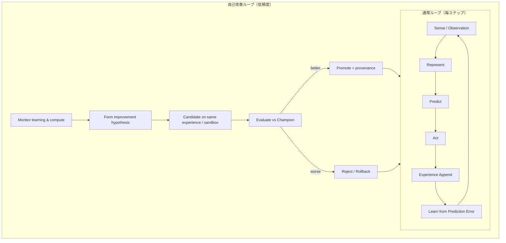

# ゲーム攻略くん — 最終目標からの全面アーキテクチャ再設計

- 文書: `future-architecture.md`
- 作成: 2026-10-28（利用者指示 t112u）
- 更新: 2026-10-28（t113u: 旧 memory.sqlite は read-only 史料として保持確定）
- 位置づけ: **現行コードを守る設計ではない**。最終目標と絶対原則だけを守り、現実装は KEEP / REBUILD / REMOVE / MISSING で評価する。
- 本文書が承認されるまで、大規模な実装変更には着手しない。

---

## 1. 最終目標

ゲーム攻略くんは、人間からゲームの攻略知識・ルール・意味・正解・報酬設計を与えられず、次だけを出発点とする。

1. ゲーム画面（画素・OCR 可能な文字）
2. 入力可能なボタン（Profile で定義された身体）
3. 入力を実際に送る能力
4. 自分自身の経験記録

人間がすることは、原則として **ゲームとゲーム攻略くんを起動するところまで** である。

その後の循環（自律）:

```
観測する
→ 画面内の構造を発見する
→ 操作を試す
→ 操作と変化の関係を切り分ける
→ 自然変化と Action による変化を区別する
→ 同じ対象や状態を追跡する
→ 文字・数字・位置・形・動き・関係・時間変化などの重要性を経験から発見する
→ 世界モデルを作る
→ 予測する
→ 予測誤差から学ぶ
→ 分からないことを減らすため自ら実験する
→ 長期的に有益な状態や結果を経験から発見する
→ Goal を作る
→ 複数手を計画する
→ 再利用可能な Skill を獲得する
→ Skill を組み合わせる
→ より遠い未知状態へ到達する
→ 自分の学習方法そのものを評価・改善する
```

長時間起動するほど次が起きることを目指す。

- 世界の理解が深くなる / 予測精度が上がる / 無意味な試行が減る
- 新しい状態へ到達できる / 操作 Skill が増える / Goal と Planning が高度になる
- 観測すべき場所を自分で選べる / 必要な情報と不要な情報を自分で区別できる
- 同じ経験から得られる学習量が増える / 計算量や観測コストを自分で削減できる
- 過去経験を再利用して自己改善できる

これは「特定ゲームを攻略する AI」ではない。

> **画面という感覚器と、入力可能なボタンという身体だけを与えられ、環境との相互作用から世界・価値・技能・学習方法そのものを獲得し続ける汎用ゲームエージェント**

として設計する。

---

## 2. 絶対に守る原則

| # | 原則 | 要約 |
|---|---|---|
| 1 | **ゼロ知識** | コード・Profile・DB 初期値・報酬・選択・認識・テスト・例外にゲーム意味を入れない。「プレイヤー」「敵」「HP」「階段」「死亡」「タイトル」「このキーで攻撃」等は禁止。 |
| 2 | **画面情報は隠さない** | 画素・色・形・テクスチャ・位置・大きさ・拡縮・回転・動き・Global Transform・局所変化・出現消失・連続性・周期性・文字・数字・OCR・Entity 候補・関係・遅延変化は必要なら高粒度で使う。隠すのは内部正解と人間の意味付け。 |
| 3 | **目と手は開発者、意味は経験** | Capture / Input / OCR エンジンは実装してよい。観測結果のゲーム内意味は経験から学ぶ。 |
| 4 | **馬鹿なプレイはバグではない** | 壁への反復・無意味キー・失敗はバグではない。同じ経験を積んでも学ばない・予測が改善しない・未知と既知を区別できない・過去経験が選択に効かないならバグ。 |
| 5 | **Observation と Meaning を分離** | 「この数字が減った」は Observation。「HP が減った」は Meaning（開発者が教えない）。 |
| 6 | **時系列と因果を分離** | Action の後に起きたことを即座に原因と決めない。自然・遅延・周期・他条件と比較し、因果自体を経験から推定。 |
| 7 | **Game Profile = 身体と接続条件だけ** | ウィンドウ・Capture・Input・使用可能入力・入力時間・安定待ち・Background 条件等。攻略情報を逃がさない。 |
| 8 | **人間診断を AI に混入させない** | 「中央の大きな物はキャラ」「ここは店／ダンジョン」等は診断・評価専用。観測・学習・選択・報酬・World Model に入れない。 |

補足（既存原則から継承し強化）:

- LLM は攻略主体にしない。削除しても経験と能力を失わない。
- 「賢く見えるように直す」ヒューリスティック禁止。直すのは汎用学習機構。
- しきい値を都合で緩めない。新しい調整値には根拠注記と監査を必須とする（最終系でも維持）。

原則同士が衝突したときだけ人間に止めて聞く（§30 末尾の Open questions）。

---

## 3. 現在のシステム構造

### 3.1 ランタイム構成（要約）

```
[起動ツール ゲーム攻略くん.exe]
   └ app/GameKouryakuKun.exe (WPF)
        ├ Capture (WGC / PrintWindow) + Input (PostMessage / SendInput)
        ├ PlaySession ループ（観測→予測→選択→入力→結果→学習→記録）
        ├ Core: Observation / Exploration / Goals / Perception / Control …
        ├ Storage: memory.sqlite（経験）+ app.sqlite（機器・部品）
        ├ OCR: PaddleOCR (ONNX) / Windows Media OCR
        └ Supervisor: プロセス・窓・取得途切れの復旧（AI から分離）
```

### 3.2 経験ループ（現行）

1 手 = 1 完全観測を目標に、静止判定 → Structured Observation（global / regions / text / temporal / entity_layer / prediction）→ TransitionModel + LocalEventModel で予測比較 → Explorer の多項スコアで行動選択 → SelfGoals（Reach / Retest）が一部割込み → Skill 芽（ActionSequence）→ DB 記録 → Health / Viewer。

### 3.3 主要モジュール（実装の実体）

| 領域 | 主な実装 | 状態（最終目標比） |
|---|---|---|
| 目と手 | Capture / Input / Profile / OCR / Setup | 成熟。KEEP 寄り |
| Structured Observation | `StructuredObservation`・`LocalPatterns`・`CommonMotion`・GT v0.32.9 | 層は揃いつつ、表現が固定格子・しきい値群に依存。REBUILD |
| Entity / Track | EntityTracker・TrackEvidence・TrackQuality・EntityExperience | 追跡品質は改善。Identity と経験の分離は途中。REBUILD |
| 自然 vs Action | NaturalBaseline・RegionCausality・Wait・TextChangeBook | 正しい方向。因果推定としては浅い。KEEP→発展 |
| World Model | TransitionModel（State ID×Action→Next）・LocalEventModel | 粗い索引中心。構造化文脈未接続。REBUILD |
| 選択 | Explorer + ScoreBreakdown（多数の固定重み項） | 動くが価値関数が固定。REBUILD |
| Goal / Plan / Skill | SelfGoals・Horizon・ActionSequence | 部分実装。State ID 依存。REBUILD |
| 地域進み | FrontierRegions | ゲーム非依存の内発指標として有用。KEEP |
| Supervisor | SupervisorEngine・ProcessControl | 境界が明確。KEEP |
| Viewer / Health | StepSummary・HealthReport・Overlay 一部 | 診断価値あり。意味混入リスクに注意。KEEP/整備 |
| 自己改善外ループ | — | **MISSING** |
| 特徴重要度→観測配分 | 設計のみ（P-3） | **MISSING（実装）** |
| Meta / Continual / Replay | 実質なし（stream 保存のみ） | **MISSING** |

### 3.4 データの現状

- `memory.sqlite` はスキーマ累積（〜v17+）。`structured_observations` が本線。旧表・途中 DROP の痕跡あり（deaths / hazard_model / floor_maps / llm_calls 等は歴史層）。
- 実機診断 zip・release バイナリは公開 git に含めない運用。
- 自動更新（v0.33.0）: Bootstrap exe が `release/latest.json` から本体を取得。

### 3.5 現行ロードマップの位置

Observation Layer 仕様の P-1〜P-13 は「現行 Observation を完成させる道」であり、**最終目標エージェントの道ではない**。本設計では P 番号を拘束条件にしない（§30 で新段階へ置換）。

---

## 4. KEEP / REBUILD / REMOVE / MISSING 監査

分類基準:

- **KEEP**: 最終目標に対し、維持・発展させる価値がある（アルゴリズム・境界・原則・インフラ）。
- **REBUILD**: 目的は正しいが、現構造が拡張を阻害する。作り直す／置換する。
- **REMOVE**: 歴史的残骸、または最終目標に有害。削除・凍結。
- **MISSING**: 最終目標に必要だが存在しない（または設計のみで実行系にない）。

### 4.1 KEEP（維持・発展）

| 項目 | 理由 |
|---|---|
| ゼロ知識原則・ConstraintAudit / ForbiddenApi / 版監査 9 項目 | 目標の護岸。強化して残す。 |
| Capture / Input / Window / 緊急停止 / ユーザー操作検出 | 「手」の実装。Profile 境界と一体。 |
| Game Profile = 身体のみ | 原則 7。現行 profile.json 方針を維持。 |
| OCR を観測として使う（意味解釈しない） | 原則 2・4。トークン化・数字系列は発展させる。 |
| 1 Action = 1 Complete Observation | 欠測を学習に混ぜない契約。性能最適化でも崩さない。 |
| Structured Observation の**概念**（層・status・provenance） | 「目の出力」契約として残す。スキーマ実装は REBUILD。 |
| Global Transform（v0.32.9）: 仮説比較・inlier 広がり・BIC・scene-switch 拒否 | 観測座標問題への正しい攻め方。KEEP して汎用座標補償の核に。 |
| NaturalBaseline / Wait / RegionCausality（action vs independent） | 原則 6 の最小実装。因果層の土台。 |
| Human Control + provenance=human（模倣報酬なし） | 原則・評価に必須。 |
| Supervisor 境界（system_events を報酬に使わない） | 長時間運転の安全の核。 |
| FrontierRegions 的な「進み」（単一指標の悪用防止付き） | 内発価値の良い前例。一般化して KEEP。 |
| Goal 価値を「学習進み（PE 減少）」で測る思想 | 原則 4 と整合。種類拡張時もこの軸を残す。 |
| Health の PASS/WARN/FAIL がプレイ上手さではなくシステム健全性 | 原則 4。拡張する。 |
| Experience stream の追記・legacy を推測で埋めない | Provenance。 |
| Bootstrap 自動更新・data/ 保持 | 運用。エージェント論理とは独立。 |
| EntityExperience / TrackQuality の**診断と経験蓄積の意図** | P-6 成果。表現層へ吸収して発展。 |
| 合成試験で意味ラベルを AI に渡さない規律 | 評価の正しさ。 |

### 4.2 REBUILD（目的は正しいが構造を作り直す）

| 項目 | 阻害理由 | 作り直し方針（要約） |
|---|---|---|
| Observation 実装全体（固定 16×12 / 32×24・散在しきい値・層の継ぎ足し） | 拡張が「欄追加」になり、表現学習・重要度配分と噛み合わない | **Sensor Stack** に再編: Raw → CoordinateFrame（GT）→ ChangeField → Candidates → Tracks → Relations → Text → Temporal。格子定数は学習/適応可能パラメータ候補へ。 |
| State ID を World Model の主鍵にする設計 | 同じ global で局所が違う現象を吸収しきれない。Goal/Skill も State ID に縛られる | State ID は**粗い索引**に降格。予測の主表現は Structured latent / 文脈付き要因。 |
| TransitionModel + LocalEventModel の二系統並立 | 接続が薄い・文脈条件が未接続 | 単一の **Predictive World Model**（複数時間尺度・要因分解）。粗い遷移は特殊ケース。 |
| EntityTracker（手がかり混合・見た目再同定の歴史的経緯） | Identity と appearance の分離がコード上あいまい | Track = 時間連続仮説。Appearance は観測特徴。Identity 確信度は経験尤度。人間診断（中央最大等）は AI 経路に載せないことを契約化。 |
| Explorer 多項固定重み | 「正しい価値」を開発者が固定しているに近い | Intrinsic Value Mixer（初期は情報利得等のポートフォリオ、長期で重み自体を学習）。 |
| SelfGoals（Reach/Retest のみ）・Planning Horizon | 構造化条件・Skill 合成・遠い未知へ弱い | Goal = 予測可能な観測条件。Planner は WM 上の探索。 |
| ActionSequence / Skill 芽 | 観測の開始・終了条件を持てない | Skill = (pre, policy/seq, post, predicted effect, confidence)。 |
| PlaySession 巨大ループ | Meta 学習・候補モデル並行比較を差し込めない | **Runtime Kernel**: StepPipeline + ModelRegistry + ExperienceStore。 |
| memory.sqlite 累積スキーマ | 死表・二重表現・移行コストが自己改善を阻害 | 新 **Experience DB vNext**。旧 DB は read-only 過去経験としてアダプタ経由。 |
| P-1〜P-13 / Phase 2 完成主義 | 「現行 Observation 完成」が最終目標とずれる | §30 の Capability Stages に置換。 |
| Viewer Overlay | 未完成かつ診断ラベル混入リスク | Explainability は観測 JSON からの投影のみ。人間注釈チャネルを物理分離。 |

### 4.3 REMOVE（削除・凍結）

| 項目 | 理由 |
|---|---|
| 「現行 Phase / P 番号を完了させること」自体を成功条件にすること | 目標のすり替わり。 |
| 歴史スキーマの意味濃厚残骸を復活・再利用すること（deaths 等） | ゼロ知識と命名規律に反する。DROP 済みでも設計語彙から排除。 |
| LLM を攻略ループの必須経路にする設計・表 | 原則違反の温床。説明補助は外側に限定。 |
| プレイ内容を FAIL にする Health 項目 | 原則 4 違反。 |
| 人間診断ラベルを特徴・報酬・選択に入れる「便利パッチ」 | 原則 8。 |
| しきい値緩和による実機「通し」 | 既存方針。最終系でも禁止。 |
| 観測を欠落させて速く見せる最適化 | 原則 2 と高速化方針に反する。 |
| 旧 diagnostics 互換試験を製品要件に残すこと | 歴史。必要なら tools に隔離。 |
| phase0 / 巨大設計書のままの「実装契約」扱い | 参照史料化。拘束は本文書と原則原文。 |

### 4.4 MISSING（必要だが無い／実行系に無い）

| 欠落 | なぜ必要か |
|---|---|
| **因果実験エンジン**（対照・遅延・周期を明示的に仮説比較） | 原則 6 を「待つ手の統計」超えて満たすため |
| **Feature Importance → 観測配分（Attention / ROI 方策）** | 「どこを詳しく読むか」を学習対象にするため |
| **予測誤差の分類→再表現の閉ループ** | PE が学習・再分類に戻らないと世界理解が止まるとめ |
| **Inner loop 外の Self-Improvement loop** | 学び方・計算配分・モデル選択の改善 |
| **Candidate / Champion モデルレジストリと同一経験での比較昇格** | 「改善したつもり」防止 |
| **Experience Replay / 再解釈パイプライン** | 表現が変わっても過去を再利用 |
| **Continual Learning 契約**（破滅的忘却・版付きモデル） | 長時間運転 |
| **学習可能な Intrinsic Value 重み** | 固定好奇心の限界を超える |
| **構造化 Goal / 階層 Skill / 合成 Planning** | 遠い未知・再利用 |
| **Algorithm Provenance**（どの学習器版がどの経験を生んだか） | 監査・rollback |
| **学習が起きていることの Evaluation スイート** | 馬鹿プレイと非学習を分離して測る |
| **観測等価性を保った性能自己最適化** | 欠落なし高速化 |
| **長時間安全策の拡張**（実験予算・不可逆操作の統計的回避・資源上限） | Supervisor 以上のエージェント側安全 |
| **事前学習モデル利用の隔離提案**（採用は別判断） | ゼロ知識影響の明示（§付録 A） |

### 4.5 直近成果の写像

| 成果 | 分類 |
|---|---|
| Global Transform v0.32.9 | **KEEP**（Sensor Stack の CoordinateFrame） |
| Track ID 改善・TrackQuality | **KEEP 意図 / REBUILD 実装**（Identity 層へ） |
| EntityExperience P-6 | **KEEP 意図 / REBUILD 配置**（Memory の per-entity 経験） |
| temporal.delayed 部分 | **KEEP 断片 → Temporal/Causality へ統合** |
| 入力 on/off トグル | **KEEP**（身体可用性。Profile/UI） |
| 自動更新 v0.33.0 | **KEEP**（配布） |
| P-7 並列化未着手 | 性能は §20。観測欠落禁止のまま **Stage 後半** |

---

## 5. 最終アーキテクチャ案

### 5.1 二つのループ



### 5.2 論理コンポーネント（少数の耐久抽象）

| コンポーネント | 責務 |
|---|---|
| **Body** | Profile・Capture・Input・可用アクション・安全禁止キー |
| **Sensor Stack** | Raw frame → CoordinateFrame → 構造化観測（意味なし） |
| **World Model** | 予測分布（多時間尺度・要因） |
| **Intrinsic Value** | 情報利得・制御可能性・到達拡大等のポートフォリオ＋学習重み |
| **Policy / Explorer** | 価値と不確かさから行動分布 |
| **Goal / Planner / Skill Library** | 条件付き目的・計画・再利用技能 |
| **Experience Store** | 追記ログ・Replay・再解釈 |
| **Model Registry** | Champion / Candidate・昇格規則 |
| **Supervisor** | プロセス／窓／取得の生存（AI 外） |
| **Viewer / Health / Provenance** | 人間向け説明・システム健全性・由来 |

### 5.3 実行配置（提案）

- **Runtime Kernel**（現行 PlaySession を置換）が Inner loop を駆動。
- 学習アルゴリズムはプラグインではなく **版付き Model Bundle**（予測器・価値・追跡・OCR ROI 方策等のセット）。
- 新実行系を旧実行系と**並行**可能にし、同一診断 replay で比較後に切替（§26）。

### 5.4 設計上の決断（自律決定）

1. **モデルベース中心**（World Model + planning + intrinsic）。純粋 model-free 深層 RL を主経路にしない（説明・因果分離・ゼロ知識監査が難しいため）。関数近似は WM / 表現の内部に限定して導入検討。
2. **表現は「記号 State ID 一本」から脱却**しつつ、完全エンドツーエンド黒箱にもしない。構造化観測を中間契約に残す。
3. **自己コード書き換えは初期はしない**。最初の自己改善は Model Bundle・パラメータ・計算グラフ選択に限定。コード生成改変は Stage 後期のオプション（検証・sandbox 必須）。
4. **旧 P-1〜P-13 は破棄**（拘束として）。有用な技術は Capability Stage に再配置。

---

## 6. Observation

### 6.1 契約

毎ステップ、欠測なく **Observation Bundle** を出す。

- `raw`（必要なら参照用ハッシュ／差分。常時フル保存はしない）
- `coordinate_frame`: Global Transform 仮説集合と採用結果・confidence（v0.32.9 系統）
- `change_field`: 補償後の局所残差・出現消失
- `candidates` / `tracks` / `relations`
- `text` / `numbers`（observed | inherited | not_observed）
- `temporal`（境界時間・自然変化・delayed・周期仮説）
- `provenance`（agent | human | wait | supervisor_gap）
- 各層 `status`

**Meaning 欄を持たない。** 名前は形式的（moved / appearance_changed 等）。

### 6.2 Sensor Stack の規則

1. 画面から観測可能な量を開発者が消さない（マスクは安定判定用と学習用を分離。現行の良い点を継承）。
2. CoordinateFrame は「多くの局所変位を一つの低次元変換が説明できるか」の証拠で決める（ゲーム意味なし）。
3. 説明できない局所変化は候補として残す。
4. OCR は観測。文字列の意味は下流が経験で付ける。

### 6.3 観測配分（後段で学習）

初期は広く読む。経験後は PE・Action 相関・Goal 関連・関係重要度に計算を寄せる。ただし低頻度の再確認と異常検知を残し、永久無視しない（§11・§20）。

---

## 7. Representation / Entity / Relation

### 7.1 三つの分離

| 概念 | 定義 |
|---|---|
| **Candidate** | 今フレームの局所パターン仮説（形・位置・テクスチャ符号） |
| **Track** | 時間的連続性の仮説（ID）。Identity ≠ Appearance |
| **Entity Experience** | Track（または再同定クラスタ）ごとの予測可能統計 |

人間診断「中央最大＝キャラ」は **Viewer 注釈チャネルのみ**。Representation API に渡さない。

### 7.2 Relation

距離・相対変位・接近/離反・重なり・同一運動・**遅延追従**を観測として保持。意味ラベル（敵追従等）禁止。

### 7.3 サイズビン

診断用のみ。学習・Structured Observation から小候補を捨てない（現行方針を維持）。

---

## 8. Temporal / Causality

### 8.1 Temporal

- 同期変化 / 遅延変化 / 周期 / 入力なしドリフトを別仮説として記録。
- `delayed[]` を Observation の一等市民にする（現行部分実装を完成させるのではなく、因果モジュールへ統合）。

### 8.2 Causality（原則 6）

最低限の仮説集合を毎関連イベントで比較する。

| 仮説 | 内容 |
|---|---|
| H0 自然 | wait / no-input 分布と区別不能 |
| H1 即時因果 | 特定 Action 後に残差が説明される |
| H2 遅延因果 | ラグ k で説明される |
| H3 文脈条件付き | 同一 Action でも局所文脈で分岐 |
| H4 共通原因 | 複数局所が同一潜伏要因 |

証拠: 対照頻度・Bayes factor / 交差検証損失。Action 後に起きたことだけで H1 を採用しない。

---

## 9. World Model

### 9.1 役割

`P(未来の観測要因 | 過去観測, Action, 文脈)` を保持し、予測・計画・内発価値・Skill 効果の共通基盤とする。

### 9.2 構造（提案）

- **短時間**: 局所イベント（移動・出現消失・文字数字変化・残差）
- **中時間**: 粗い scene 遷移（旧 TransitionModel 相当を特殊ケースとして内包）
- **長時間**: 到達グラフ・Skill 効果・Goal 達成分布

条件付けに使う特徴は §11 で選ばれたものだけを段階的に追加（無制限分裂禁止・取り消し可能）。

### 9.3 非目標

ゲームの「正解ルールブック」を抽出して人間が読める攻略本にすることではない。予測・制御・再学習に効く圧縮である。

---

## 10. Prediction Error

### 10.1 定義

層・要因ごとの適正スコアリングルール（対数損失等）。校正（予測確率 vs 当たり）を Health で監視（現行の良い点）。

### 10.2 PE の使い道（閉ループ）

| PE の型 | 行き先 |
|---|---|
| 表現が粗い | 文脈特徴の追加候補（§11） |
| Track 不安定に集中 | 追跡仮説の再計算 |
| wait と同分布 | 自然変化へ |
| 履歴で減る | 時間文脈特徴 |
| どこでも減らない | 能動実験（§12） / モデル不足 |

**試算だけで終わらせない**（現行 P-3 未完の中核欠陥）。

---

## 11. Feature Importance

### 11.1 定義

特徴 f の重要度 = 「f を知ると予測損失がどれだけ下がるか」（leave-one-out / ablation on replay）。

### 11.2 用途

1. World Model の条件付けに採用するか
2. 観測配分（どこを高解像度で読むか）の重み
3. Viewer の強調（説明）。**報酬ラベルにはしない**

下がらない特徴は観測から削除せず、選択・高コスト処理への寄与だけ下げる。低頻度再確認を残す。

---

## 12. Exploration / Active Experiment

### 12.1 通常探索

未知遷移・高不確かさ・進み（Frontier 系）・可逆性の維持を Intrinsic Value 経由で混合。

### 12.2 能動実験

競合仮説（§8・§10）を最もよく区別する Action（または短シーケンス）を選ぶ。期待情報利得。固定「正解キー」禁止。

### 12.3 実験予算

長時間運転では危険なループ（同一失敗の無限反復）を **学習失敗検出**（§22）と予算で扱う。プレイが馬鹿なこと自体は止めない。

---

## 13. Intrinsic Value

### 13.1 初期ポートフォリオ（ゲーム意味なし）

- 情報利得 / PE 減少
- Controllability（Action が分布を動かす）
- 到達可能集合の拡大 / 未知 transition への到達
- Future options / 可逆な状態の維持
- 新 Skill の獲得・WM の長期改善

### 13.2 メタ価値学習

これらを永久の正解価値関数としない。長期経験から「どの内部指標が、その後の学習・到達・Goal・Skill に寄与したか」を測り、**重み自体を Outer loop で更新**（Champion 比較のうえ）。

数が多いほど良い生カウント（画面数・発見数・達成数）を価値に直接しない（現行 goals 設計の良い制約を継承）。

---

## 14. Goal

### 14.1 定義

Goal = **観測言語で書ける達成条件** + 成功時に期待される学習/到達価値。

例（意味ではなく形式）:

- ある Track 関係を再現できる文脈へ行く
- ある数字系列の変化を引き起こせる Action を確認する
- 不確かさの高い要因を再テストする
- 進みの高い領域へ出る（Frontier）

### 14.2 禁止

「クリアする」「ボスを倒す」「HP を守れ」等の外部意味 Goal。

### 14.3 価値

達成数ではなく、達成後の PE 減少・制御可能性・option 増加等（§13）。

---

## 15. Planning

- World Model 上の木/グラフ探索。Horizon は実績で伸縮（現行思想を一般化）。
- Skill をマクロ行動として展開。
- 計画失敗は引き直し・Goal 放棄。計画自体をエピソード境界にしない。
- Supervisor 復旧の前後を一本の計画として接続しない（現行どおり）。

---

## 16. Skill

```
Skill := {
  pre_condition: 観測述語（文脈）,
  body: Action シーケンス or 方策断片,
  post_condition: 予測可能な観測変化,
  effect_model: 信頼度付き,
  origin: 採掘元（replay / goal / active experiment）
}
```

昇格は再現性と効果の確からしさ。人間実演からの模倣報酬は置かない（human provenance は世界の遷移観測としてのみ）。

入れ子 Skill は Stage 後期。初期は浅い階層。

---

## 17. Memory / Experience Replay

### 17.1 記録

追記専用の Experience Log（観測要約・Action・予測・結果・PE・provenance・model_bundle_id）。

### 17.2 Replay

1. **学習 Replay**: 同一ログで Candidate を訓練/評価
2. **再解釈 Replay**: 新しい Sensor/WM で過去フレームを再処理（可能な範囲）。旧結論は残し、新解釈を並行保存
3. **優先度**: PE 大・仮説衝突・Goal 関連・稀少遷移

フル生フレームの永久保存は必須としない。再解釈に必要な圧縮表現とサンプルフレーム方針を Stage 1 で固定する。

---

## 18. Continual Learning

- Model Bundle は版付き。起動をまたいで Champion をロード。
- 新環境分布（窓サイズ変更・OCR 部品更新・長期ドリフト）で自動再較正。
- 破滅的忘却対策: Replay 混合・重要経験の保護・悪化時 rollback（§27）。
- 「知っている状態の減少」は版が変わった組では FAIL にしない（現行成長テストの教訓）。

---

## 19. Meta-Learning / Self-Improvement

### 19.1 対象

特徴・追跡方法・WM・予測器・選択・探索・Goal 生成・Planning・Skill 抽出・記憶構造・Replay・観測頻度・OCR ROI・キャッシュ・並列化・モデル選択・パラメータ・資源配分。

### 19.2 手順（必須）

```
旧方式（Champion）を残す
→ 改善仮説から Candidate を作る
→ 同一経験（または安全サンドボックス）で比較
→ 明確に改善したときのみ昇格
→ 悪化時は Rollback
→ 結果を Provenance に記録
```

### 19.3 初期スコープ

パラメータ・方策混合重み・ROI・モデル選択まで。**本番コードの自動書き換えはしない**（将来オプション、§付録）。

自己改善機構自体にも検証・provenance・rollback を付ける（メタレベルの無限改変を防ぐ）。

---

## 20. Performance Self-Optimization

### 20.1 禁止

観測欠落・層スキップ・「だいたい同じ」で正式観測を落とすことによる高速化。

### 20.2 許可（等価性検証付き）

キャッシュ / 差分 / ROI / 並列 / 非同期 / バッチ / モデル圧縮 / 計算配分。

エージェントが経験的に確認する文:

- この処理を省略しても予測・選択に使う結果が同じだった
- この領域は再計算不要だった
- この特徴は予測に寄与しない
- このモデルは同精度で高速

確認は Candidate 比較で行い、Champion 昇格規則に乗せる。

---

## 21. Viewer / Explainability

### 21.1 目的

人間が **目の品質と学習機構** を監査する。プレイの上手さの採点 UI ではない。

### 21.2 規則

- 表示は Observation / 予測 / 選択内訳 / Goal / Skill の投影のみ。
- 人間が「これは敵」とタグ付けする入力を学習経路に接続しない（診断メモは別ファイル・別チャネル）。
- Overlay は JSON→描画の決定的投影（試験可能）。

---

## 22. Health / Failure Detection

### 22.1 Health が見るもの

| 見る | 見ない |
|---|---|
| 取得・入力・DB・OCR 欠測・1手=1観測 | 壁に何回向かったか |
| 予測校正・PE の改善傾向 | クリアしたか |
| Track 连续性・分裂・再同定（診断） | 「キャラを正解追跡できたか」意味判定 |
| Supervisor 復旧・回路遮断 | 攻略の良し悪し |
| Champion 悪化・学習停滞 | — |

### 22.2 学習失敗検出（バグ側）

- 同分布経験の増加でも PE が下がらない
- 既知/未知の区別が選択に影響しない
- Candidate が常に Champion を下回るのに Outer loop が停止している
- 観測欠測率の上昇

これらは WARN/FAIL。馬鹿プレイ自体は FAIL にしない。

---

## 23. Provenance

記録する由来:

- 経験の actor（agent/human/wait）
- Observation schema / Sensor bundle 版
- Model bundle 版（予測・価値・追跡）
- Goal/Skill の origin
- Supervisor gap（中断前後を結合しない印）
- Outer loop の昇格・棄却理由

過去経験を新しい意味で埋め直さない。再解釈は新レコードとして追加。

---

## 24. Supervisor との境界

| | Supervisor | Agent |
|---|---|---|
| 入力 | プロセス・窓・取得・入力路・人が書いた launch 設定 | 画面観測のみ |
| 出力 | 停止・保存・再接続・再起動・診断 zip | 中立キー・wait |
| 知らない | ゲーム意味 | 起動/終了/再起動を自分の Skill にしない |
| 記録 | system_events（価値に使わない） | experience log |

AI コードが Supervisor 設定を攻略知識として読まない（静的検査を維持・強化）。

---

## 25. Game Profile との境界

書いてよい: ウィンドウ識別、Capture/Input 方式、論理キー→物理キー、chords、hold/interval、禁止キー、Background 条件、安定待ちの技術パラメータ。

書いてはいけない: 画面意味、攻略手順、正解キー、HP/敵/ダンジョン等、診断用の既知操作の「意味」。

可用アクションの on/off（人間が探索から外す）は身体可用性として許容。ただし「この画面ではこれを押せ」条件付けは禁止。

---

## 26. Migration 戦略

### 26.1 原則

互換性のために悪い構造を残さない。ただし **過去経験の不可逆破壊は人間の明示承認が必要**。

### 26.2 段階

1. **史料化**: 現行 design.md / phase2 / P-roadmap を拘束から外し、本文書を上位に。
2. **Experience DB vNext**: 新スキーマを **別ファイル** で開始。旧 `memory.sqlite` は **read-only の史料・Replay 元**（t113u 確定）。旧 DB を直接 UPDATE / マイグレートして上書きしない。
3. **Adapters**: 可能なデータだけ Adapter 経由で新 Experience 形式へ変換・再解釈する。変換時に **失われる情報** と **推定した箇所** を明示する。旧レコードを新しい意味で上書きしない（新側に派生レコードを書く）。
4. **Dual runtime**: 旧 PlaySession と新 Kernel を配布物で切替可能（フラグ）。既定は当面旧でもよい。
5. **Champion 切替**: 同一実機診断 replay + 合成 suite で新が優越したら既定を新へ。
6. **削除**: 死コード・死表・旧 UI 経路を除去。旧 `memory.sqlite` の **不可逆削除は、将来不要と判断できてもその時点で改めて人間確認**（t113u）。設計者判断だけでは捨てない。

### 26.3 変換で捨ててよいもの / 残すもの

- 残す（旧ファイル上）: 旧 `memory.sqlite` 全体を read-only で保持。時系列の観測・Action・結果・provenance。
- 新へ写せるもの: Adapter が損失を注記したうえで Experience vNext へ派生コピー。
- 再計算可のため新へ必須でないもの: 古い固定重みのスコア内訳の「意味」、廃止モデルの内部重み。
- 破棄承認が要る: 旧 DB ファイル削除、生の長期スクリーンショット一括削除等。

---

## 27. Rollback 戦略

| 層 | Rollback |
|---|---|
| Model Bundle | 直前 Champion にポインタを戻す（原子的） |
| Outer loop 昇格 | 昇格レコードを無効化、推論を旧へ |
| DB migration | 移行前バックアップから開く（現行運用を継承） |
| 配布 | Bootstrap は本体を置き換えるだけ。`--repair` / 旧 release 資産 |
| 実験フラグ | 新 Kernel OFF で旧ループへ |

「改善したつもり」の防止装置が Rollback 不能なら Outer loop を動かさない。

---

## 28. Evaluation 方法

### 28.1 合格の定義

| 合格にしてよい | 合格にしてはいけない |
|---|---|
| 学習指標の改善（PE・校正・到達拡大・Skill 再利用） | 人間から見て賢いプレイ |
| システム健全性（欠測ゼロ・入力到達・DB） | 特定ゲームの進捗 |
| 同一経験での Candidate 優越 | しきい値緩和でのテスト通過 |

### 28.2 スイート構成

1. **合成世界**（意味ラベルは試験側のみ）: 因果・追跡・遅延・重要度・能動実験
2. **Replay**: 実機診断の非破壊再生（GT・追跡・欠測）
3. **長期運転**: 起動またぎで Champion が悪化しない・進みが定義どおり動く
4. **原則回帰**: ConstraintAudit / ForbiddenApi / Profile 境界

### 28.3 原則 4 の運用

馬鹿プレイのログを「修正チケット」にしない。学習停滞メトリクスだけをチケットにする。

---

## 29. 長時間自律運転の安全策

1. Supervisor による生存・回路遮断・診断書き出し（KEEP）
2. 禁止キー / 入力ガード（OS・窓破壊の防止）
3. エージェント側 **実験予算**（同一高 PE ループの情報利得枯渇検出）
4. 不可逆らしき遷移の統計的回避（意味で「セーブ破壊」と名付けない。復帰不能・option 消滅として）
5. 資源上限（CPU・ディスク・OCR 頻度）と自己最適化
6. 人間の緊急停止・Human Control
7. Outer loop は本番入力を増やす変更を默认禁止（まず replay）
8. セーブデータのバックアップは人間手順として README に残す（エージェントはセーブを操作しない）

---

## 30. 段階的ロードマップ（新 Capability Stages）

旧 P-1〜P-13 / Phase 完成度は使わない。段階は **能力の閉ループ** で定義する。

| Stage | 名前 | 成果（出る能力） | 主な建築作業 |
|---|---|---|---|
| **S0** | 契約固定 | 本設計の承認・原則テストの上位化・旧文書の史料化 | 実装大規模変更なし（本タスク） |
| **S1** | Runtime Kernel + Experience vNext | 新旧並行、旧 DB アダプタ、provenance に model_bundle_id | PlaySession 分解、新 DB、切替フラグ |
| **S2** | Sensor Stack 再編 | CoordinateFrame（GT KEEP）+ ChangeField + Tracks が単一契約 | Observation REBUILD。欠測ゼロ維持 |
| **S3** | Causal WM | H0–H4 比較が PE 閉ループに接続 | Temporal/Causality + Predictive WM |
| **S4** | Importance & Attention | 特徴重要度が文脈採用と ROI を駆動 | §11・観測配分 |
| **S5** | Intrinsic & Active Exp | 価値ポートフォリオ + 仮説識別行動 | Explorer REBUILD |
| **S6** | Goal / Plan / Skill | 構造化条件・マクロ Skill・合成計画 | Goals/Sequences REBUILD |
| **S7** | Outer Self-Improvement | Candidate 昇格・rollback・性能等価最適化 | Model Registry・Replay |
| **S8** | Long-horizon Autonomy | 長時間で理解・到達・計算効率が同時に改善 | Health/安全/成長スイート完成 |

### 30.1 設計承認後の次の一手（S0→S1）

**S0 状態（2026-10-28）:** 本文書を拘束とし、t113u で旧 DB 方針を確定。Open questions #2/#3 は既定採用。

1. ~~本文書のレビュー指摘を反映~~ → t113u を §26・付録 B に反映済み
2. ~~S1 契約~~ → **`docs/s1-runtime-contract.md`**（Experience レコード・ModelBundle・Kernel ステップ API・Adapter / LossReport・ファイル配置）
3. ~~旧 DB アダプタ垂直スライス~~ → `OldExperienceAdapter` + `experience-vnext.sqlite`（学習ロジック変更なし・旧 DB read-only・Session 未配線）
4. ~~実機 Adapter Replay~~ → `src/audit/v0.33.1-adapter-replay.md`（v0.32.9 診断・62,626 手・旧 DB ハッシュ不変）。**次:** Kernel 空シェルをフラグ裏に
5. その後 S2 で Sensor Stack に GT/Track/EntityExperience を移植

P-7 並列化やしきい値変更は、S2 契約が安定してから性能 Candidate として扱う。

### 30.2 成功の見え方（人間向け）

長時間置くほど:

- Health の学習指標が改善
- 無情報な反復が減る（価値が枯渇した領域の再訪低下）
- 新しい到達・Skill が増える
- 同じ diag replay の PE が版を追って下がる

「トルネコをクリアした」は成功条件にしない。

---

## 付録 A. 事前学習モデル（提案・非採用）

勝手に導入しない。検討するなら影響を明示して分離提案する。

| 種類 | 利点 | ゼロ知識リスク | 扱い |
|---|---|---|---|
| 汎用視覚エンコーダ（自己教師済み） | 形・テクスチャ圧縮 | 実世界事前がゲーム意味を密輸しうる | 特徴候補としてだけ。重要度で採用。ゲーム語彙のデコーダ禁止 |
| 汎用 OCR | すでに利用中 | 文字読みは観測。意味解釈に使わなければ可 | KEEP（現行方針） |
| LLM | 説明・仮説整理 | 攻略知識注入が最大リスク | 攻略ループ外。削除可能 |
| ゲーム特化事前学習 | — | **原則違反** | 禁止 |

採用する場合も Outer loop の Candidate として、同一経験で「無し」Champion と比較し、原則監査を通すこと。

---

## 付録 B. Open questions（人間判断が要るものだけ）

設計判断は本文書で自律決定済み。止めて聞くべきは次のみ。回答済みは拘束に格上げする。

| # | 論点 | 状態 | 決定 |
|---|---|---|---|
| 1 | 旧 `memory.sqlite` の扱い | **確定（t113u）** | 削除しない。read-only 史料・Replay 元。vNext は別ファイル。Adapter で損失・推定を明示。旧データを新意味で上書きしない。不可逆削除は将来も改めて人間確認。 |
| 2 | フルフレーム永続 vs 観測粒度 | **既定採用（未否認）** | 観測時は高粒度利用。永続は圧縮 Replay サンプル。フルフレーム永続は必須にしない。 |
| 3 | 自己コード変更 | **既定採用（未否認）** | S7 まで（および当面）パラメータ／モデル Bundle に限定。本番コードの自己改変は別承認が必要。 |

ゲーム固有知識が必要になる実装要求が出た場合は、実装せず確認する（原則原文どおり）。

---

## 付録 C. 文書の位置

| 文書 | 今後の扱い |
|---|---|
| `principle-original.md` | 最上位原則の原文。維持 |
| `future-architecture.md`（本稿） | 最終目標アーキテクチャの現行拘束 |
| `design.md` / `phase2-design.md` / `src/docs/observation-layer-*.md` | 史料・部分移植元。新規実装の拘束にしない |
| `src/audit/v*.md` | 版監査の継続。新 Stage でも 9 項目＋学習停滞観点を追加 |

---

以上。
