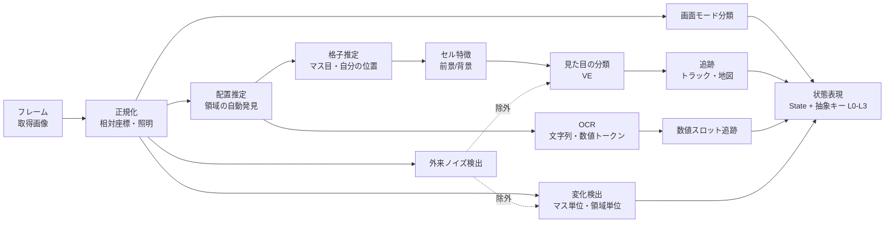

# ゲーム攻略くん Phase 2 設計書 ― 画面認識・状態表現

| 項目 | 内容 |
|---|---|
| 文書種別 | 詳細設計（**2026-10-18 ユーザー承認済み。実装中**） |
| 版 | 0.13（2026-10-18 15:44。§16.14: 入力なしの変化）／0.12（2026-10-18。§16.13: 予測の確率の較正）／0.11（2026-10-18 15:07。§16.12: 画面ごとの常時アニメのマスク）／0.10（2026-10-18 14:38。§16.11: 仮説・新発見の構造化した表示）／0.9（2026-10-18 14:14。§16.10: 分割の一生・観測の確かさ・並びの評価・長期の運用・表示の設定）／0.8（2026-10-18 13:31。§16.9: 予測 → 比較 → 修正 → 選択・判断の記録）／0.7（2026-10-18 13:07。§16.8: 並びの候補の入れ替え・弱い事前の推定・反応の情報の量・分割時の読み直し・経験の出どころ）／0.6（2026-10-18 10:49。汎用の機構 §16.7: 予測の外れの基準・ベイズ的変化点・区画とキーの反応の対応表・操作の並び・見た目と遷移の別表現）／0.5（2026-10-18 09:36。遷移パターンの区切りを連続経験履歴からの統計的な発見に変更、エピソード境界と anchor を廃止、実機確認は診断 zip だけ）／0.4（2026-10-18 07:06。U1〜U5 の回答と最上位原則 10「目と手は与える、意味は教えない」を反映。抵触した節は改訂し、旧記述は無効として折りたたむ）／0.3（v0.2 と論点 N1〜N4 の承認） |
| 上位文書 | `design.md`（v2.6）。本書は §2.2 画面認識・§2.3 ターン検出・§2.4 状態表現・§2.5 短期記憶・§5 データ・§6.1 状態抽象化・§8 UI・§9 Profile 境界を Phase 2 向けに詳細化し、一部を改める |
| 前提 | Phase 1 完了（背面入力の分離・取得・ターン検出の骨格・OCR 部品・記録・診断が実機で動作） |
| 最上位原則 | `design.md` 冒頭の「攻略知識の外部注入禁止」（2026-10-18）。本書のすべての記述より上位。v0.4 で、D4・N4（終了種別）を教師なしの遷移パターン分類に、§7A.4 の安全規則を可逆性の学習に、§4 の格子と自分の位置を周期構造と anchor の発見に、§12 の検証を合成＋実機の性能評価（U5）に改めた。v0.5 で、§7.3〜7.4 の区切りを連続経験履歴からの発見に、§4 の anchor を廃止、§12 の実機確認を診断 zip だけに改めた（`design.md` 冒頭「v2.11 の決定」） |
| 絶対条件 | `design.md` §0.2 のとおり。画面から人間が得られる情報のみを使う。メモリ読み取り・内部変数・ゲームファイル解析・攻略データ・セーブステート・巻き戻し・乱数取得は禁止。入力は通常のキーボード／ゲームパッド相当だけ。トルネコ固有の攻略知識は AI に与えない |

---

## 0. 目的と範囲

Phase 2 では、AI が**画面だけを見て**次のことをできるようにする。

1. 画面のどこが「入力に連動して動く領域」で、どこが「動かない文字表示」「ときどき出る矩形」かを、観測と入力の結果から自分で見つける（意味は付けない。U4）。
2. 画面に周期構造（格子）があればその大きさと位相を発見し、~~入力に連動して動く点（anchor）を見つける~~（v0.5 で廃止）。格子があることも、操作対象という物があることも前提にしない（U4）。
3. マスの中の見た目を、**意味を付けずに**分類する（見た目ID = VE）。
4. 固定の文字表示の数値を読み取り、手ごとに追いかける。どの数値とどの棒の長さが連動するかも統計で見つける。
5. 「入力しても地図が反応しない画面」を経験から見分ける。
6. 画面の一部だけが小さく変わる変化も見落とさない。
7. Steam 通知などゲームと無関係な変化を学習に混ぜない。
8. 以上をまとめて、学習（Phase 3）が使える状態表現（4段階の抽象キー）と DB に記録し、UI で「AI に何が見えているか」を表示する。

9. **起動画面（タイトル）から冒険の開始、冒険の終了後の再開までを、事前知識なしに画面遷移として自分で探索して覚える**（§7A。ユーザー回答 D3）。
10. 連続した経験の系列（状態・入力・結果）から、反復系列・循環・区切りを事前のラベルなしに**統計的に発見**し、パターン P1, P2, … を作る（§7.3〜7.4。U1・v0.5）。「1件」の範囲も経験から見つける。人向けの名前（死亡・脱出など）は説明層で付ける。最終目標「死亡か脱出かを判断する」は撤回せず、この分類に説明層で名前を付けて達成する。

**範囲外**: 仮説の学習・行動評価（Phase 3）、説明ログの完成（Phase 4）。Phase 2 は次の 2 段に分けて進める（D3 の回答で 2b の中身を「定型手順の確認」から「自律探索」に変更）。
- **2a 画面認識・状態表現**（§3〜§10）: 2b が使う画面モード・領域・数値スロットを作る。
- **2b 画面遷移の自律学習**（§7A）: 2a の画面モードを節点にした遷移図を探索で作り、起動画面から冒険の開始と再開を自動で行う。`design.md` §11 の Phase 2 完了基準（無人で10冒険）は 2b の完了基準とする。ゲームで生き残ることは目的にせず、**画面遷移を覚えること**を目的にする。
---

## 1. 実機データから分かっていること（設計の根拠）

**v0.4 の改訂（最上位原則・U5）**: 実機データから読み取ったゲームの意味（画面の種類・要素・手順）は設計の根拠にしない。実機データの用途は、システムの動作の確認と、知覚器（矩形の検出・OCR・キャプチャ）の性能評価（一時的な正解データ・数値だけ）に限る。下の旧表は無効。

<details><summary>旧記述（v0.3 まで。最上位原則に抵触するため無効・新しい実装の根拠にしない）</summary>

Phase 0/1 の画面記録（`phase0-results/`、`phase1-results/`、診断 zip 04:54 の `profile/last_screen_*.png` と `memory.sqlite`）から、次の性質が分かっている。これらは**設計者が画面を見て得た観察**で、AI には与えない。汎用の仕組みがこうした画面でも動くかを確かめる試験条件として使う。

> **注（v0.3 追記、design.md §0.4）**: 下の表の値や見た目を、コードの閾値・既定値・規則に写してはならない。合成画面の試験条件は、ここから「周期のある模様」「固定の文字の帯」のような**一般化した性質**だけを取り出して作る。実機の記録は健全性の確認（入力が届く・記録が残る・止まらない）にだけ使う。

| # | 観察 | 根拠 | 設計への影響 |
|---|---|---|---|
| F1 | WGC の取得サイズは 1466×825〜1468×857 で、PrintWindow はタイトルバー込み 1482×864。ウィンドウの大きさはユーザーが変えられる | capture_probe ログ | 座標は**取得画像の相対座標**（0〜1）で持ち、サイズ変更を検知したら配置を再推定する（§3.5） |
| F2 | 画面上端に1行の固定表示（「1階 Lv 1 HP 15/15 満腹度 91% 0G」と2本の棒）。地図が動いても位置が変わらない | last_screen、FixedOverlayTracker（大変化 237 回で不変） | 固定文字領域の自動発見（§3） |
| F3 | 地図はやや斜めに見下ろす描き方で、壁に高さがある。自キャラは画面中央付近に固定され、移動すると地図全体が動く | step001 の移動前後 | 格子は「正方格子」と決めつけず、2本の基底ベクトル＋遠近の補正で表す（§4） |
| F4 | 床の模様に周期がある（実測で横約 119px・縦約 114px、1468×857 の取得画像）。1マス分動くと床の模様がほぼ重なり、全体の位相相関では移動量が 0 と出た | 自己相関・ブロック照合の試算 | 移動量の推定は床の模様だけに頼らず、壁・物体・縁を使い、移動キーとの整合で決める（§4.2） |
| F5 | 画面に固定された明暗（中央が明るく周辺が暗い）と、舞う粒子・床のきらめきがある。待機中に変化するブロックは画面の 6.3〜6.6%（較正のマスク） | calibration ログ | 照明の正規化と、セル単位の周期変化マスク（§6, §8） |
| F6 | 半透明の小地図が地図の上に重なって表示される（移動に伴い中身が変わる） | last_screen、step012 | 「重なり表示」として地図のセル照合から除外する（§3.3） |
| F7 | メニューを開くと白枠の枠が複数出て、項目の文字や別の数値（最深階 25、ちから 8/8 など）が並ぶ | step002 menu Normal | 一時的な枠の検出と、枠ごとの数値の追跡（§3, §6） |
| F8 | 冒険の結果画面は黒地に白枠で、地図・固定表示が消え、文字だけになる | last_screen_010704 | 「地図のない画面」の画面モード分類と、入力への反応の学習（§7） |
| F9 | **足踏みで敵らしきものだけが1マス動いた手が「変化なし」と判定された**（run2 step012: 変化率 0.0135、最大連結 0.0064 < 閾値 0.015） | step012_enemy_moved_crop | 画面全体の閾値では小さな動きを拾えない。マス単位の変化検出が必要（§8） |
| F10 | 同じ step012 の移動前の画面の右下に **Steam の通知**が出ていた | 同上 | 外来の重なり表示の検出と除外（§9） |
| F11 | 移動の変化率は 0.26〜0.46、メニュー開閉は 0.14〜0.21、壁に当たる・足踏みの「変化なし」は 0.0006〜0.0035（直近 2 回の実行の集計） | memory.sqlite outcomes | 「大きく変わった」の判定は今の方式でよい。小さな変化だけをマス単位で補う |
| F13 | v0.4.2 の分離試験（2026-10-18 05:05〜05:15）で、600.8 秒・背面時のメニュー開閉 913/913 に画面が反応し、合格した。分離試験モードは Phase 2 の回帰試験として使える | 診断 zip 05:20 の separation_check | §16 の回帰試験 |
| F12 | 村では「Num1 話す」のような操作の案内が地図の上に出る | phase0 1_postmessage_bg | 一時的な文字表示も OCR するが、意味は付けない |

既存の記録上の不備: `outcomes.entity_events_json` に画面差分の数値（peak_ratio 等）が入っている。Phase 2 の移行で `diff_metrics_json` へ移す（§10.3）。

---

</details>

## 2. 認識パイプラインの全体像



- 1フレームを処理する目標時間: 60ms 以下（p95）。上位文書の付録 B に合わせる。重い処理（配置推定・格子推定・クラスタの統合）は**数十手ごとの背景処理**で行い、毎手の処理は「推定済みの配置と格子に当てはめる」だけにする。
- 推定結果にはすべて**信頼度**と**版**を付けて記録する。信頼度が低いあいだ、その部分は `unknown` として扱う。

---

## 3. 画面領域の自律発見

### 3.1 方針

**v0.4 の改訂（U4）**: 領域は「入力の後に変わる画素」「長く変わらない画素」「矩形の輪郭」「文字」などの一般的な視覚特徴の統計だけで分ける。「地図」「ステータス欄」「メッセージ欄」などの名前・意味は付けない（領域は R1, R2, … の番号だけ）。

<details><summary>旧記述（v0.3 まで。最上位原則に抵触するため無効・新しい実装の根拠にしない）</summary>

事前知識なしに、**画面の各部分が入力や時間に対してどう振る舞うか**だけで、領域を汎用の「種類」に分ける。種類の名前は振る舞いを表すだけで、ゲーム上の意味（HP 欄、メッセージ欄など）は付けない。

| 汎用の種類 | 判定に使う振る舞い（統計） | トルネコでの例（設計者の観察。AI には与えない） |
|---|---|---|
| `scroll_field`（動く面） | 移動系のキーの後に、面全体が同じ向きに平行移動する | 地図 |
| `fixed_text`（固定の文字） | 大きな画面変化でも位置が変わらず、OCR の文字検出が安定して出る | 上端の1行 |
| `fixed_graphic`（固定の図形） | 位置は固定、文字は出ない、形や長さが変わる | 上端の2本の棒 |
| `overlay`（重なり表示） | 位置はほぼ固定、半透明で、下の面が透けて動く | 小地図 |
| `panel`（一時的な枠） | 入力やできごとの後に矩形の縁が現れ、中に文字が並び、後で消える | メニュー、文章の枠 |
| `full_mode`（画面全体が切り替わる） | 面と固定表示の大半が消える | 結果画面、タイトル |
| `foreign`（外来の表示） | 入力と時間的に結び付かずに現れ、数秒で消える。画面の隅に多い | Steam の通知（§9） |

</details>

### 3.2 アルゴリズム

1. **ブロックの振る舞い統計**（既存の BlockGrid と FixedOverlayTracker を拡張）: 画面を 16×16px 相当のブロックに分け、ブロックごとに次を累積する。
   - 大変化（画面の 25% 以上が変化）のときに不変だった割合
   - 待機中の変化率（ノイズ較正）
   - OCR の文字検出に入った割合
   - 移動系キーの後の局所移動ベクトル（§4.2 の推定値）との一致率
2. **領域の組み立て**: 振る舞いが似た隣接ブロックをまとめ（連結成分＋矩形化）、上の表の種類のどれに当たるかを、しきい値ではなく**ブロック統計の混合モデル**で決める。種類ごとの確率を持たせる。
3. **一時的な枠（panel）の検出**: フレーム差分で新しく現れた領域のうち、縁が直線で囲まれた矩形（強いエッジの水平線・垂直線の組）を枠の候補とし、中を OCR する。どのキーの後にどの枠が出るかは記録するだけで、意味は付けない（例: 「キー `menu` の後に枠 #2 と #3 が出る確率 0.98」）。
4. **再推定**: 取得サイズの変化、画面モードの新規発見、領域の信頼度の低下（50 手連続で振る舞いが合わない）があれば、背景で配置を推定し直す。版（`layout_version`）を上げ、古い版の記録はそのまま残す。
5. **発見に必要な手数の目安**: 固定表示は大変化 4 回で候補になる（Phase 1 の実装で確認済み）。動く面は移動 20 手程度、枠は該当キーの 3 回程度。

### 3.3 重なり表示（小地図など）の扱い

動く面の中で、移動しても**位置が動かず中身だけが変わる**半透明の部分は `overlay` とし、セル照合（§5）と移動量推定（§4）から除外する。その部分のセルは「重なりあり」として信頼度を下げる。重なり表示そのものも VE と同じ仕組みで記録するが、マス目の観測としては使わない。

### 3.4 Game Profile との境界（D2: 完全自律）

| 区分 | Profile に書ける（インフラ） | 自動発見する（AI） | どこにも書かない |
|---|---|---|---|
| ウィンドウ | プロセス名・クラス名（現行） | 取得サイズ・余白 | — |
| 領域 | **書かない** | 全領域の位置・種類・信頼度 | 領域の意味（「HP 欄」「メッセージ欄」など） |
| 格子 | **書かない** | 格子の基底・原点・遠近補正 | — |
| 文字 | OCR の言語、前処理（拡大率・二値化） | 文字が出る領域、行の並び | ラベル文字列の意味 |
| キー | 論理キー割当（現行）。互換性テストに使う往復操作 | どのキーが何を起こすか | キーの効果の説明 |
| 冒険の外の手続き | **書かない**（D3。開始・再開の手順、終了画面の画像、`idle_safe` を Profile から外す） | 起動画面から冒険の開始・再開までの遷移（§7A） | — |

- **配置と格子は完全に自律で推定する**（ユーザー回答 D2）。ユーザーの確認は求めない。
- **最終手段**: 推定が収束しない状態が続いた場合（移動 500 手を過ぎても格子の説明率が 90% に届かない、または配置の版が 100 手のあいだに 5 回以上変わる）に限り、UI に「推定がまとまりません」と表示する。そのうえで、ユーザーに推定結果を見てもらう**任意の**確認を案内する。確認しなくても学習は続ける。確認の結果は「人の確認あり」として別の記録に残し、正解として学習に混ぜない（推定の打ち切り判断にだけ使う）。
- Profile のスキーマは v1 のまま（領域・格子・ライフサイクルの欄を追加しない）。上位文書 §9.2 の `layout.json`・`lifecycle.json` は使わない。

### 3.5 解像度・ウィンドウの大きさの変化

座標はすべて取得画像の相対座標で持つ。ピクセル単位で決まる量（マスの大きさなど）は「取得の幅に比例する」と仮定して換算する。取得サイズが 2% 以上変わったら、格子を推定し直す（§4）。

---

## 4. タイル格子の推定と自分の位置

**v0.5 の改訂**: anchor（入力に連動して動く点）は廃止（列・計算とも削除。操作対象の存在を前提にしないため）。残るのは周期構造の発見だけ。

~~**v0.4 の改訂（U4）**~~（anchor の部分は v0.5 で無効）: この章は「周期構造の発見と anchor の発見」に改める。(1) 画面のある領域に反復パターン（周期）があれば、その周期と位相を推定する（なければ格子なしとして扱う）。(2) 入力のたびに一緒に動く、またはその周りで画面がずれる点を anchor として見つける（`anchor_*` の列）。それが「自分」であることも、格子が「マス」であることも前提にしない。フロア座標（§4.4）は置かない。

<details><summary>旧記述（v0.3 まで。最上位原則に抵触するため無効・新しい実装の根拠にしない）</summary>

### 4.1 表現

```
Grid {
  layout_version
  basis_u, basis_v : Vec2        // 1マス分の画面上のずれ（右方向・下方向）。斜め見下ろしでも表せるよう直交を仮定しない
  origin           : Vec2        // あるマスの中心の画面座標（位相）
  perspective_k    : float       // 画面の縦位置による縮尺の変化（0 なら平行投影）
  self_cell_screen : (i, j)      // 自分がいるマス（画面上の格子座標）
  confidence       : float
}
```

### 4.2 マスの大きさの推定（移動の手から）

1. 移動系キーの手で「変化あり」になったものについて、動く面の**前後の移動ベクトル**を求める。
   - 前処理: 照明の影響を除く（局所平均を引く高域通過）。固定表示・重なり・外来表示・ノイズマスクを除外する。
   - 照合: エッジ特徴点（ORB 相当、または勾配画像のブロック照合）を使う。床の模様は周期的で、1マス分ずれても重なってしまう（F4）。そのため、**周期の弱い特徴（壁の縁・物体）を優先**し、照合結果のうち複数の候補（周期の整数倍だけ違うもの）をすべて残す。
2. キーごとに移動ベクトルの候補を集め、全体として**少数の基底の整数結合**で説明できる組を選ぶ。例えば「up は (0,-v)、left は (-u,0)、up+left は (-u,-v)」のような整合を見る。これは格子という**汎用の仮定**で、どのキーがどの方向かは事前に決めない。キー名は Profile の論理名だが、その効果は観測で決まる。
3. 床の模様の周期（自己相関のピーク）は、基底の**候補の一つ**として使う。周期と移動量が一致すれば信頼度を上げる。
4. 採用条件: 30 手以上で、整数結合での説明率が 90% 以上。満たさないうちは格子なし（`unknown`）として、セル単位の処理を止め、画面全体の特徴だけで状態を作る。
5. 斜め見下ろしの遠近（F3）: 画面の上と下で移動量の大きさが違えば、`perspective_k` を回帰で推定する。

### 4.3 原点（位相）と自分の位置

- 原点は「物体の見た目が落ち着く位置」で決める。移動が終わって静止した画面で、前景の塊（§5.2）の重心の分布を格子に折り畳み、最も集中する位相を原点とする。
- **自分の位置**は、次の2つの統計で決め、どちらか一方で決まれば採用する。
  1. スクロール型: 動く面が平行移動するのに、**画面上で位置が変わらない前景の塊**がある。移動の手の 90% 以上で不変なら、それを「自分」の候補とする。
  2. 非スクロール型（部屋の端などでカメラが止まる場合も含む）: 移動キーの方向と、ある前景の塊の格子上の移動が一致する率。
- 自分の見た目は**Profile で与えない**（上位文書の方針どおり）。自分の VE は追跡の結果として決まる（§5）。
- 斜めキー、ダッシュ、地図表示など、移動量が 1 マスでない手は、格子の整数結合として何マス動いたかを記録する。何のキーかは区別しない。

### 4.4 フロア座標

自分の移動量（格子座標）を積算し、フロアごとの座標系を作る（上位文書 §2.5）。動く面が大きく切り替わり、同時に固定表示の数値スロットのどれかが変化した、といった**汎用のできごと**でフロアが替わったとみなす候補を立てる。ただし Phase 2 では候補の記録までにする。フロアの替わり目の確定は、地図がつながらない（照合できない）ことを主な根拠にする。

---

</details>

## 5. 視覚パターンの教師なしクラスタリング（VE）

### 5.1 方針

- マスの見た目を、意味を付けない **VE ID**（例: VE#17）に分類する。「敵」「アイテム」「階段」といった名前やカテゴリは、プログラムにも DB にも持たない。
- VE の性質は**数えた統計**として持つ。例: 動いた割合、そのマスに進もうとして動けなかった割合、自分が重なった後に消えた割合、同じ手に出た文章テンプレート。これらから「動くもの」「通れないもの」のような**汎用の性質**を推定し、行動への影響の学習は Phase 3 の仮説エンジンが担う。

### 5.2 前景と背景の分離

1. フロア座標の各マスについて、そのマスを観測した見た目の時間的な中央値を**背景モデル**とする（照明の正規化後）。
2. 現在のマスの見た目と背景モデルの差が大きい部分を**前景**とする。背景モデルがまだ無い（初めて見るマス）場合は、周囲の背景 VE との比較で仮に分ける。
3. 粒子・きらめき（F5）はマスごとの周期変化マスクで除外する。自分や他の前景の待機アニメーションは、§5.4 の時間リンクで1つの VE に吸収する。

### 5.3 特徴量とクラスタリング

| 段階 | 内容 |
|---|---|
| セル切出し | 格子に合わせて、マス＋周囲 15% の余白を切り出す（前景が上へはみ出す斜め見下ろしに対応） |
| 特徴 | 縮小カラー（Lab 16×16）、勾配方向ヒストグラム、知覚ハッシュ、前景マスクの形。任意で汎用の画像埋め込み（論点 D7） |
| 照明 | 画面位置による明暗（F5）を、空間的に滑らかな明るさの比で正規化する。暗い部分では信頼度を下げる |
| オンライン分類 | 最近傍＋距離しきい値（リーダー法）で毎手割り当てる。しきい値を超えたら新しい VE を仮に作る（`tentative`） |
| 統合（背景処理） | 数百手ごとに、仮の VE をまとめる（凝集型の統合、DP-means 相当）。統合の履歴は残し、分割もできるようにする |
| 背景と前景 | 背景の VE と前景の VE は別の辞書で管理する（同じ仕組み・別 ID 空間） |

### 5.4 アニメーションと向きの吸収

同じトラック（§5.5）が連続する手で見せる見た目の組を「時間リンク」として数え、リンクが強い VE 同士を**同一 VE の複数の見本**として束ねる。こうすると、待機アニメーションや向きの違いで VE が増えすぎるのを防げる。束ねた結果は UI の見た目一覧で確認できるようにする。

### 5.5 追跡

前景の塊を手ごとにトラックとして対応付ける（距離と見た目の類似度を使ったハンガリアン法）。トラックごとに次を記録する。

- 格子上の移動
- 現れた手・消えた手
- 自分との距離の推移

### 5.6 新しさの記録

新しい VE、新しい画面モード、新しい文章テンプレートが現れたら「新規」として、原寸の切り出しを保存する（上位文書 §5.4）。UI の「新発見」に出す。

---

## 6. OCR の数値トークンの追跡

### 6.1 トークン化（Phase 1 の OcrTokens を継続）

OCR は文字列と数値トークン（`Text` / `Number`）の抽出までを行う（制約どおり）。「HP」「満腹度」のようなラベル文字列は、**表示されたとおりの文字列として保持するだけ**で、プログラムの中で特定の文字列を特別扱いしない（§13 の自己監査で検査する）。

### 6.2 数値スロット

固定文字の領域（`fixed_text`）と一時的な枠（`panel`）の中で、数値トークンの「置き場所」を**スロット**として識別する。

```
TokenSlot {
  slot_id
  region_ref        // 領域（layout_version と領域ID）または枠の種類（panel 署名）
  line_index, x_bucket
  left_text         // 直前の文字列トークン（例 "HP"）。照合の手掛かりで、意味は付けない
  shape             // "n" / "n/n" / "n%" / "n文字列" など、区切り文字の並び（汎用）
}
TokenValue { turn_id, slot_id, value, max?, raw_text, conf, engine }
```

- `a / b` の形は、組（値と、その右の値）として持つ（上位文書 §2.2 の汎用パーサ）。
- **棒（`fixed_graphic`）の長さ**も、塗られた部分の割合を「数値トークン」と同じ形で記録する。どの色が何を表すかは決めない。

### 6.3 読み取りの誤りへの対策

- 時間的な整合: 値が変わるのは手の境界の後だけとする。前の値と大きく違う値は、2 回続けて読めたときにだけ採用する。
- 複数エンジンの比較: Phase 1 で用意した PaddleOCR v5・v4（任意で Windows OCR）を、信頼度が低いときだけ並べて使い、多数決をとる。
- 固定表示はキャッシュする。画素が変わらなければ OCR を再実行しない（毎手 5ms 以内）。

### 6.4 数値どうし・できごととの対応の学習（Phase 2 は統計の蓄積まで）

- スロットどうしの**連動**: 手ごとの変化量の相関、変化が同じ手で起きる率、値の範囲（`a ≤ b` が常に成り立つ、など）を蓄積する。例えば、ある `n/n` スロットの左の値と、ある棒の割合が連動していることは、相関として見つかる。
- できごととの連動: 各スロットの変化と、キー・VE との隣接・文章テンプレート・画面モードの変化との同時発生を数える（`token_links`）。
- 「この数値が 0 になると冒険が終わる」といった仮説の生成と確信度の更新は Phase 3。Phase 2 ではそのための集計表を用意し、UI に連動の強いものを表示する。

### 6.5 文章テンプレート

一時的な枠に出る文章は、上位文書 §2.4 のテンプレート抽出（固定部とスロットへの分解）を適用する。数値スロットと名詞スロットを汎用の規則で区別するが、名詞の意味は付けない。

---

## 7. 「入力が効かない画面」の学習的な識別

### 7.1 画面モード

縮小画像（64×36）の特徴と、配置の署名（どの種類の領域が見えているか: 動く面あり／固定の文字あり／枠の数／画面全体が文字だけ、など）を組み合わせ、オンラインでクラスタにする（`screen_mode_id`）。モード ID に意味はない。

### 7.2 モードごとの反応のしかた

モードごとに、キー × 結果（地図が動いた／枠が出た／変化なし／モードが変わった）の回数を数え、**反応プロファイル**を作る。

- 「移動系のキーで動く面が動く率が 0、`menu` のキーで枠が出る率も 0、`confirm` のキーでモードが変わる率は高い」というモードは、**入力を通常どおり受け付けない画面**として、統計上の性質 `unresponsive_p` が高くなる。これは「死亡」という意味付けではなく、反応の統計である。
- Phase 1 で入れた応答確認（変化なしが続いたらメニュー開閉で確かめる）は、このモード別の反応プロファイルを作るための安全な観測手段として引き続き使う。応答確認の結果もモード別に記録する。
- 冒険の区切りとの関係: どのモードの列の後で冒険が終わったか、どのモードを通ると操作できるモードに戻るかは、遷移図（§7A）に記録する。学習側（Phase 3）はこれを「冒険の終わりの手前の状態」として扱える。

### 7.3 冒険の区切りの検出

**v0.5 の改訂（2026-10-18 09:36）**: この節と §7.4 の「冒険の区切り」「方向入力に反応する種類の画面から離れて戻るまで」は**無効（参照禁止）**。エピソード境界（1回の冒険・終了から再開）も、反応頻度による主要状態も与えない。代わりに:
- 全実行を通した**連続経験履歴** `experience_stream`（通し番号 `seq`・状態＝ノード・入力＝中立の論理キー・結果＝画面が変わったか・次の状態・変化量）を記録する。`run_id` はシステム上の照合用で、学習には使わない。再起動の切れ目にも印を付けない。
- **境界の候補**: (1) 予測の外れ（(状態, 入力) → 次の状態の頻度予測の surprisal が最近の分布の平均＋2.5σ を超える）、(2) 変化点（画面の変化量の平均の持続的な変化。Page-Hinkley 法）、(3) 大きな変化（変化量が平均＋3σ を超える）。
- **パターン**: 記号（状態|入力|結果）の n-gram（2〜6）の閉じた頻出系列（3 回以上）= Motif、30 手以内に同じ状態へ戻る状態の並び（回転を正規化。3 回以上）= Cycle、境界の候補と候補の間の状態の並び（2〜60 手。2 回以上）= Segment。種類は見つけ方の区別だけ。番号 P1, P2, … は通し番号で保存・引き継ぎ（`sequence_patterns`）。
- 起動時に履歴の最後の 20000 手を流し直して統計を作り直す。
- 人向けの名前は説明層の `pattern_labels` だけ（学習・判断は読まない）。

<details><summary>旧記述（v0.4 まで。無効・新しい実装の根拠にしない）</summary>


- **冒険の開始**: 遷移図（§7A）の中で「移動系キーで動く面が動くモード」（操作できるモード）に初めて入った時点を、冒険の開始の候補とする。開始と判定するのは、その前に「操作できない遷移の列」（起動画面・枠の選択など）を通ってきた場合である。
- **冒険の終了**: 操作できるモードから、移動系キーが効かないモードの列へ移り、遷移図の上で**起動画面側の節点群に戻る**か、操作できるモードに戻ったときに数値スロットが大きく初期化されていた（例: 値の多くが前回の冒険の最初の値に戻った）場合を、冒険の終了とする。いずれも汎用の規則で、どの画面が何かは決めない。
- 終了の時点で、`end_mode_id`（終わりに通ったモードの列）、終了直前 50 手の数値スロット・棒の推移、終了後に最初に操作できるモードで見えた数値スロットの値を記録する。

</details>

### 7.4 終了種別（死亡／脱出／不明）の自己判定（D4）

**v0.5**: 下の v0.4 の改訂のうち、区切りの候補と 8 つの特徴による群分け（`transition_patterns`・`transition_events`）は**無効**（§7.3 の v0.5 の改訂で置き換え）。

**v0.4 の改訂（U1）**: 終了種別の事前ラベル（死亡／脱出／不明）は本体に持たない。§7.3 の区切りの候補（方向入力に反応する種類の画面から離れ、4手以上たってから再びそうした種類に戻るまで）ごとに、8 つの汎用の特徴（log 手数・log 経たノード数・log 画面の種類の数・log 新しい種類の数・同じ種類に戻ったか・明るさの最小／最大／平均）を記録し、Welford 法で標準化した RMS 距離による逐次の群分け（距離 > 1.5 で新しい群、標準偏差の下限 0.1）で遷移パターン P1, P2, … に分類する（`transition_patterns`・`transition_events`）。人向けの名前は説明層の `pattern_labels` だけ（UI で表示。学習・判断は読まない。静的検査で保証）。N4（終了種別の汎用定義を本体に持つ）は撤回。

<details><summary>旧記述（v0.3 まで。最上位原則に抵触するため無効・新しい実装の根拠にしない）</summary>

人によるラベルも、固定の終了画像も使わない。AI は終了の経験を集め、次の手順で種類を分ける。

1. **終了の特徴**: 終了ごとに次を記録する。
   - 終わりに通ったモードの列とその見本画像の特徴
   - 終了画面の文字列テンプレート（意味は付けない）
   - 終了直前の数値スロットの推移（どのスロットが単調に減り、最小値に達したか）
   - 終了直前の手（自分の行動か、他のトラックとの隣接が続いていたか）
   - 終了後の「持ち越し」: 冒険の外で見える数値スロット（所持金らしきもの等、意味は付けない）や、次の冒険の最初の値が、終了直前の値を**保っていたか、失われたか**
2. **教師なしの分類**: 終了の特徴をクラスタにまとめる（混合モデル。クラスタの数はデータで決める）。
3. **種類の名前付け（汎用の定義だけで行う）**: 本体には、ゲームによらない終了の定義だけを持つ。
   - **消耗型**（UI では「死亡」）: 終了の直前に「上限のある数値スロット」（`a/b` の形のもの、または値が範囲の一端に張り付くもの）のどれかが最小値に達している。そのうえで、終了後に冒険中の蓄積が**失われる**傾向がある。
   - **保持型**（UI では「脱出」）: 最小値に達したスロットがなく、終了後に冒険中の蓄積が**保たれる**傾向がある。
   - **不明**: 上のどちらにも確信度が足りない。

   どのスロットが「生命」に当たるかは事前に決めない。「終了と同時に最小値に達しやすいスロット」として統計から見つける。クラスタごとに確率（Beta 事後）を持ち、確信度の下限が 0.8 を超えたときだけ「死亡」「脱出」と表示する。それ以外は「不明」とする。
4. **当面の見込み**: ランダムな行動では保持型の終了はまず起きない。そのため、しばらくは「死亡」と「不明」だけになる見込みである。保持型のクラスタは、データが無いうちは作らない（空のまま）。
5. **記録**: `runs.end_kind_est`（`death` / `escape` / `unknown`）と `end_kind_conf` を推定値として書く。新しい終了の経験が入るたびに、過去の冒険の推定も再計算して版を付ける。`end_reason` は手続き上の区切り（`ended` / `abort` / `crash`。§10.4）として分ける。

> 「上限のある数値が最小値になって終わる＝消耗による終了」「終了後に蓄積が失われるか保たれるか」は、特定のゲームではなく「冒険を終える」ことの一般的な定義として本体に持つ。トルネコ固有の数値の名前・値・画面は使わない（論点 N4 で確認）。

</details>

## 7A. 起動画面からの画面遷移の自律学習（2b、D3）

### 7A.1 目的

ユーザーがゲームを起動したあと、タイトル（起動画面）から冒険の開始、冒険の終了後の再開までを、**キー割当（論理キー）と画面だけ**を手掛かりに自分で探って覚える。生き残ることは目的にしない。目的は「遷移を覚えること」と「操作できるモードに確実に戻れること」である。

### 7A.2 遷移図

- 節点は画面モード（§7.1）。枠が出ている状態は「モード＋枠の署名＋カーソル位置」の組で区別する。
- 辺は「キー → 結果の分布」。結果は、次の節点・変化なし・時間切れのいずれかである。
- 辺ごとに試行回数と成功率を持つ。往復（行って戻れる）かどうか、戻るための最短の手順も記録する。
- 同じ節点の判定は、モードの見本との距離、枠の署名、OCR の文字列の集合の一致で行う。文字の意味は使わない。

### 7A.3 探索の方策（汎用の内在動機）

| 動機 | 内容 |
|---|---|
| 新しさ | まだ試していない（節点, キー）を優先する |
| 制御できること | 「移動系キーで動く面が動く」節点（操作できるモード）への到達を高く評価する。これは「自分の入力で画面の多くを思いどおりに動かせる」という一般的な指標（入力と変化の相互情報量）で測る。冒険という意味は使わない |
| 戻れること | 新しい辺を試すのは、今の節点に戻る手順が分かっている（たとえば `cancel` で戻れた実績がある）ときを優先する |
| 効率 | 操作できるモードまでの最短の手順を覚えたら、再開はその手順を使う（Go-Explore 型。覚えた手順で戻ってから先を探る） |

- 一度に押すキーは Profile の論理キーだけ。禁止キー（Esc・Alt・Tab・F12 等）は今までどおり使わない。
- 探索の手数には上限を設ける。50 手のあいだ新しい節点が増えず、操作できるモードにも届かないときは、`cancel` を連打して既知の節点に戻ってから、別の枝を試す。

### 7A.4 取り返しのつかない操作への備え

**v0.4 の改訂（U2）**: キーの意味（取消・決定）を前提にした安全規則（取消を先に試す・決定は後）は撤回。代わりに**可逆性の学習**: 操作ごとに、押して別のノードへ移ったあと 6 手以内に元のノードへ戻れたか（戻れた・戻れなかった・直前のノードへ戻した回数）を数え、ラプラス平滑化した割合 (r+1)/(r+nr+2) を重み 0.5＋割合に使う。戻れなかったことが 3 回以上かつ割合 < 0.35 の操作は、その画面でまだ移った実績がなければ、ほかの操作を 2 回ずつ試すか画面が停滞する（8 手）まで後回しにする（禁止はしない＝未知の画面で止まらない）。リスク: 意味を前提にしないため、上書き保存のような取り返しのつかない操作を経験の前に押すことがある。セーブデータの手動バックアップを利用者に勧める（N1 の継続）。

<details><summary>旧記述（v0.3 まで。最上位原則に抵触するため無効・新しい実装の根拠にしない）</summary>

起動画面やメニューには、ゲームの設定変更・キー設定の変更・セーブデータの上書きや削除・ゲームの終了など、取り返しのつかない項目があり得る。AI は文字の意味を知らないので、次の**汎用の安全規則**で守る。

1. **確認の枠の扱い**: `confirm` の後に出た新しい枠で、選択肢が 2〜3 個の小さな枠（構造的な判定）が出たら、最初の遭遇ではまず `cancel` を試し、戻れることを確かめる。次にその枠の `confirm` を試すのは、その枠を通らないと操作できるモードに行けないことが分かった場合だけにする。
2. **キー割当の変化の検知**: 遷移の後で、それまで確実だった辺（例: `menu` で枠が出る）が 3 回続けて別の結果になったら、「入力の効き方が変わった」とみなす。探索を止め、直前に通った辺を危険としてしるしを付け、UI でユーザーに知らせる（キー設定が変わった可能性。自動で直すことはしない）。
3. **ウィンドウの消失**: ゲームのウィンドウが消えたら（ゲームの終了）、直前の辺を危険としてしるしを付けて停止し、ユーザーに知らせる。ゲームの再起動を自動で行うかは論点 N2。
4. **危険のしるし**: しるしを付けた辺は以後選ばない。しるしは長期 DB に残る。
5. **セーブデータ**: ゲームのセーブデータのファイルには触れない（バックアップもしない）。ユーザー自身にバックアップをお願いするかどうかは論点 N1。

</details>

### 7A.5 ゲームの起動と前提

- 2b の開始時点の前提は「ゲームが起動していて、ウィンドウが見つかる」こと。どの画面から始めてもよい（起動画面・村・冒険中のいずれでも、遷移図の上で現在地を探す）。
- ゲームを起動すること自体（Steam からの起動）は、ゲームへの入力ではなく OS の操作である。自動で行うかどうかは論点 N2。

### 7A.6 2b の完了基準

| # | 項目 | 合格条件 |
|---|---|---|
| B1 | 起動画面からの開始 | 起動画面から、事前の手順なしに操作できるモードへ到達する。最初の 1 回は 300 手以内、覚えた後は 20 手以内 |
| B2 | 再開 | 冒険の終了から次の冒険の開始までを無人で行う。10 冒険を連続で、人の介入なし（`design.md` §11 の Phase 2 の基準） |
| B3 | 安全 | 10 冒険のあいだ、キー割当の変化・ゲームの終了・設定の変更が 0 回。起きた場合は検知して止まり、そこで不合格とする |
| B4 | 終了種別 | 全冒険に終了種別の推定（`death` / `escape` / `unknown`）が付く。死亡で終わった冒険のうち、確信度を満たして「死亡」になる割合を記録する（目標 80% 以上。正解は採点用に開発側で確認し、学習には使わない） |
| B5 | 分離 | その間ユーザーが通常の作業を続けられる（Phase 1 の分離試験の基準を同時に満たす） |

---

## 8. 足踏みで敵だけが動くようなケースの変化検出

**v0.4 の改訂**: この章は「画面の一部だけが小さく変わる変化の検出」として読む（足踏み・敵などの意味は前提にしない）。2段階の変化検出（全体の差分と、領域ごとの小さな差分）と、反応の遅れの自己調整（初回の変化までの時間の p95 の 2 倍、600〜4000 ms）は汎用の仕組みとして残す。

<details><summary>旧記述（v0.3 まで。最上位原則に抵触するため無効・新しい実装の根拠にしない）</summary>

### 8.1 問題

いまの判定は「画面全体の変化率 > 0.003 かつ 最大連結 > 0.015（画面比）」である。1 マスの前景が動いた程度の変化（取得画像の 0.2〜0.5%）は、連結の基準を満たさず「変化なし」になる（F9: step012）。

### 8.2 2段階の変化検出

| 段階 | 目的 | 方法 |
|---|---|---|
| 画素段階（既存を維持） | いつ画面が落ち着いたか（手の境界のタイミング） | いまの変化率・連結の判定。大きな変化はこれで十分（F11） |
| マス段階（新規） | **何が**変わったか | 境界の後の画面を格子に当てはめ、マスごとに「前景 VE が変わった／トラックが動いた／背景 VE が変わった」を判定する。数値スロットの変化、新しい枠も同じ「できごと」として扱う |

- マス段階の判定は、**画素の差ではなく VE とトラックの変化**で行う。待機アニメーションは時間リンクで同じ VE なので、変化としては数えない。粒子・きらめきはマスごとの周期変化マスクで除外する。
- 小さな変化の取りこぼしを防ぐため、画素段階で「変化なし」となった手でも、`T_nochange` が過ぎた時点の画面で**必ずマス段階の比較を行う**。マス段階で変化があれば `boundary_kind = small_change` とする（新しい種類）。この場合、NoChangeRunGuard（変化なしの連続による停止）は数えない。
- 連結のしきい値は、**1 マスの面積の 30%** を目安に、マスの大きさから自動で決める（画面比の固定値をやめる）。格子がまだ推定できていないときは今の判定のまま。

### 8.3 「ゲーム内のターンが進んだか」の推定

`turn_consumed_p` は、次の汎用のできごとからロジスティック回帰で推定する（教師ラベルは使わない。EM 法で、できごとの同時発生の構造だけから2群に分ける）。

- 他のトラックが動いた
- 数値スロットの値が変わった
- 自分が動いた

Phase 2 では特徴量を記録して推定量を出すまでにする。足踏みや壁に当たる手でターンが進むかどうかは、この推定と Phase 3 の仮説で学ぶ。

---

</details>

## 9. Steam 通知などのノイズ

| ノイズ | 性質 | 対策 |
|---|---|---|
| Steam の通知（右下のトースト、F10） | ゲームのウィンドウ内に描かれるので取得に写る。入力とは無関係に現れ、数秒で消える。画面の隅に出る | 外来表示の検出: 入力の直後ではない時刻に、隅で矩形の領域が現れて 2〜10 秒で消えることを検出し `foreign` とする。その領域は消えるまで変化検出・VE 分類・OCR の学習用の記録から除外し、`noise_events` に残す。出現が入力の時刻とは独立であることを統計で確かめてから「外来」と確定する |
| Steam のオーバーレイ全体 | 画面全体が覆われる | Shift+Tab は Phase 1 から禁止キー。万一出たら新しい画面モードとして扱い、反応プロファイルの学習から除外して一時停止し、UI に表示する |
| 実績の表示・FPS 表示 | 隅の固定表示 | 外来表示と同じ扱い。消えない場合は固定表示として領域に入れ、学習用の特徴からは外す（入力やできごととの連動がないことで判断） |
| 粒子・きらめき・照明（F5） | ゲーム内の常時アニメーション | 較正マスク（既存）とマスごとの周期変化マスク |
| マウスカーソル | 取得設定でオフ（既存） | 変更なし |
| ウィンドウの大きさ変更・移動 | 配置が変わる | §3.5 で再推定。推定が終わるまでは一時停止 |
| 個人情報の写り込み（通知の文面など） | 記録に残る | 外来表示の領域は保存画像で塗りつぶす（上位文書 §5.4 の方針を強化） |

- ユーザーに Steam のゲーム内通知をオフにしてもらうかどうかは論点 D6。自動の対策は、オフにしてもらうかどうかにかかわらず入れる。

---

## 10. 状態表現と DB スキーマの変更

### 10.1 処理の層

1. R0 画素
2. R1 配置（領域・格子）
3. R2 観測（マスの VE・数値スロット・枠・文章）
4. R3 状態（トラック・フロア地図・抽象キー）

各層の版（`recognizer_version`）を記録し、上の層を作り直してもたどれるようにする。

### 10.2 State（上位文書 §2.4 の更新点）

```
State {
  raw_ref, mode, layout_version, grid_ref
  self: { cell, ve_id, conf }?
  local_view: Grid<{bg_ve, fg_ve?, overlay?, conf}>（自分中心 7×7。格子がないときは null）
  tracks: [ { track_id, ve_id, cell, rel_pos, dist, moved_last_turn } ]
  slots: { slot_id: { left_text, value, max?, delta, conf } }   // 「HP」などは left_text の文字列としてだけ現れる
  bars: { slot_id: { fill, delta } }
  panels: [ { panel_sig, lines[], cursor_index? } ]
  messages_new, message_templates
  change: { pixel_kind, small_change, cell_events[] }
  noise: { foreign_regions[], masked_ratio }
  novelty, features, abstract_keys: { L0, L1, L2, L3 }
}
```

### 10.3 4段階の抽象キー（上位文書 §6.1 を Phase 2 で使える形に）

| レベル | キーの構成 | Phase 2 での扱い |
|---|---|---|
| L0（最も粗い） | 画面モード × 危険度ビン | 危険度モデルは Phase 3 なので、Phase 2 では危険度ビンを `u`（未学習）に固定。モード部分だけで有効 |
| L1 | L0 × 各数値スロットの比率ビン（`a/b` の形は a/b、それ以外は観測範囲での位置。0-25-50-75-100%）× 隣接に動くトラックがあるか | どのスロットをキーに入れるかは、Phase 2 では「`a/b` の形のスロット」と「値が変わったことのあるスロット」の全部を入れる。重要度での選別は Phase 3 |
| L2 | L1 × 距離 2 以内の前景 VE の集合 × 足元の背景 VE | VE の統合で ID が変わるため、キーは統合後の代表 ID で作る。統合のたびに `sa_stats` を再集計する |
| L3 | L2 × 最後に見た枠の文字列の集合のハッシュ | 枠の文字は、メニューで見た項目の並び（意味は付けない） |

キーは文字列で記録し、どのレベルで何件の観測があるかを UI に出す（学習が使える量の目安）。

### 10.4 memory.sqlite スキーマ v3（移行の要点）

| 変更 | 内容 |
|---|---|
| 新規 `layout_versions` | layout_version, 取得サイズ, 領域の JSON（相対矩形・汎用の種類・信頼度）, 作成手, 根拠の統計（人の確認は扱わない。最終手段の確認だけは別表 `layout_reviews`） |
| 新規 `grid_estimates` | grid_id, layout_version, 基底 u/v, 原点, 遠近係数, 説明率, 信頼度, 作成手 |
| 新規 `screen_modes` | mode_id, 見本の特徴, 配置の署名, 観測回数, 反応プロファイル JSON, unresponsive_p, 初観測手 |
| 新規 `ve_prototypes` | ve_id, 見本番号, 特徴 BLOB, 観測回数（`entities` の見本を複数持てるようにする） |
| 新規 `ve_links` | ve_a, ve_b, 種類（時間リンク／統合）, 回数 |
| 新規 `ve_stats` | ve_id, 動いた回数, 進めなかった回数, 重なった後に消えた回数 など、数えた統計だけ |
| 新規 `token_slots` / `token_values` / `token_links` | §6 の定義 |
| 新規 `panels` | panel_sig, 縁の形, 出現したキーの分布, 文字の行 |
| 新規 `noise_events` | turn_id, 種類, 相対矩形, 継続時間, 判定根拠 |
| 新規 `floor_maps` | run_id, floor_seq, 格子座標ごとの背景 VE・通行の成否の回数（圧縮 BLOB）。フロアの切替時に保存 |
| `observations` に列追加 | layout_version, grid_id, self_conf, cells_blob（マスごとの VE と信頼度）, slots_json, panels_json, noise_json, abstract_keys_json |
| `turns` | boundary_kind に `small_change` を追加。turn_consumed_p を推定値で埋める |
| `outcomes` | 新しい列 `diff_metrics_json` に、現在 `entity_events_json` に入っている差分の数値を移す。`entity_events_json` は本来の用途（トラックのできごと）に戻す |
| `entities.kind_guess` | 自由な文字列を入れられないよう、CHECK で `mobile` / `static` / `unknown` の汎用値だけに制限する（意味ラベルの混入を構造的に防ぐ） |
| `runs` | **v0.5**: 実行単位（システム上の記録）としてだけ残し、学習の境界に使わない。見方 `learning_runs` は廃止。以下は旧記述: `end_mode_id`、`end_kind_est`（`death`/`escape`/`unknown`）、`end_kind_conf`、`end_kind_version` を追加（§7.4）。`end_reason` の CHECK を手続き上の区切り（`ended`/`abort`/`crash`/`test_completed`/`unknown`）に改める（現状は分離試験が正常に終わっても `abort` になる。2026-10-18 05:15 の実行で確認）。`policy_version = 'separation-test'` の実行は学習の集計から除外する |
| 新規 `mode_transitions` | from_node, key, to_node, 回数, 成功率, 往復可否, 危険のしるし（§7A） |
| ~~新規 `run_end_features`~~ | v0.5 で削除（区切りに依存）。代わりに `experience_stream`（連続経験履歴）・`sequence_patterns`（系列のパターン） |

- 移行は既存の方式で行う。Backup API でバックアップしてからトランザクションで移行し、`migrations` に記録する。移行のテストは、実機の診断 zip の DB（schema v2）で行う。
### 10.5 過程データの自動削除（D8）

永続 DB に**集約し終えた過程データは自動で消す**（ユーザー回答 D8）。

| データ | 集約先（永続） | 消すタイミング |
|---|---|---|
| 手ごとの原寸画像・縮小画像 | VE の見本と切り出しアイコン、画面モードの見本、特徴量（`features_blob`、`cells_blob`） | VE の統合（背景処理）と、その手の観測の記録が終わった後。既定では冒険の終了時に、その冒険の画像をまとめて削除する |
| 記録モードの評価用原寸画像 | 合格条件の採点結果（数値と、少数の代表例） | 採点の完了後。採点を行わない場合は 7 日後 |
| 診断用の失敗画像 | 失敗の件数・理由 | 診断データを書き出した後、または 30 日後 |
| OCR の生の結果 | `token_values`（値と信頼度） | 時間的な整合の判定の後 |
| 手ごとのブロック統計 | 領域の推定（`layout_versions` の根拠の統計） | 配置の版が確定した後 |

- 永続で残すもの: 手ごとの観測（VE ID・スロットの値・抽象キー）、VE の見本と統計、遷移図、終了の特徴、仮説（Phase 3）、少数の代表画像（新しい VE・新しいモード・終了画面の初出。合計 200MB を上限に古い順に間引く）。
- 消した後でも、認識の改良で作り直せるよう、特徴量は残す。原寸画像からの作り直しはできなくなる。これは D8 の回答で了承済みの扱いとする。
- 保存量の上限（作業中の一時的な画像）は既定 2GB。超えそうなら古い過程データから先に消す。

---

## 11. UI 表示

鑑賞 UI（上位文書 §8）の左の縮小表示に、**認識オーバーレイ**を重ねる。ボタン1つで表示・非表示を切り替えられる。

| 表示 | 内容 | ユーザーに分かること |
|---|---|---|
| 領域の枠 | 種類ごとに色を変えた矩形と、「動く面」「固定の文字 #1」のような汎用の名前、信頼度 | AI が画面をどう分けたか |
| マス目 | 推定した格子の線と、自分のマスの印 | マス目が合っているか |
| 見た目 ID | マスごとの VE 番号（色分け）。新しいものは強調 | 何を同じものとみなしているか |
| 変化 | 前の手からの変化（マス段階）を点滅で表示 | 「足踏みで何かが動いた」を拾えているか |
| ノイズ | 除外した領域に斜線 | 通知などを無視しているか |

右側のパネルに次のタブを加える。

- **見つけた領域**: 一覧・信頼度・版。推定がまとまらないときだけ「推定がまとまりません」の表示と、任意の確認の案内を出す（§3.4 の最終手段）。
- **数値の並び**: スロットごとの文字列（例「HP」）、値の推移の小さなグラフ、連動の強い組（例「数値 #2 と 棒 #1 が連動（相関 0.98）」）。
- **見た目の分類**: VE の切り出し画像の一覧、観測回数、動いた割合、進めなかった割合、統合の履歴。
- **画面の種類**: モードの見本画像と、キーへの反応のしかた（入力が効かない率）。
- **ノイズ**: 外来表示を検出した時刻と場所の一覧。
- **画面の遷移**: 遷移図（節点の見本画像と、キーの矢印）、操作できるモードまでの覚えた手順、危険のしるしを付けた辺。
- **冒険の終わり方**: 冒険ごとの終了種別（死亡／脱出／不明）と確信度、根拠（最小値に達したスロット、持ち越しの有無）。

表示する言葉は、事前知識が入っていないことが分かるように、AI が付けた番号と、画面に出た文字列だけにする（例「VE#17」「数値#2（左の文字: HP）」）。

---

## 12. 検証方法と合格条件

**v0.5 の改訂（2026-10-18 09:36）**: 実機確認は**診断 zip だけ**で行い、記録 zip の画像は開かない。診断 zip には画像を入れず（名前・大きさ・ハッシュだけ）、自動集計の健全性レポート（`health.txt`・`health.json`）と `profile.json` を入れる。健全性レポートはゲームに依らないシステム動作（版・DB・Profile 移行・例外・停止理由・入力の到達・記録の整合・学習の更新量・診断と学習の分離・ユーザー入力との分離・ターン判定・取得）だけを集計し、プレイの内容は評価しない。

**v0.4 の改訂（U5）**: 知覚器の評価は二本立て。(1) 合成データ: 乱数で作る一般的な図形（矩形の輪郭・塗りの面・雑音）での再現率・誤検出率（src 内の自動テスト `PerceptorBenchmarkTests`）。(2) 実機画像: 開発者が実機画像を見て一時的な正解データ（例: 矩形の輪郭があるか）を作り、src の外の開発用の道具で数値だけを測る。正解データは学習・判定・報酬・Profile・初期知識に入れず、しきい値の調整にも使わない。合成データだけで実機性能を保証しない。実機試験で合否を見るのはシステムの動作だけ（最上位原則 2）。下の旧条件のうちゲームの意味に依るもの（例: 自分の位置の正答率・死亡の判定）は無効。

<details><summary>旧記述（v0.3 まで。最上位原則に抵触するため無効・新しい実装の根拠にしない）</summary>

### 12.1 検証の材料

> 記録モードの `confirm` は、操作できるモード（移動系キーで動く面が動くモード）で、枠が出ていないときだけ押す。枠が出ているときに押すと、枠の項目を選んでしまうことがあるためである。枠が出たら `cancel` で閉じる。この規則は試験用ハーネスの安全規則であり、学習には使わない。記録モードは画面の記録が目的なので、倒れたら §7A の再開（2b ができるまでは手動の再開）に任せる。

1. **合成画面の試験（box 上の自動テスト、ゲーム非依存）**: 乱数で作ったタイル模様・周期的な床・前景の小さな画像・スクロール・固定表示・半透明の重なり・周辺減光・粒子・隅のトースト通知を組み合わせた画面を生成する。そのうえで、格子・領域・自分の位置・VE・変化検出・ノイズ除外を正解と比べる。CI で毎回実行する。
2. **実機の記録モード（ユーザーの PC）**: 新しい「記録モード」で、メニュー開閉・縦横と斜めの移動・足踏み・**攻撃（`confirm` = Num1。ユーザー回答 D9）**のランダム操作を行い、各手の前後の原寸画像と入力を保存する。目安は 1 回 20〜30 分を数回。保存された画像は診断 zip とは別の zip で受け取る。
3. **評価用の正解データ**: 実機の記録から数百手を抜き出し、人が正解を付ける。正解は、マス目の位置、自分のマス、マスの中身が同じものかどうかの組、数値の正しい読み、小さな変化の有無、通知の有無である。**正解は採点にだけ使い、AI の DB・Profile・学習には一切入れない**（別フォルダ・別ファイル。論点 D5）。

### 12.2 合格条件（Phase 2a の完了基準。2b は §7A.6）

| # | 項目 | 合格条件 |
|---|---|---|
| A1 | 領域の発見 | 移動 50 手以内に、固定の文字・動く面・固定の図形を発見する。正解との重なり（IoU）0.8 以上。動く面の 5% を超える誤った領域がない |
| A2 | 格子 | マスの大きさの誤差 2% 以内、原点の誤差がマスの 5% 以内。移動の手の 95% 以上で「格子の整数結合」として説明できる |
| A3 | 自分の位置 | 地図が見えるモードの手の 98% 以上で、自分のマスが正しい |
| A4 | VE の分類 | 正解の「同じもの」の組に対する純度 0.9 以上。1 種類あたりの VE の数（分かれすぎ）が平均 3 以下（時間リンクの後） |
| A5 | 数値の読み取り | 固定の文字の数値の読みが、時間的な整合の後で 99% 以上正しい。`n/n` の値と棒の長さの連動が、値が 10 回変わるまでに相関として見つかる |
| A6 | 小さな変化 | 正解で「何かが動いた」手のうち 95% 以上を検出する（F9 の型）。正解で「何も起きていない」手の誤検出は 2% 以下 |
| A7 | 入力が効かない画面 | 冒険の終わりの画面で、移動系キーが効く率 0（地図が動かない）と推定される。地図が見える通常のモードは、10 冒険で 1 度も `unresponsive_p` 0.5 を超えない |
| A8 | ノイズ | 評価データの通知の 95% 以上を外来として除外する。通知のせいで「変化あり」になった手が 0 |
| A9 | 性能 | 1 手あたりの認識が p95 60ms 以下（取得サイズ 1466×825、ユーザーの PC） |
| A10 | 再現性 | 同じ記録を 2 回処理して、同じ VE 割当・同じ抽象キーになる（乱数の種を固定） |
| A11 | 制約の自己監査 | §13 の検査がすべて通る |
| A12 | 過程データの削除 | 冒険の終了後、その冒険の画像が残っていない（代表画像を除く）。削除後も手ごとの観測と抽象キーが DB から読める |

---

</details>

## 13. 制約遵守の確認

| 制約 | Phase 2 の設計での担保 | 自動検査 |
|---|---|---|
| 画面情報だけ | 入力は取得画像（WGC / PrintWindow）だけ。プロセスのメモリ・ファイルは開かない | 本体のコードにプロセスのメモリ読み取り API（ReadProcessMemory など）やゲームのインストール先へのアクセスがないことを、ビルド時の静的検査で確かめる |
| 事前の攻略知識なし | VE・モード・スロットは番号だけ。ラベル文字列は表示されたまま | Core のコードに、ゲームに出る特定の語（「HP」「満腹度」「階」「レベル」「Lv」など）の文字列定数がないことをテストで確かめる。`kind_guess` の CHECK 制約。Profile は未知キーでエラー |
| 通常の入力だけ | Phase 2 で入力の方式は変えない（WindowMessage、Phase 1 の分離） | 既存の互換性テストと分離試験 |
| セーブステート・巻き戻し・乱数の取得なし | 該当する機能を持たない | 静的検査 |
| 評価用の正解が学習に入らない | 正解は別フォルダ。本体は読み込まない | 本体が正解フォルダのパスを参照しないことを検査 |
| 冒険の外の手続きを事前に与えない | Profile に開始・再開の手順・終了画像・`idle_safe` の欄がない（スキーマ v1 のまま） | Profile の読み込みテスト（未知キーでエラー） |
| 終了種別にラベルを使わない | 終了種別は汎用の定義と統計だけで決まる。採点用の確認は別フォルダ | 本体が採点フォルダを読まないことの検査 |
| 試験用ハーネスの切り離し | 分離試験の実行（`separation-test`）、記録モードの安全規則（枠が出ているときは `confirm` を押さない）と評価データは学習から切り離す | 集計の SQL のテスト |

---

## 14. 事前に実装するものと学習するものの区分

| 事前に実装する（汎用の仕組み・ゲーム非依存） | 経験から学習・推定する（AI） |
|---|---|
| ブロック統計、領域の種類（振る舞いの名前だけ） | 画面のどこが何の種類か、その信頼度 |
| 格子という仮定（基底 2 本＋遠近） | マスの大きさ・原点・遠近、自分のマス |
| 前景／背景の分離、特徴量、クラスタリング、時間リンク | VE の数と見本、どれが同じものか |
| OCR、トークン化、スロットの識別、時間的な整合 | スロットの値、スロットどうし・できごととの連動 |
| 画面モードのクラスタリング、反応プロファイルの集計 | どのモードで入力が効かないか、冒険の終わりとの関係 |
| マス段階の変化検出、`turn_consumed_p` の推定の仕組み | どの手でゲーム内のターンが進むか |
| 外来表示の検出規則（入力と時間的に独立・隅・一時的） | どの領域が外来か |
| 抽象キーの構成規則 | どのスロット・VE がキーとして重要か（Phase 3） |
| 遷移図の仕組み、探索の内在動機（新しさ・制御できること・戻れること）、取り返しのつかない操作への汎用の安全規則 | 起動画面から冒険の開始・再開までの手順、危険な辺 |
| 終了種別の汎用の定義（消耗型・保持型）と、教師なしの分類 | どの終了画面・どのスロットがどの種別に当たるか、その確信度 |
| Profile（インフラ）: ウィンドウ、キー割当、禁止キー | — |

---

## 15. 論点

### 15.1 決定済み（2026-10-18 のユーザー回答）

| ID | 決定 |
|---|---|
| D1 | `idle_safe` は Profile に書かない。AI が観測で決める（決まるまでは `false` 扱い） |
| D2 | 配置・格子は**完全自律**。ユーザーの確認は求めない。推定が収束しない場合だけ、最終手段として任意の確認を案内する（§3.4） |
| D3 | **起動画面から全て自動**。冒険の開始・再開は事前知識なしの自律探索で覚える（§7A）。2a（認識）→ 2b（遷移の学習）の順で進める |
| D4 | 終了種別（死亡／脱出／不明）は AI が画面の経験から判定する。人のラベル・固定画像は使わない（§7.4） |
| D5 | 評価用の正解データは採点専用として使う（開発側で付ける） |
| D6 | Steam 通知は自動の対策だけ。オフにするのは任意 |
| D7 | 汎用の学習済み画像モデルは最初は使わない |
| D8 | 永続 DB に集約した過程データ（画像等）は自動で削除する（§10.5） |
| D9 | 記録モードに攻撃（`confirm` = Num1）も含める（§12.1） |

### 15.2 v0.2 で挙げた論点（2026-10-18、すべて推奨どおり承認）

| ID | 論点 | 選択肢 | 推奨（→ 決定） |
|---|---|---|---|
| N1 | 自律探索で、起動画面やメニューの取り返しのつかない項目（セーブの上書き・削除、設定の変更）を選んでしまう危険がある。AI は文字の意味を知らないため、安全規則（§7A.4）で確率を下げられるが、ゼロにはできない | (a) 2b を始める前に、ユーザーがゲームのセーブデータを手動でバックアップする／(b) バックアップなしで、安全規則だけに頼る | **(a)**。ツールはゲームのファイルに触れない（制約）。バックアップはユーザーの手作業で 1 回だけお願いする。Steam クラウドを使っている場合はその旨を確認する。**決定: (a)**。記録モードの開始時にも同じお願いを表示する |
| N2 | ゲームの起動・再起動（探索でゲームを終了してしまった場合を含む）をツールが自動で行うか | (a) 自動で行う（Steam の起動 URL を開く。ゲームへの入力ではなく OS の操作）／(b) ユーザーが起動する。ゲームが終了したらツールは止まって知らせる | **(b)** から始める。(a) は、ゲームの終了が探索中に何度も起きる場合に再検討する。**決定: (b)** |
| N3 | キー設定が変わってしまった（入力の効き方が変わった）ときの復旧 | ツールは止まって知らせるだけ（ユーザーがゲームのキー設定を直す） | 推奨どおり。自動で直そうとすると、さらに設定を変えてしまう危険があるため。**決定: 推奨どおり** |
| N4 | 終了種別の名前付けに使う汎用の定義（「上限のある数値が最小値になって終わる＝死亡」「終了後に蓄積が保たれる＝脱出」）を本体に持つこと | 持つ／持たない（クラスタ番号だけ表示し、名前は付けない） | **持つ**。特定のゲームの知識ではなく「冒険の終わり方」の一般的な定義で、他のゲームにもそのまま使える。ただし行動の評価（報酬）には使わず、表示と記録にだけ使う。**決定: 持つ（表示・記録だけ）** |

### 15.3 U1〜U5（2026-10-18 07:06 のユーザー回答）

回答の原文と適用は `design.md` 冒頭「U1〜U5 の決定」を正とする。本書への影響: D4・N4 → 遷移パターンの教師なし分類（§7.4）、取消優先の安全規則 → 可逆性の学習（§7A.4）、診断の既知操作は Profile `diagnostics.toggle` と `diagnostics.sqlite` に完全分離（U3）、格子・自分 → 周期構造・anchor の発見（§4）、検証 → 合成＋実機の性能評価（§12）。

### 15.4 v0.5（2026-10-18 09:36 のユーザー指示）

`design.md` 冒頭「v2.11 の決定」を正とする。本書への影響: §7.3〜7.4 の区切り（方向入力に反応する種類の画面からの離脱・復帰）と冒険の区切り → 連続経験履歴からの統計的な発見（§7.3）、§4 の anchor → 廃止、runs → 実行単位としてだけ（§10）、§12 の実機確認 → 診断 zip だけ（画像なし・健全性レポート）。実装は v0.8.0（DB スキーマ v5）。

## 16. 実装の進め方（承認後）

1. スキーマ v3 の移行（終了種別・遷移図・過程データの削除を含む）と、攻撃を含む記録モードを入れる。ユーザーに記録を依頼する。**→ v0.5.0 で実装済み（2026-10-18）**:
   - スキーマ v3（runs・entities の作り直し、外部キー検査付き）。終了理由 `test_completed` を区別し、旧版の分離試験の記録も移行する。`learning_runs` ビューで学習から除く。
   - 差分の数値を `outcomes.diff_metrics_json` に移す（`entity_events_json` への誤格納の修正）。
   - 記録モード（20分。移動・斜め・足踏み・メニュー開閉・攻撃）。攻撃は、直前の移動で地図が動き、汎用の枠検出（白い細枠の矩形。ゲーム固有の画像は使わない）で枠が見えないときだけ送る。枠が残ったら取消で閉じ、3回で閉じなければ停止する。無反応が12手続いたら停止する。画面は JPEG で `recordings/` に保存し、書き出しは95MBまで。
   - 過程データの自動削除: 冒険の終了時と起動時に縮小画像を削除する。代表画像は200MBまで。記録モードの画像は7日または2GBまで。
   - 制約の静的検査（`ConstraintAuditTests`）。
   - v0.5.2: 実機の記録を受けて、枠の検出を色付きの枠に広げ、暗転で入力をやめる（その後12秒は入力なしで記録）。**→ v0.6.0 で撤回・汎用化**（design.md §0.4 に反するため）。
   - **v0.6.0（2b の最小版を前倒し）**: 記録モードは死亡後も止まらず、手探りで進み続ける。
     - 画面の種類は、色の分布（64 区分）の先着順の群分けで教師なしに決める。枠の配置を加えてノードにする。
     - 探索は、ノードごとにまだ試していない操作、新しいノードに行けた操作、画面を変えた操作を優先する。事前の重みは置かず、キー設定にあるキーはすべて使う。画面を変えた移動は同じ向きを続けやすい。
     - 安全規則: 枠の見えるノードでは取消を先に試し、取消を2回試しても出られないときに決定を試す。
     - 停止は、時間・停止ボタン・入力が届かないとき（40手続けて、4種類以上の操作で画面が変わらない）だけにする。
     - 1手の待ち時間の上限は、落ち着くまでの実測（90 パーセンタイルの3倍、1.5〜8秒）で自己調整する。
     - 遷移は `mode_transitions` に、画面の種類は `screen_modes` に保存し、次回はその続きから学ぶ。
     - 冒険の区切りの候補（面のある種類から離れて戻る）を `run_end_features` に、終了種別を `unknown` として記録する（数値の欄の追跡 A5 ができるまで、死亡・脱出は判定しない）。
2. 合成画面の生成器と自動テスト。続いて領域の発見と格子の推定（A1〜A3）。（v0.6.0 時点: 移動の推定・格子の推定・領域の推定の部品をコードとして用意したが、合成画面のテストと接続は未着手）
3. 前景・背景の分離、VE、追跡（A4）。マス段階の変化検出（A6）。
4. 数値スロットの追跡（A5）。画面モードと反応プロファイル（A7）。外来ノイズ（A8）。過程データの自動削除（A12）。
5. 状態表現・抽象キー・UI のオーバーレイとタブ。性能の調整（A9、A10）。実機の評価データで 2a の合格条件を判定する。
6. **2b**: 遷移図と探索、安全規則、冒険の区切りと終了種別。N1 のバックアップ後に、起動画面からの実機試験を行う（B1〜B5）。

7. **v0.9.0（2026-10-18 10:49 のユーザー承認。順に 5→1→2→3→4）**:
   - 5 待ち時間の揺れの抑制（`AdaptiveTurnTimeout`）: ヒステリシス。上げるのはすぐ、下げるのは 99 パーセンタイルの目標が 8 割未満で 20 回続いたときだけ。合成試験: 二峰の応答の遅れで、使う値の大きな変化が目標値の大きな変化の 1/5 以下、常に目標値以上。
   - 1 予測の外れ（`SequenceLearning.cs`）: ふだんの不確かさ（予測分布のエントロピー）を引いた外れ `excess`。外れの起きる率のベイズ的変化点 `BayesianChangePoint`（境界の候補 `predictionshift`）。合成試験: 結果がばらつく組では観測がたまった後は境界なし、いつも同じ結果の組の外れは 8 割以上で境界、未知の組ばかりなら 0、遷移の表の切り替えの直後 20 手以内に変化点、定常では 500 手に 1 回未満。
   - 2 区画とキーの反応の対応表（`Core/Perception/ReactionMap.cs`、表 `reaction_maps`）: §7 の反応プロファイルの汎用版。物体の前提なし。記録と報告だけ。
   - 3 操作の並び（`Core/Exploration/ActionSequences.cs`、表 `action_sequences`）: 中立の名前 ActionSequence #n、事前の価値なし、経験から価値を学ぶ。
   - 4 見た目の状態と遷移の特徴（`Core/Exploration/VisualStates.cs`、表 `visual_states`・`state_fingerprints`・`state_splits`）: 別々の表現。似た遷移は群として記録だけ、違う遷移は証拠がそろってから分割。
   - 未実装（ユーザーの判断事項）: 並びの候補の上限に達した後の入れ替え、遷移の群からの経験の借用、反応の対応表を選択に使うこと。

8. **v0.10.0（2026-10-18 13:07 のユーザー決定）**: §16.7 の未決の4点。
   - 並びの候補: 選択中の上限 16（記憶の上限ではない）。休止（2000 手再現しない・最近 10 回の再現性 0.6 未満）と再開。表 `action_sequence_events`。合成試験: 枠が埋まっている間は待ち、再現性が下がった候補と入れ替わり、再び再現すると戻り、記録は消えない。
   - 弱い事前の推定（`Explorer.SetPrior`・`Blended`）: 借用は仮の観測 最大 1 回分、分割前のノードは 2 回分。似かよりの証拠（比べた入力 3 個以上）が足りなければ借りない。合成試験: 直接の経験 9 回で推定の影響は 1 割以下。
   - 区画の反応の情報の量（`ReactionMap.InformationGain`）: 合成試験: 毎回変わる操作と毎回反応しない操作で同じ値、ときどき反応する操作の方が大きい、選択の頻度も同じ。
   - 分割時の読み直し（`ExperienceStore.ReclassifyForSplit`）: 直接の記録は書き換えず、読み直しを別の表に持つ。表 `stream_reinterpretations`・`derived_transitions`・`experience_priors`、見方 `experience_provenance`。

9. **v0.11.0（2026-10-18 13:31 の自律開発の指示。優先目標 3〜7・9・10）**:
   - `TransitionModel`: 予測（次の画面の分布・画面が変わる確率・証拠の出どころ）→ 結果との比較（外れ・ふだんとの差）→ 関係ごとのベイズ的変化点による修正（古い証拠を仮の観測 2 回分に縮める。記録は消さない）。合成試験: 持続的な変化は数回で修正し、分布が変わらない関係ではまれ（6 万回で 30 回以下）、流し直しで同じ状態になる。
   - `Explorer.UncertaintyValue`: 予測の不確かさ（ディリクレ分布の相互情報量）を補助の項に。合成試験: 修正のあとはその操作を選ぶ割合が上がる。
   - 判断の記録 `decision_records`（点数の内訳を再計算できる）、修正 `model_revisions`、推定の変化の履歴 `experience_prior_events`。Viewer の4つの欄に表示（`DecisionText` は説明層だけ）。
   - 分割にベイズ因子 10 以上の証拠を要求（`VisualStateBook.SplitEvidence`）。DB スキーマ v8。

各段階の終わりに診断 zip で実機の結果を確かめる。いずれの段階でも分離（Phase 1）を後退させないため、分離試験モードを回帰試験として残す。

### 16.10 v0.12.0（2026-10-18 14:14・14:27 の指示）

- 分割の一生: 分割（見た目の状態の結果の分布、または次の画面の分布のベイズ因子 10 以上）→ 読み直し（済みの印）→ 取り消し（同じとのベイズ因子 10 以上・3 操作以上・各操作が分割のときの 2 倍の回数）→ 分け直し（取り消し後の観測だけ）。どの段でも直接の記録は書き換えず、読み直しの理由（split／revert）を残す。
- 観測の確かさ: 見た目の状態・画面の種類の割り当ての距離 ÷ 新しく作る距離、判定に使った画面の古さ、境目の近く（比が 1 ± 0.25）を判断の記録に残す。境目の近くの観測は内部モデルの変化点の入力にしない。
- 並びの評価: 実行の結果と予測の比較（1 ビット以上の驚き）を記録し、最近 DormantAfterSteps 手の実行で 3 回以上・外れの割合（ラプラス平滑化）が 1 − 最小の再現性 を超えたら休止。
- 長期の運用: 判断の記録の 1 万手ごとの要約（追記だけ）。点検の道具は読み取り専用。
- 表示の設定（右側の欄の畳む・開く）は表示だけの設定ファイルで、学習とは分ける。
- 実機の確認は、診断 zip の健全性レポートの自動判定だけで行う（人が画面を見て報告しない）。

### 16.11 v0.13.0（開発中。2026-10-18 14:38 の指示）

- 仮説 = 内部モデルの関係（画面, 操作）→ 次の画面、見た目の状態の分割、操作の並び。状態は記録の数値だけで区分する（不確かさ ≥ 0.5 → 確かめ中、修正の後に比べた回数 < 5 → 作り直した直後、ほかは確か。分割の取り消し・並びの休止 → 取り消し・休止）。
- 新発見 = この回に初めて現れた画面の種類・画面ノード・分割・取り消し・並び・系列のパターン・予測の作り直し。
- どちらも表示だけで、選択・学習・記録の経路には入らない。

### 16.12 v0.13.1（2026-10-18 15:07。v0.12.0 の診断を受けて）

- 目の修正: 時間切れの手の終わり（MaxMs の 2/3 以降）に連続するフレームの間で変わり続けたブロックを、手の前の画面の種類ごとに数える。2 回以上（根拠: 汎用）そろったブロックを膨らませてその画面のマスクにし、起動時の較正のマスクと合わせて画面の落ち着き・変化なし・判定が早すぎた手の判定に使う。画面の 12%（根拠: 較正と同じ上限）を超えるときは隠さない。
- ゲームの知識は使わない（どの画面・どこが動くかは実行時に学ぶ）。マスクは学習 DB・Profile に書かない。
- 健全性レポート: 時間切れの手の割合（後半の手で 0.5 を超えたら注意。根拠: 診断の合格条件）、画面ごとの内訳、学習の回数。

### 16.13 v0.14.0（2026-10-18。v0.13.1 の診断を受けて）

- 内部モデルの次の画面の予測分布: P(既に見た k) = w_k/(n+α)、P(まだ見ていない結果) = α/(n+α) をまだ見ていない画面で等分（ディリクレ過程の予測分布）。何も見ていない関係は一様のまま。
- 集中度 α: 関係ごとに「n 回見た後に新しい結果が出たか」を n でまとめて数え（上限 200）、50 回ごとに尤度を最大にする α を 0.01〜100 の対数で等間隔の 61 点から選ぶ。既定 1。起動時の流し直しで同じ値になる。
- 行動の選択に使う不確かさ（ディリクレ分布の相互情報量）と、系列の学習の予測は変えない。
- 健全性レポート: 実行ごとの予測の確率の較正のずれ（10 段の期待較正誤差。0.15 を超えたら注意。根拠: 診断の合格条件）。

### 16.14 v0.14.1（2026-10-18 15:44 の指示 t32u）: 入力なしの変化・部分的な変化・状態の遷移

- 監査の結果と既知の問題 K1〜K4 は `src/audit/v0.14.1.md`。
- 手と手の間の変化: 前の手の結果の画面と次の入力の直前の画面を毎回比べる。変わっていれば観測として記録し、別の画面になっていれば（入力なしの遷移）その画面で手を選び直す（2 回まで）。入力なしの遷移を次の手の結果に混ぜない。
- 判定から外した所（較正・常時アニメのマスク）は、画面の落ち着きの判定にだけ使う。その中の変化は手ごとに観測として残し、画面の割り当てには外した所も使う（従来どおり）。
- 次のブロック（予定）: 入力なしの観測を中立の関係「入力なし」として内部モデルに入れ、学習 DB に記録する。「待つ」（キーを送らない）を中立の観測として選択の候補に加える。状態ごとの変化の性質（ブロックごとの変化の率）を残す。動き続ける状態では、時間切れを入力の効果の弱い証拠として扱う。
